# lattice-oidc

Lattice is an OAuth 2.0 and OpenID Connect authorization server, built with Play Framework in Java and Scala 3. It hosts the endpoints, sign-in, consent and account pages, and delegates protocol processing and token storage to [Authlete](https://www.authlete.com/). It began as Authlete's reference server, [java-oauth-server](https://github.com/authlete/java-oauth-server), and fixes [its security flaws](#security-fixes-compared-to-the-reference-server).

What it covers:
- **Sign-in:** passwords (Argon2id), passkeys, authenticator apps (TOTP), LDAP and Active Directory, upstream identity providers, single sign-on, required actions, account recovery.
- **Protocols:** authorization code with PKCE, PAR, CIBA, device flow, token exchange, JWT bearer, DPoP and mutual TLS, Grant Management, OpenID Federation 1.0, OpenID for Verifiable Credential Issuance, Identity Assurance, Open Banking Brasil.
- **Operations:** PostgreSQL and Redis storage, an operator console, an audit trail, webhooks, Prometheus metrics, Docker and Kubernetes setups.

## Quick start

You need JDK 21 or newer, sbt, and an Authlete service (its API key and access token).

```sh
export AUTHLETE_SERVICE_APIKEY=<service API key>
export AUTHLETE_SERVICE_ACCESSTOKEN=<service access token>
sbt --client run                  # http://localhost:9000
```

- **Storage:** everything is kept in memory and lost on restart. See [Storage](#storage) for PostgreSQL.
- **Demo accounts:** `john`, `jane`, `max` and `inga`, each with its own name as the password (`conf/demo-users.json`). Turn them off with `DEMO_USERS=false`.
- **Discovery:** `http://localhost:9000/.well-known/openid-configuration`.
- **Other Authlete regions:** set `AUTHLETE_BASE_URL` (the default is `https://us.authlete.com`).

Tests and formatting, as CI runs them:

```sh
sbt --client test
sbt --client "scalafmtSbtCheck; scalafmtCheckAll"
```

## Contents

- [Lattice and Authlete: who does what](#lattice-and-authlete-who-does-what)
- [Access tokens: what they prove](#access-tokens-what-they-prove)
- [Security fixes compared to the reference server](#security-fixes-compared-to-the-reference-server)
- [Project structure](#project-structure)
- [Design and screens](#design-and-screens)
- [Running the server in production](#running-the-server-in-production)
- [Tickets: a handle for pending requests](#tickets-a-handle-for-pending-requests)
- [Single sign-on](#single-sign-on)
- [Identity brokering](#identity-brokering)
- [OpenID Federation 1.0](#openid-federation-10)

Background notes live in separate files: [crypto-notes.md](crypto-notes.md) (elliptic curves, ECDH, signatures and MACs, X.509 validation), [modular-arithmetic.md](modular-arithmetic.md), [envelope-encryption.md](envelope-encryption.md) (KMS and JWE), [oauth-grants-notes.md](oauth-grants-notes.md) (grants and client authentication, with Keycloak examples), [grant-management.md](grant-management.md) (Grant Management for OAuth 2.0 with Authlete), [nimbus-crypto-design.md](nimbus-crypto-design.md), [authlete.md](authlete.md) and [misc-notes.md](misc-notes.md).

## Lattice and Authlete: who does what

Authlete is a hosted OAuth 2.0 / OpenID Connect **protocol engine**. Authlete calls its model **semi-hosted**:

- **The operator hosts** the authorization server: its endpoints, sign-in, consent and pages. Lattice is that authorization server.
- **Authlete** handles the protocol work behind those endpoints: parsing and validating requests, issuing and storing tokens, and introspection. Lattice calls it through a REST API.

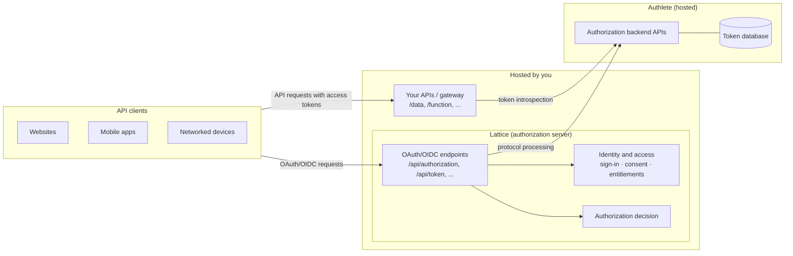

| Lattice decides and keeps | Authlete processes and keeps |
| --- | --- |
| User accounts, passwords (Argon2), passkeys, authenticator apps, LDAP | Request validation for OAuth 2.0, OpenID Connect, PKCE, PAR, CIBA, device flow, FAPI and more |
| Sign-in, sessions, consent (and [remembered consent](#sign-in-and-account-security)), required actions | Authorization codes, access and refresh tokens, and their lifetimes |
| The authorization decision: who may grant what, and which claims are released | ID token signing, discovery metadata, JWKS |
| Pages, audit trail, metrics | Token introspection and revocation |

Authlete never sees a password or any other credential. Lattice authenticates the user, then tells Authlete only the result: the subject, the claims to release and the ACR.

Lattice is itself a client of Authlete's API. If you set `AUTHLETE_DPOP_KEY`, the token Lattice uses to call Authlete is DPoP-bound: [PlayAuthleteApiBase.java:80](app/com/lattice/oidc/client/PlayAuthleteApiBase.java#L80) loads the key, and [line 166](app/com/lattice/oidc/client/PlayAuthleteApiBase.java#L166) adds a freshly signed proof to every call. That's Lattice proving its identity to Authlete, separate from your apps' DPoP.

### The semi-hosted pattern: what it gives Lattice

Authlete needs only the *result* of user authentication, which is a user ID, and doesn't care how it was obtained. So the authorization flow is split into three parts:
1. **Process the request:** Authlete, through `/auth/authorization`.
2. **Authenticate the user:** Lattice, by any means.
3. **Make the response:** Authlete, through `/auth/authorization/issue`, with the subject from step 2.

The token endpoint works the same way for the grants that carry a user's credentials: Authlete hands control back (`PASSWORD`, `JWT_BEARER`, `TOKEN_EXCHANGE`), Lattice checks, then Authlete issues.

Because the protocol engine knows nothing about users, each of these parts can be chosen independently:

| Concern | Handled by | In Lattice |
| --- | --- | --- |
| User authentication | Lattice | Password (Argon2), passkeys, authenticator apps, LDAP, upstream providers. Adding a method needs no change in Authlete. |
| Login sessions | Lattice | `UserSessions`: single sign-on, `max_age`, `prompt`, idle timeout, logout. |
| The user pool | Lattice | `UserStore` (memory or PostgreSQL) and LDAP. |
| API gateways | Authlete, or Lattice in front of it | A gateway that validates tokens through RFC 7662 introspection works unchanged, for example an AWS API Gateway Lambda authorizer or IBM API Connect. It calls Lattice's `POST /api/introspection` with resource-server credentials, or Authlete directly. |

**Extensions beyond the specifications.** Authlete's API isn't bound by the OAuth specs, so it offers operations the specs don't define:

| Authlete API | What it's for | In Lattice |
| --- | --- | --- |
| `/auth/token/create` | Issue a token outside the standard flows | Issues the token for JWT bearer assertions and token exchange, after Lattice has verified the assertion or subject token itself (`TokenGrantHandler`). |
| `properties` on issue calls | Attach arbitrary data to a token (optionally hidden from the client) | Not used. |
| `/client/authorization/get/list`, `/delete` | List the apps a user has authorized, and revoke one | The account page's connected apps, and "Remove access". |
| `/client/granted_scopes/get`, `/delete` | Remember what a user granted an app, even after its tokens expire (dedicated Authlete servers only) | Not used. Lattice keeps that record itself (`AppConsentStore`, in memory or PostgreSQL), so it also works on Authlete's shared servers. It's used to skip the consent page when nothing new is asked, and to [ask only for what's new](#sign-in-and-account-security) when something is. |

**Several authorization servers, one user pool.** In this pattern, each service can have its own authorization server (its own scopes, clients and release schedule) while sharing one user pool. In Lattice terms that means one Lattice deployment per Authlete service (`authlete.service-id`), each with its own storage, all authenticating against the same user pool. The shared pool should be an LDAP directory, or an upstream provider through identity brokering, not a shared Lattice database: one database holds sessions, consents and audit along with the users, and isn't designed to be shared between deployments. Each deployment has its own sessions, so signing in to one doesn't sign the user in to another. This setup hasn't been tested.

### What an authorization server does

An authorization server issues access tokens to client applications. An access token records that a user has granted a client some permissions. Before issuing one, the server asks the user whether to grant them, on an authorization (consent) page.

Authlete implements the OAuth 2.0 and OpenID Connect logic, and keeps access tokens and other protocol data in its own database, so Lattice doesn't have to.

In Lattice that page is built from what Authlete returns for the request:
- **Who is asking:** the client's name, logo and description, and links to its website, privacy policy and terms.
- **What it asks for:** the scopes in plain language, the user data it will receive, and, where requested, the purpose and fine-grained authorization details.
- **Who the user is:** the signed-in account, with a link to switch.
- **The decision:** Deny or Allow.

Sign-in comes first, as separate steps (identifier, then password or passkey), so "Allow" is never the same click as typing a password. Consent is `app/views/oidc/authorization.scala.html`.

### One authorization, step by step

Each Lattice endpoint forwards the client's request as is, and Authlete's answer (its `action`) tells Lattice what to do next.

| Step | Client calls Lattice | Lattice calls Authlete | Authlete answers |
| --- | --- | --- | --- |
| 1. Authorization request | `GET /api/authorization` | `POST /auth/authorization` with the raw query | `INTERACTION` and a ticket, or an error to return |
| 2. Sign-in and consent | (pages) `POST /api/authorization/decision` | `POST /auth/authorization/issue` with the ticket, subject and claims | `LOCATION`: the redirect carrying the code |
| 3. Token request | `POST /api/token` | `POST /auth/token` | `OK` and the token response to return |
| 4. API access | the client calls your API with the token | your API calls `POST /auth/introspection` (or Lattice's `POST /api/introspection`) | whether the token is valid, its scopes and subject |

The [Tickets](#tickets-a-handle-for-pending-requests) section explains the ticket that links steps 1 and 2.

### When Authlete is slow or down

Every flow needs Authlete, so its calls go through a resilience layer (`com.lattice.oidc.client.resilience`). Settings are under `authlete.resilience` in `application.conf`.

| Practice | What it does |
| --- | --- |
| **Caching safe reads** | Discovery, the JWK Set, clients and credential-issuer metadata are answered from memory for 5–10 minutes. |
| **Stale fallback** | When Authlete fails, an expired cached answer (up to 30 minutes old) is served instead of an error, so discovery and the keys apps use to verify tokens keep working. |
| **Conditional retry** | Only transient failures are retried: a 429, a 5xx, or no response at all. Permanent 4xx answers never are. |
| **Exponential backoff with jitter** | Retries wait 500 ms, then 1 s, plus up to 200 ms at random, so replicas don't retry in lockstep. A 429's `RateLimit-Reset` is honoured. |
| **A circuit breaker per Authlete method** | After 5 transient failures within 30 seconds, that method fails fast for 60 seconds, then one trial call decides whether to close it again. A failing method, such as client management, doesn't block another, such as introspection. |

**Choices made for Lattice:**
- **Writes are retried only when Authlete certainly didn't process them:** a 429, or no connection at all. A retry after a read timeout or a 5xx, when the request was already sent, could redeem an authorization code twice for `authorizationIssue` or `token`. Reads are retried on any transient failure.
- **A short retry budget:** 3 attempts within 5 seconds. A user's page waits on the call, and the call holds one of the `authlete.max-concurrent-calls` permits (default 1,000; each call runs on a virtual thread, so waiting costs almost nothing).
- **Introspection isn't cached by default (TTL 0).** Otherwise a revoked token could still introspect as active on another replica. Set `cache.ttl.introspection` to trade that delay for fewer Authlete calls.
- **Cached clients are evicted when a client changes,** because Lattice's console edits clients.

**When nothing is cached and the breaker is open,** a call fails at once. Users get the "temporarily unavailable" page (503 with `Retry-After`), and API clients get the JSON error.

**Metrics:**
- `lattice_authlete_calls_seconds{operation, outcome}`: real HTTP calls to Authlete, each retry included.
- `lattice_authlete_resilience_total{operation, event}`: `cache_hit`, `stale`, `retry` or `rejected`.
- `lattice_authlete_circuit_open`: how many methods' breakers are open.

### Authlete compared with Duende IdentityServer

The two put the boundary in different places.

| | Authlete (with Lattice) | Duende IdentityServer |
| --- | --- | --- |
| Shape | You host the endpoints, in any language. Protocol logic and token storage are a REST service. | The whole token server runs in-process, in your own ASP.NET Core host. |
| Per-request external dependency | Yes: each OAuth/OIDC request calls Authlete. | None: everything is in your infrastructure. |
| Tokens stored | At Authlete. | In your own infrastructure. |
| User credentials | Stay on your side. | Stay on your side. |
| Known for | Financial-grade API (FAPI 1.0 and 2.0) certification and open-banking profiles. | .NET-native identity hosts. |
| Licensing | Authlete's commercial plans. | Editions by features and number of client IDs. |
| Fits | Polyglot or heavily regulated environments that want protocol logic as a service. | Keeping the whole token server inside a .NET system. |

### AI agents, MCP and client ID metadata documents (CIMD)

The Model Context Protocol (MCP) lets AI applications call tools on an MCP server. Its authorization profile uses OAuth 2.1:
- **The authorization server** issues scoped, time-limited access tokens. It decides who gets access and with which permissions.
- **The MCP server** checks the token on each request. It decides whether that request may run.
- **The client is trusted only through its token:** it holds least-privilege access that can be revoked.

**Tokens solve only half the problem.** OAuth assumed that registering a client is a controlled step, done by people. AI agents can appear dynamically, register themselves and ask for broad permissions with no one involved. **CIMD** (OAuth Client ID Metadata Document, an IETF draft) changes how a client is identified:
- **The client ID is a URL:** the client publishes a JSON metadata document at an HTTPS URL, and that URL is its client ID.
- **Fetched on demand:** when a flow starts, the authorization server fetches and validates the document. No registration database is needed.
- **Server-side policy:** the authorization server can add its own validation on top, such as an allowlist of acceptable client hosts.

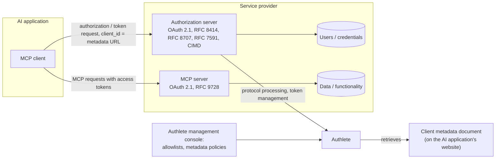

**Where Lattice stands:**

| Piece | Status in Lattice |
| --- | --- |
| Authorization server metadata (RFC 8414) | Served at `/.well-known/oauth-authorization-server` and `/.well-known/openid-configuration` |
| Dynamic client registration (RFC 7591) | `POST /api/register` |
| Resource indicators (RFC 8707) | Passed to Authlete with the request, as received |
| Protected resource metadata (RFC 9728) | Not Lattice's job: the MCP server (the resource) publishes it |
| CIMD | Not used by Lattice's code yet. Authlete supports it as service settings: client ID metadata documents on or off, an allowlist, whether plain HTTP is permitted, and whether the document is always fetched. Because Lattice forwards the authorization request as is, URL client IDs should work once CIMD is enabled for the Authlete service, but this is untested. Lattice also doesn't yet pass Authlete's per-request `cimdOptions` on its authorization and token calls. |

## Access tokens: what they prove

### Authentication or authorization?

When an API receives `Authorization: Bearer <token>`, two separate things happen:

- **The API authenticates the token, not the person.** It checks the token is genuine: either by verifying its signature, or by asking the authorization server through introspection. It also checks the token is active, unexpired and issued for this API.
- **What the token proves is authorization.** It tells the API which permission the request is using, for example: user 1001 allowed app 42 to `read:notes` until 10:30. The API then decides whether this particular request is allowed.

"The access token authenticates the request" therefore means only that the request is authenticated as a use of that permission. The token doesn't say that the user is present, or that they signed in recently. Nor does it say that the user signed in to this app: that is the ID token's job in OpenID Connect.

| | ID token | Access token |
| --- | --- | --- |
| Question it answers | Who signed in to this app, when and how? | What may the bearer do, at which API, until when? |
| Addressed to | The client app (`aud` = its client ID) | The API (resource server) |
| Used for | Authentication: signing the user in | Authorization: calling APIs |
| Read by the client? | Yes, and validated | No, it's opaque to the client; only the API interprets it |

Treating an access token as proof of sign-in is a classic mistake. Another app the user signed in to could replay a token issued to it as a sign-in. OpenID Connect added the ID token, addressed to one specific client, to keep the two apart.

### Authenticating the "bearer"

With standard OAuth 2.0 bearer tokens (RFC 6750), the API isn't authenticating the sender of the request; it only authenticates the token itself. The security model is that whoever holds the string may use it, like a cinema ticket. The request is authenticated entirely by the presence of a valid token, which is why a stolen bearer token can be successfully replayed by an attacker.

**Sender-constrained tokens** close that gap. The token is bound to a key the client holds, and every request must also prove possession of that key:

| Mechanism | How the client proves possession | Where it's bound |
| --- | --- | --- |
| DPoP (RFC 9449) | A `DPoP` header: a short-lived JWT signed with the client's private key, covering the HTTP method and URL | The token records the key's thumbprint (`cnf.jkt`) |
| Mutual TLS (RFC 8705) | The TLS client certificate presented on the connection | The token records the certificate's thumbprint (`cnf.x5t#S256`) |

A stolen sender-constrained token is useless without the private key. Only then does the token authenticate the sender, as "the client that holds this key". FAPI 2.0 requires one of the two.

**In Lattice:** the token endpoint passes the `DPoP` proof and the TLS client certificate to Authlete, which binds the token to them. The endpoints that accept access tokens pass them again, and Authlete checks that the request matches the binding. Those endpoints are UserInfo, the Open Banking resource APIs and the credential endpoint.

### What an API does with a token, on every request

An API protected by opaque tokens does four things each time. Lattice's own protected endpoints (UserInfo, the credential endpoint, grant management, the Open Banking APIs) follow this pattern. The credential and Open Banking endpoints call introspection themselves; UserInfo and grant management call Authlete APIs that check the token, including its DPoP binding, as part of the same request.

1. **Extract the token.** RFC 6750 allows three places: the `Authorization` header, a form body parameter, and a query parameter. Lattice reads the header everywhere (with the `Bearer` or `DPoP` scheme), and the form body only on UserInfo `POST`, because OpenID Connect requires that. It never reads the query string: URLs end up in logs, browser history and `Referer` headers, and OAuth 2.1 drops that option.
2. **Introspect it.** The API asks Authlete (`/auth/introspection`) with the token and the scopes this endpoint needs. For sender-constrained tokens it also passes the `DPoP` proof with the request's method and URL, or the client certificate, so a stolen token without its key is refused. An API can also require a specific subject, for example a user's own profile.
3. **Turn the answer into the RFC 6750 error.** The error goes in the `WWW-Authenticate` header, with no body:
   - no token or an invalid one: `400` or `401` with `error="invalid_token"`;
   - a valid token that lacks a scope: `403` with `error="insufficient_scope"` and `scope="..."` listing what is needed.

   Authlete builds the header value, so the format rules don't have to be reimplemented. Lattice sets it with `Responses.bearerError`. The Open Banking endpoints use that specification's JSON error body instead.
4. **Check what the token doesn't say.** A scope proves the client may use the API, not that it may touch every record. For example, an Open Banking consent can be read only by the client that created it, even with a valid token for the right scope.

### Opaque or JWT: where the permission is written

Both formats stand for the same permission. They differ in where the API finds it.

- **An opaque token** is a random string that points to a record held by the authorization server (here, Authlete's token database). It contains no user, no scopes and no expiry. The API learns them through introspection (RFC 7662). Its answer always has `active`, and for an active token usually also `sub`, `client_id`, `scope`, `exp` and `aud`.
- **A JWT access token** (RFC 9068) carries those fields itself, signed by the authorization server, so the API verifies the signature and reads them with no network call.

| | Opaque | JWT |
| --- | --- | --- |
| How the API checks it's genuine | Introspection: the server knows it and it's active | Signature verification with the server's public key |
| Where the permission comes from | The introspection response | The token's own claims |
| Revocation | Immediate: the next introspection says `active: false` | It stays valid until it expires, unless the API also asks the server |
| Who can read it | Nobody without the server | Anyone holding it can decode it (signed, not encrypted) |
| Cost per request | A call to the server (usually cached briefly) | Local verification |

Authlete issues opaque access tokens by default, and JWT access tokens when the service is configured with a signing algorithm for them. The ID token is always a JWT, because the client must read it.

### What "grant" means

The word is used in three ways:

- **The permission the user gave**, which is what a token represents: who (`sub`) let which app (`client_id`) do what (`scope`, or `authorization_details` for fine-grained rights) at which API (`aud`) until when (`exp`). In Lattice, the remembered consent (`AppConsentStore`) records this per account and app.
- **An authorization grant, in RFC 6749's sense:** the credential a client exchanges for tokens. The grant types are an authorization code, a refresh token, client credentials, a device code, a CIBA request and others. This is the meaning of `grant_type=authorization_code`.
- **A grant in Grant Management for OAuth 2.0**, a FAPI specification Authlete supports: a long-lived record of a user's permissions for a client, with an ID (`grant_id`) that the client can query, extend or revoke. Lattice serves it at `/api/gm/{grantId}`. Details: [grant-management.md](grant-management.md).

### Consent, grant and access token

The difference is between the human action, the technical record, and the credential issued from that record.

- **Consent** is the user agreeing to delegate access. It happens when a user reads the requested scopes on an authorization screen and clicks "Allow". The word is also used for the stored record of that decision, as with an Open Banking consent or Lattice's `AppConsentStore`.
- **The grant** is the technical permission created as a result of that consent, which the app then holds.
- **An access token** is a short-lived credential issued from the grant, which the app presents to an API.

| | Consent | Grant | Access token |
| --- | --- | --- | --- |
| What it is | The user's decision: "Acme Notes may read my notes" | The permission the app holds: user 1001 → app 42 → `read:notes` | The credential presented to an API to use that permission |
| Held by | The authorization server, as a record of what was approved | The authorization server, on the app's behalf | The app, sent with each API call |
| Lifetime | A moment (approved at 09:12), plus its record | Until revoked or expired by policy | Minutes to an hour |
| How many | One per approval | Usually one per user and app, growing as more is approved | Many: replaced as each expires, usually with a refresh token |
| Scope | What was asked and approved | Everything currently approved | Can be narrower: some scopes, or one API (`aud`) |

As an analogy: consent is signing a power-of-attorney form, the grant is the power of attorney on file, and access tokens are the day passes printed from it.

**A grant can exist without anyone clicking a consent screen:**
- **Client credentials, in machine-to-machine architectures.** No user is involved and nothing is delegated: the app acts for itself. An administrator or system policy pre-authorizes it, by registering which scopes the client may request. RFC 6749 calls the client credentials themselves the authorization grant. No user ever sees a consent screen, but the client can still obtain access tokens. With Authlete, the permission comes from the client's registration rather than from a stored per-user record.
- **Pre-approved apps:** an administrator approved the app for users in advance, or it is a trusted first-party app.
- **Remembered consent:** the user approved the same permissions earlier.

The opposite also holds: if the user clicks Deny, no grant is created.

**Revoking works differently at each level:**
- **One access token:** the grant stays, and the app gets a new token with its refresh token.
- **The grant:** the app's access ends. Its refresh tokens stop working, and opaque access tokens fail introspection at once. JWT access tokens may stay valid until they expire, unless the API checks with the server.
- **The consent record:** the user is simply asked again next time.

**In Lattice:**
- **Consent:** the consent page, logged as `CONSENT_GRANTED` or `CONSENT_DENIED`. `AppConsentStore` remembers the approval so the page can be skipped (`CONSENT_REUSED`).
- **Grant:** held by Authlete and listed on the account page as connected apps. "Remove access" deletes it in Authlete, revoking the app's tokens, and also clears the remembered consent.
- **Access tokens:** issued by Authlete at `/api/token`, and checked by introspection.

## Security fixes compared to the reference server

The reference server is Authlete's [java-oauth-server](https://github.com/authlete/java-oauth-server), which Lattice started from.

- JWT bearer and token exchange: the reference never checked the signature on JWT bearer assertions or JWT subject tokens, so a forged JWT got tokens. These are now verified against this server's own Authlete keys or a configured list of trusted issuers; anything else is rejected.
- Pairwise `sub`: computed as a keyed hash per site, so it's opaque and can't be linked across clients. The reference concatenated the sector and the user ID in plain text.
- ACR: an `acr` is only asserted if it's configured as satisfied by password login. The reference echoed back whatever the client asked for.
- Login: passwords are hashed with Argon2 and accounts lock after repeated failures. Response timing doesn't reveal which accounts exist.
- Sessions: a new session ID on every login, server-side invalidation on logout, and pending flows only completable by the browser that started them.
- Browser forms: protected against cross-site form posts (CSRF), with security headers and a CSP set throughout.

### Pairwise sub: a keyed hash instead of plain concatenation

**What pairwise means** (OIDC Core §8.1). A client registered with `subject_type=pairwise` should get a different `sub` for the same user than every other client, so that two sites can't compare notes and work out that they share a user.

The reference built `sub` as `"PAIRWISE-" + sectorIdentifier + "-" + userId`, for example `PAIRWISE-shop.example-1001`. The real user ID sits inside the string, so any two clients can strip the prefix and correlate users. It also leaks the internal user ID.

Lattice computes it in `PairwiseSubjects`:

```text
sub = base64url(HMAC-SHA256(secret, sector + "|" + userId))
```

- Stable: the same user on the same site always gets the same value.
- Unlinkable: different sites get unrelated values.
- Not reversible without the server's secret (`PAIRWISE_SECRET`, falling back to the app secret).

### JWT bearer and token exchange: signatures are now verified

Normally a user logs in at this server through the browser. These two grants let an application get a token for a user without that browser login, by showing proof that someone else has already vouched for the user.

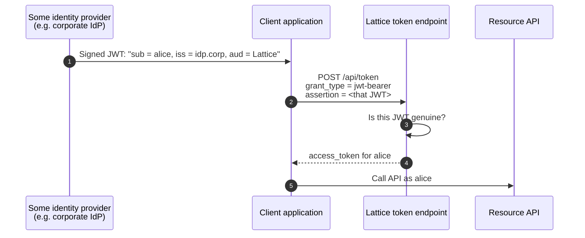

- **JWT bearer (RFC 7523)**: the proof is a JWT signed by someone (the `assertion`).
- **Token exchange (RFC 8693)**: the proof is a token the client already holds (the `subject_token`). It can be an access token, a refresh token, a JWT or an ID token.

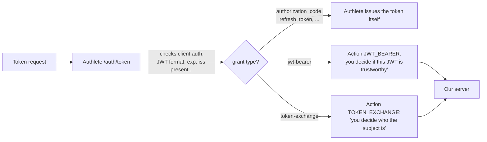

Authlete can't verify the signature because it doesn't know which keys to trust. The JWT could be signed by any identity provider in the world, and only the deployment knows which of them it trusts. So the authorization server has to do this check itself.

#### The bug in the reference server

The reference server's `verifySignature()` method was empty, so it trusted whatever the JWT claimed:

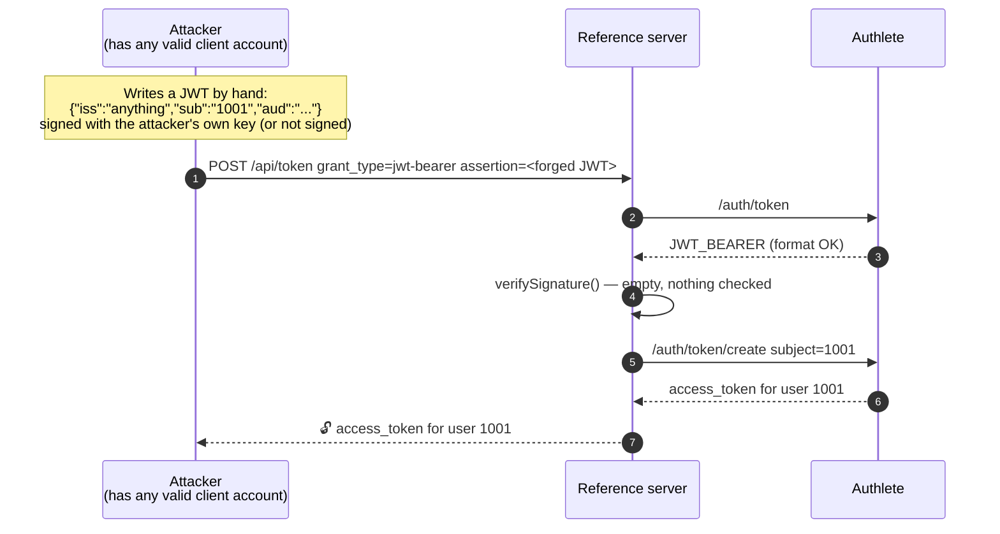

Anyone with any client registration could get tokens for any user, without ever knowing that user's password. That's full account impersonation. Token exchange had the same problem with JWT and ID-token subject tokens.

#### What Lattice checks now

`TokenGrantHandler` hands the JWT to `JwtVerifier`, which only lets it through if every check below passes:

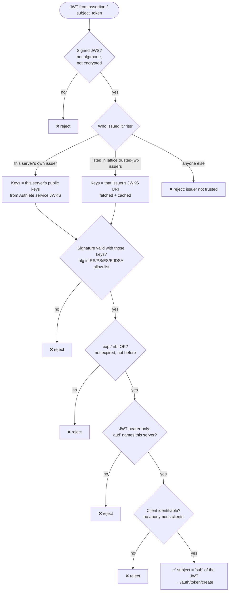

All rejections come back to the client as `400 invalid_grant` (or `invalid_request`), and no token is created.

#### What each check stops

| Check                                            | Attack it stops                                                                              |
| ------------------------------------------------ | -------------------------------------------------------------------------------------------- |
| Must be signed, not `alg=none`, not encrypted    | "Unsigned" JWTs that anyone can write                                                        |
| Issuer must be this server or explicitly trusted | An attacker signing with their own key and naming themselves as issuer                       |
| Signature verified with that issuer's real keys  | Forging a JWT that claims to come from a trusted issuer                                      |
| Algorithm allow-list                             | Algorithm-confusion tricks, such as switching to HMAC and using the public key as the secret |
| `exp` / `nbf`                                    | Reusing an old, leaked JWT indefinitely                                                      |
| `aud` must be this server (JWT bearer)           | Replay: a genuine JWT that the IdP issued for another service, reused here                   |
| Client must be identifiable                      | Anonymous callers using the grant at all                                                     |

#### Legitimate and forged assertions side by side

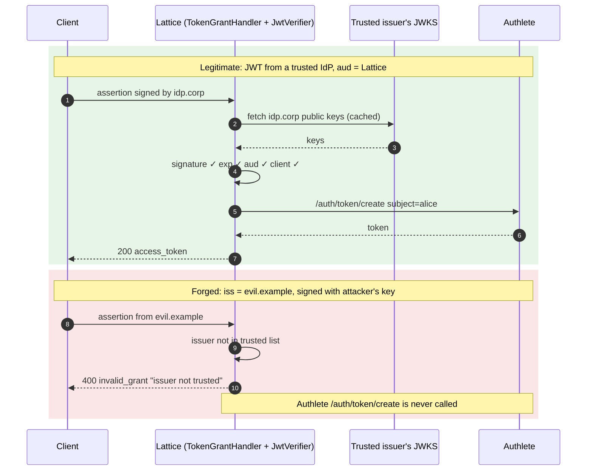

#### How Keycloak handles the same grant

Keycloak calls it the **JWT Authorization Grant** (feature `jwt-authorization-grant`, on by default). It trades a JWT about a user, signed by a system Keycloak trusts, for a Keycloak token, with no browser and no login page. Examples: a partner platform that has already signed the user in, or an internal system that issues signed assertions about its users.

The request is RFC 7523 §2.1:

```sh
curl -X POST https://kc.example/realms/myrealm/protocol/openid-connect/token \
  -u partner-app:secret \
  -d grant_type=urn:ietf:params:oauth:grant-type:jwt-bearer \
  -d assertion=eyJhbGciOiJSUzI1NiIs...      # {"iss":"https://idp.partner.com","sub":"alice", ...}
```

What `JWTAuthorizationGrantType` does, in order (checked against the Keycloak source, `services/.../protocol/oidc/grants/`):

1. **The client:** must be confidential, and must have the JWT Authorization Grant switched on in its settings.
2. **The assertion's issuer:** `iss` and `sub` must be present. `iss` selects the identity provider configured with that issuer, which must be enabled.
3. **Per-client allow-list:** the client must be allowed to use that identity provider.
4. **The signature:** checked by the provider (`JWTAuthorizationGrantIdentityProvider`), with its JWKS URL or a pasted public key. An existing OIDC identity provider can also accept these assertions.
5. **Lifetime and replay:**
   - `exp` is required, with clock skew allowed.
   - The assertion may live at most 300 seconds by default.
   - It is single-use by default: `jti` is required and remembered until the assertion expires, and a second use fails with "Token reuse detected".
6. **The user:** found by `sub`, through an existing link between a Keycloak user and that provider. `preferred_username` only names the brokered identity. Unlike a browser sign-in through a provider, **no user is created**: an unlinked `sub` fails with "User not found". The user must also be enabled, have no pending required actions, and already have consent for the requested scopes.
7. **The audience:** `aud` must be the realm's issuer or its token endpoint, unless the client's settings name other audiences.
8. **The tokens:** an access token, and **no refresh token**. The client presents a fresh assertion when it needs a new token.

Compared with Lattice's checks above, Keycloak also:
- **Allows each assertion once** (`jti`) and **caps its lifetime** (300 s). Lattice checks only `exp` and `nbf`, so a captured assertion can be replayed until it expires.
- **Limits which issuers each client may use.** Lattice's `lattice.trusted-jwt-issuers` applies to every client.
- **Requires an existing, linked user,** while Lattice takes `sub` as the subject directly.

### Login: Argon2 hashing, lockout, and no account enumeration

- Argon2 hashing, a memory-hard algorithm that makes offline cracking expensive. Demo passwords are hashed when the store loads; nothing is stored in plain text.
- Lockout: failed sign-ins are counted over `lattice.login.lockout` (15 minutes) in three ways, and reaching any limit refuses further attempts, even with the correct password, until the window ends. The user sees "Too many failed attempts".
  - for one account from one IP address: `lattice.login.max-failures` (default 5);
  - for one account from any IP address: `max-failures-per-account` (20);
  - from one IP address for any accounts: `max-failures-per-ip` (50), against password spraying.

  Counting per account and IP first means someone guessing from elsewhere can't lock the real user out with a handful of attempts.

### Sessions: rotation, real logout, and pending flows tied to one browser

**Session ID rotation** (`UserSessions.login`). Every successful login creates a brand-new session ID (`session_id` in the cookie). This prevents session fixation, where an attacker plants a known session ID in the victim's browser before they log in and then rides on it afterwards.

**Server-side invalidation.** Play's session cookie is signed, but anyone holding a copy can replay it. So the cookie only carries the session ID, and a session counts as valid only while that session ID is registered on the server. Logout removes it there, so a stolen or replayed copy of the old cookie stops working. A test checks this. The session ID is also what back-channel logout and native SSO key on, and it is sent to clients as the `sid` claim of ID tokens and logout tokens.

**Pending flows bound to the browser** (`Interactions`). Each browser gets a stable random ID (`browser_id`) in its cookie. Pending consent, device-approval and federation-login state is stored server-side under its ticket or code and tagged with that `browser_id`. Completing a flow requires the same `browser_id`. That stops an attacker who learns or guesses a ticket from completing the consent or device approval from their own browser, and it stops cross-site requests from finishing someone else's flow. CSRF tokens on the forms add a second layer.

**Single use.** The ticket is removed when it's used, so a replayed decision fails. That's tested too.

**Idle timeout.** A session ends after `lattice.session.idle-timeout` (default 30 minutes) without activity, and in any case after `lattice.session.max-lifespan` (10 hours). An app using the session through native SSO counts as activity.

**Signing out everywhere includes apps** (`LogoutHandler.endSessionsOf`). A password reset, a password change, and "Sign out other sessions" (when "Sign out everywhere else, including apps" is ticked, the default) do three things:
- end the other sessions;
- send back-channel logout to the apps used in them;
- revoke every access and refresh token issued for the account, with one call to Authlete's `/auth/token/revoke` by subject.

The third step is what makes the promise true. Tokens live in Authlete, not in Lattice's sessions, and Authlete doesn't ask Lattice about the user when an app refreshes. Without the revocation, an app that doesn't support back-channel logout would stay signed in. Worse, after an account takeover, the attacker's refresh token would keep working through the reset until it expired.

Consents are kept, so apps on the device that stays signed in get new tokens without a password or consent page. Ending a single other session doesn't revoke anything, since tokens aren't tied to a session. If Authlete can't be reached, the reset still completes; the failure is logged as an error and appears in the audit event as `"tokens_revoked": "failed"`.

### Client credentials and key thumbprints

**Basic credentials are form-decoded** (`Requests.basicCredentials`). RFC 6749 §2.3.1 has clients form-encode the client ID and secret before base64, so `s+cr%t` is sent as `s%2Bcr%25t`. Lattice decodes both before passing them on to Authlete or comparing them with an introspection caller's secret. A client that follows the spec authenticates even with such characters in its secret. Secrets made only of letters, digits, `-`, `_`, `.` and `~`, which is all Authlete generates, decode to themselves, so they work the same way as before.

**Thumbprints** (`Thumbprints`):
- `of(PublicKey)` and `ofJwk(Map)` compute the RFC 7638 JWK thumbprint. This is DPoP's `jkt` and a stable `kid` for a key that has none.
- `ofCertificate` computes the RFC 8705 `x5t#S256`.
- `matches` compares two thumbprints in constant time.

The thumbprint covers only the required public members, in canonical form. The same key therefore always gets the same value, whatever its `kid` or member order, and a private JWK gets the thumbprint of its public half. RSA values are encoded unsigned and minimal. EC coordinates are padded to the curve's size. These are the two details that hand-written versions most often get wrong. OKP keys are read from their X.509 encoding, so JDK and Bouncy Castle keys both work. Symmetric keys are refused, because a published thumbprint of a secret key would be a hash of the secret. The tests check the RFC 7638 and RFC 8037 vectors and compare against nimbus-jose-jwt for every key type.

#### How Keycloak authenticates workloads without a secret

**The problem:** a program, such as a backend in Kubernetes, needs a token (`client_credentials`). Normally it authenticates with a client secret or a private key, which someone has to create, store, distribute and rotate. A leaked secret works until someone notices.

**The idea:** the platform the program runs on already gives it an identity. Kubernetes issues every pod a signed service-account token, and SPIRE issues SPIFFE SVIDs. Keycloak can accept that platform-issued JWT as the client's credential, so there's no secret to manage.

This is the **"Signed JWT - Federated"** client authenticator (`federated-jwt`, `FederatedJWTClientAuthenticator`). The identity provider says which issuer to trust and how to get its keys; the client says which subject at that issuer it is. Federated client authentication and the Kubernetes provider are on by default; the SPIFFE provider is a preview feature that must be enabled.

```text
Client config (Credentials tab)
  Client Authenticator: Signed JWT - Federated
  Identity provider:    my-cluster                                  ← which issuer to trust
  Federated subject:    system:serviceaccount:billing:billing-job   ← who this client is

Identity provider "my-cluster" (type Kubernetes)
  Issuer:  https://kubernetes.default.svc.cluster.local             ← your cluster's issuer
  Keys:    fetched from the cluster's JWKS
```

**1. Kubernetes issues a token to the pod.** Ask for a projected service-account token whose audience is the Keycloak realm:

```yaml
apiVersion: v1
kind: Pod
spec:
  serviceAccountName: billing-job          # a dedicated service account, never "default"
  volumes:
    - name: kc-token
      projected:
        sources:
          - serviceAccountToken:
              audience: https://kc.example/realms/myrealm   # must be the realm's issuer URL, and the only audience
              expirationSeconds: 600                        # at least 600; Keycloak rejects over 3600 by default
              path: kc-token
```

The kubelet writes a JWT to the volume and refreshes it before it expires. Decoded:

```json
{
  "iss": "https://kubernetes.default.svc.cluster.local",
  "sub": "system:serviceaccount:billing:billing-job",
  "aud": ["https://kc.example/realms/myrealm"],
  "exp": 1760000600,
  "kubernetes.io": { "namespace": "billing", "serviceaccount": { "name": "billing-job" } }
}
```

**2. The pod sends it to Keycloak as its client credential:**

```sh
curl https://kc.example/realms/myrealm/protocol/openid-connect/token \
  --data-urlencode grant_type=client_credentials \
  --data-urlencode client_assertion_type=urn:ietf:params:oauth:client-assertion-type:jwt-bearer \
  --data-urlencode client_assertion="$(cat /var/run/secrets/tokens/kc-token)"
```

There's no `client_id` and no `client_secret`. Keycloak finds the identity provider from the token's `iss`, then the client whose identity provider and federated subject match (`DefaultClientAssertionStrategy`). A self-signed assertion (`iss` equal to `sub`) is left to the ordinary "Signed JWT" authenticator.

**3. Keycloak verifies it** (`KubernetesIdentityProvider`, `FederatedJWTClientValidator`):
- **Signature:** checked with the cluster's public keys. `KubernetesJwksEndpointLoader` reads `<issuer>/.well-known/openid-configuration`, then its `jwks_uri`, unless the provider has a JWKS URL set. When Keycloak runs in a cluster, it authenticates those calls with its own service-account token (`/var/run/secrets/kubernetes.io/serviceaccount/token`), but only if that token's issuer is the configured one, so its credential is never sent to another cluster.
- **Issuer:** `iss` must be the provider's issuer.
- **Audience:** exactly one, and it must be the realm's issuer.
- **Lifetime:** not expired (with clock skew allowed), and at most 3600 seconds long by default, configurable on the provider.
- **Reuse is allowed:** the pod presents the same token on every request until the kubelet refreshes it. That's unlike Keycloak's JWT Authorization Grant above, which allows each assertion once.

**4. Keycloak returns an access token** for the client's service account, with whatever roles it was given.

### Security building blocks

These standalone helpers aren't all used by the sign-in flows yet. Each one's Javadoc explains the attacks it handles.

| Helper | What it does | Why it's written this way |
|---|---|---|
| `JoseAlgorithms` | **Used by dynamic client registration** (create and update, `invalid_client_metadata`) **and at startup for resource servers' introspection settings**. Refuses `RSA1_5` and `PBES2-*` for key encryption, HMAC keys shorter than the hash, and `none` for ID tokens, client assertions, introspection, JARM and CIBA requests. `none` stays allowed for UserInfo and request objects, as OIDC permits. | `RSA1_5` is open to Bleichenbacher's padding-oracle attack. `PBES2` is password-based, and a crafted `p2c` iteration count makes the server burn CPU. `none` is refused only where it removes a protection: an unsigned UserInfo JWT or request object is no weaker than the unsigned JSON or query parameters used by default. |
| `RedirectUris` | Checks redirect URIs when they're registered (`problem`) and when a request names one (`matches`) | Matching is exact, with no wildcards. The one exception is RFC 8252's any-port rule for loopback, and only for the IP literals `127.0.0.1` and `[::1]`, not the name `localhost`. It refuses: `..` segments (encoded or double-encoded too), user info, OAuth response parameters already in the query (parameter pollution), fragments, `http` except on loopback, `javascript:`/`data:`/`file:`, and private-use schemes that aren't reverse domain names. |
| `Secrets` | Random tokens and codes | Characters are drawn without modulo bias. `lengthFor(bits, alphabet)` sizes a secret by the entropy it must carry, using integer arithmetic so the edge cases come out right. Default is 128 bits. |
| `EcdsaSignatures` | Converts between JOSE `R‖S` and DER signatures | Strict both ways. It refuses r or s = 0 (CVE-2022-21449, "psychic signatures"). Lengths must be exact, never padded or truncated. DER must be canonical, which prevents signature malleability. It handles P-521's long-form length. Tests compare against nimbus. |
| `SecureContexts` | Whether a page is a browser secure context, which WebAuthn and `Secure` cookies need | `https`, or loopback. Loopback is recognised by the host's form only, never by DNS. An `https` frame inside an `http` page is detected with `Sec-Fetch-Dest` and `Referer`. |
| `LockoutBackoff` | Incremental lockout as a pure function of the stored state and the time | Waits grow per failure up to a cap. Machine-speed failures wait even below the threshold. Old failures expire. A permanent lock is optional. Keying the state on account and IP keeps it from becoming a lock-out-anyone tool. |
| `EmailAddresses` | Checks email syntax | Splits at the last `@`. Applies the length limits for the local part, the domain and the whole address. The domain is converted with IDNA, then checked as a host name. Line breaks are refused, so the address can't inject mail headers. It uses small patterns instead of one large regular expression, which avoids ReDoS. |

### Identifiers and secrets

Lattice makes two kinds of random-looking values, and they must not be mixed up.

- **An identifier** names a record or a message. Knowing it lets you refer to the thing, not act on it. `Ids` makes these as UUIDv7 (RFC 9562), using `java-uuid-generator`.
- **A secret** grants something to whoever holds it: a session ID, OAuth `state`, `nonce`, a PKCE verifier, a device secret, the "this wasn't me" link. These come from `UserSessions.randomId()`, which returns 256 random bits from `SecureRandom`, base64url-encoded.

**What a UUIDv7 looks like.** The first 48 bits are the creation time in milliseconds since 1970. The `7` that starts the third group is the version. The rest is random, apart from two variant bits.

```sh
# One hex digit is 4 bits.
01a1443f-df50-7843-bd08-e9e28f06efd0
└─────┬─────┘ ↑└─────────┬─────────┘
  time (ms)   version   76 bits: 74 random + 2 variant

time 0x01a1443fdf50 = 2026-10-16T10:26:39.056Z

# The 2 bits that aren't random. The first digit of the fourth group, b, is 1011 in binary. Its first two bits, 10, are the variant
variant: the first 2 bits of "b" (1011) are always 10, so that digit is always 8, 9, a or b

b is 4 bits. Only its first 2 bits are fixed; its last 2 bits are random. 
```

Because the time comes first, ids sort by creation time, both as UUIDs and as text. That gives two benefits:
- A run of request IDs in the logs reads as a timeline.
- A new primary key goes at the end of the index, instead of at a random place as a UUIDv4 would. That keeps inserts cheap and the index compact.

**Where Lattice uses them** (`Ids.timeOrdered()`):

| Value | Example |
|---|---|
| `X-Request-ID`, when the request didn't bring a valid one (`RequestIdFilter`) | `01a1443f-df50-7843-bd08-e9e28f06efd0` |
| Webhook message ID, the `webhook-id` header (`Webhooks`) | `msg_01a1443f-df56-72c2-a252-7738a76a733a` |
| Open Banking consent ID, the `consents` primary key (`ConsentStore`) | `urn:lattice:01a1443f-df56-7784-b908-6021083a0896` |

**The two generators.** `Ids` has two methods. They differ only in what happens when several ids are made in the same millisecond. These samples come from bursts of six:

| `Ids.timeOrdered()` (the default) | `Ids.sequential()` |
|---|---|
| `01a1443f-df50-7843-bd08-e9e28f06efd0` | `01a1443f-dfba-76e8-9a09-a357446f4eb9` |
| `01a1443f-df50-7293-9ed7-64727e88886d` | `01a1443f-dfba-76e8-9a09-a357446f4eba` |
| `01a1443f-df50-70f1-b150-f66ac508f895` | `01a1443f-dfba-76e8-9a09-a357446f4ebb` |
| `01a1443f-df50-7d0e-bba1-26a3f51654c6` | `01a1443f-dfba-76e8-9a09-a357446f4ebc` |
| Fresh randomness for every id. Within one millisecond, the order is arbitrary, and one id says nothing about the next. | The first id in a millisecond is random. Each later id in the same millisecond is the previous one plus 1. The order is strict, but the neighbours of an id can be guessed. |

- **Use `timeOrdered()`** for anything another party sees, which is every current use. Order within a millisecond doesn't matter for logs or index locality, and unpredictable neighbours mean that one consent ID can't be used to guess another.
- **Use `sequential()`** only where ids made in the same millisecond must keep their order. An example is paging through rows by id when many are inserted at once.

Its order holds only within one JVM, and only while the clock doesn't step back. Replicas don't coordinate, and a clock corrected backwards by NTP produces smaller ids.

**Why a UUIDv7 is never a secret.** It has at most 74 random bits, and the other 48 bits are a timestamp that anyone can estimate. With `sequential()`, even the random part follows from a neighbouring id. A secret needs all its bits unpredictable, and Lattice uses 256. So none of the values that `UserSessions.randomId()` makes was switched to UUIDv7. The jti of DPoP proofs that Lattice signs stays a UUIDv4, and the audit table keeps its `bigserial` key, which is already in order.

## Project structure

```text
com.lattice.oidc
├── controllers/   thin Play controllers, one per spec area or page; routes point here
│                  Authorization, Token, UserInfo, Introspection, Revocation, PushedAuthorization,
│                  ClientRegistration, GrantManagement, Discovery, Ciba, CibaApproval, Device,
│                  Credential, CredentialOffer, Federation (OpenID Federation 1.0), IdentityBroker,
│                  Obb, Logout, Account, AccountSecurity, Passkey, SecondFactor, Recovery,
│                  RequiredActions, Console, Admin, Metrics, Health, Test
├── handlers/      protocol logic: AuthorizationHandler, TokenGrantHandler (exchange/JWT bearer),
│                  NativeSsoHandler, CibaHandler, DeviceHandler, CredentialOrderHandler,
│                  ObbDcrHandler, ObbTokenHandler, LogoutHandler,
│                  IdentityProvider, IdentityProviders (identity brokering)
├── models/        page and form models: AuthorizationPage, Consent, User, Passkey, AccountPage, ...
├── security/      LoginService, PasswordHasher, UserSessions, Interactions, Passkeys, Totp,
│                  SecondFactors, LdapDirectory, JwtVerifier, PairwiseSubjects, JoseAlgorithms,
│                  RedirectUris, Thumbprints, EcdsaSignatures, Webhooks, AuditService, ...
├── stores/        store interfaces with in-memory implementations
│   ├── jpa/       PostgreSQL implementations: JPA entities and stores (Hibernate ORM)
│   ├── postgres/  the connection pool and Flyway (PostgresDatabase), and StorageCleanup
│   └── redis/     Redis short-lived state and counters
├── cache/         read cache for users and sessions, and its invalidation bus
├── client/        Authlete Play WS client, ServerMetadata
│   └── resilience/  caching, retries, backoff and circuit breakers for Authlete calls
├── metrics/       Prometheus metrics
├── filters/       RequestIdFilter, HstsFilter, AccessLogFilter, RequiredActionsFilter, ...
├── common/        Requests, Responses, Secrets, OutboundUrls, EmailAddresses, LatticeConfig, ...
└── modules/       AuthleteModule, StorageModule
```

Outside the application code:
- `deploy/`: Docker Compose and Kubernetes setups ([deploy/README.md](deploy/README.md)).
- `benchmarks/` and `perf/`: JMH micro-benchmarks and HTTP load tests ([perf/README.md](perf/README.md)). They aren't part of `test` or the image.

## Design and screens

Designs for all 15 end-user and operator screens (sign-in, consent, device flow, CIBA, logout, account, wallets, open banking and the operator console) are in [docs/screens](docs/screens/README.md), with the design language, the flow each screen belongs to, and whether it is built yet.

## Running the server in production

```sh
sbt --client stage
APPLICATION_SECRET=$(openssl rand -hex 32) \
AUTHLETE_SERVICE_APIKEY=<id> AUTHLETE_SERVICE_ACCESSTOKEN=<token> \
LATTICE_STORAGE=postgres DATABASE_URL=jdbc:postgresql://db:5432/lattice \
DATABASE_USERNAME=lattice DATABASE_PASSWORD=<password> \
DEMO_USERS=false \
target/universal/stage/bin/lattice-oidc -Dhttp.port=9000
```

`DEMO_USERS=false` matters: `lattice.demo-users` is on by default, and it adds the demo accounts, with their published passwords, to an empty `users` table.

### Storage

`lattice.storage` (`LATTICE_STORAGE`) chooses where state is kept:

| Value | Where | Use for |
| --- | --- | --- |
| `memory` (default) | In this server's memory; lost on restart | Development and tests |
| `postgres` | PostgreSQL, shared by every server and kept across restarts | Production, one server or several |

With `postgres`:
- **Kept durably:** accounts, passkeys, identity links and Open Banking consents.
- **Shared between servers:** login sessions, pending sign-ins, password reset links, CIBA requests, native SSO device secrets, sign-in alerts and the rate-limit counters. Any server can continue a flow another one started, so no sticky sessions are needed.
- **Schema:** created and migrated at startup by Flyway (`conf/db/migration`). A wrong URL or password stops the server at startup, not at the first sign-in.
- **Access:** through JPA, with Hibernate ORM on the same connection pool (`stores/jpa`). Hibernate never changes the schema; at startup it checks every entity against the tables Flyway created, and a mismatch stops the server. Operations that must be atomic stay single statements: JPQL bulk updates, or native SQL where JPQL has none (`ON CONFLICT` upserts, `DELETE … RETURNING` for single-use entries and logouts, the rate-limit counter's increment).
- **Cleanup:** every server deletes expired rows every `lattice.postgres.cleanup-interval` (1 minute).
- **Same secret everywhere:** every server must use the same `APPLICATION_SECRET`, because it signs the session cookie.

| Setting | Environment variable | Default |
| --- | --- | --- |
| `lattice.postgres.url` | `DATABASE_URL` | `jdbc:postgresql://localhost:5432/lattice` |
| `lattice.postgres.username` | `DATABASE_USERNAME` | `lattice` |
| `lattice.postgres.password` | `DATABASE_PASSWORD` | empty |
| `lattice.postgres.maximum-pool-size` | `DATABASE_POOL_SIZE` | 10 |

With `lattice.demo-users` on, the demo accounts are added only to an empty `users` table, so a real database is never changed.

### Short-lived state and the read cache

Two more settings decide where the fast-moving data goes. Each is independent of `lattice.storage`:

| Setting | Values | What it controls |
| --- | --- | --- |
| `lattice.short-lived-state` (`LATTICE_SHORT_LIVED_STATE`) | `storage` (default), `redis` | Single-use state: sign-in state and nonce, consent tickets, reset links, CIBA approvals, device secrets, sign-in alerts. Also the rate-limit counters. This data needs no durability, so Redis suits it. |
| `lattice.cache.type` (`LATTICE_CACHE`) | `none` (default), `local`, `redis` | A read cache in front of the two lookups made on every signed-in request: the user by subject and the session by id. |

How the cache stays correct:
- **Changes invalidate it everywhere.** A sign-out, a password change or a removed passkey invalidates the cached copy on every server at once. With `local`, each server keeps its own copy and changes are announced through PostgreSQL `LISTEN`/`NOTIFY`. With `redis`, there is one shared copy.
- **`lattice.cache.ttl` (30 seconds)** bounds the rare race where a copy is read just before a change and stored just after it.
- **Never cached:** single-use state and counters. They rely on one atomic step in their store; a cached copy would allow reuse or under-counting.
- **Password hashes are cached** along with the user, so secure Redis as you would the database.

| Redis setting | Environment variable | Default |
| --- | --- | --- |
| `lattice.redis.url` | `REDIS_URL` | `redis://localhost:6379` (use `rediss://` for TLS, `redis://:password@host:6379` for a password) |
| `lattice.redis.key-prefix` | `REDIS_KEY_PREFIX` | `lattice:` (lets several deployments share one Redis) |

PostgreSQL and Redis are both checked at startup, so a wrong address stops the server at startup instead of the first sign-in.

### Sign-in and account security

**Keep me signed in** (`lattice.session.remember-me`). Password sign-in offers a checkbox. Remembered sessions last up to 30 days and end after 7 days without activity; others keep the 30-minute idle limit and 10-hour lifetime. The session cookie itself lives 30 days and the server enforces each session's limits, so closing the browser doesn't end an unremembered session that's used again within 30 minutes.

**Two-step verification** (`lattice.second-factor`). Users can set up an authenticator app (TOTP, RFC 6238) from their account page. After that, password sign-in also asks for a 6-digit code.
- **Recovery codes:** 10 are issued when the app is set up and shown once. Each can replace a code exactly once.
- **Stored safely:** app secrets are encrypted (AES-GCM) and recovery codes stored as keyed hashes.
- **No reuse:** a code is accepted once.
- **Wrong codes:** count towards `lattice.login.max-failures`.
- **ACR:** signing in with a code asserts the ACR `mfa`.
- **`required = true`:** every account must have an authenticator app or a passkey.
- **Exempt:** passkey sign-in, since a passkey is already two factors.
- **The password grant** refuses accounts with an app, because it can't ask for a code.

**Rotating the two-step key** (`encryption-key`, or the application secret when it's empty). Every stored secret and recovery-code hash carries the id of its key.
1. Set the new `encryption-key`, and list the old one in `previous-encryption-keys` (`SECOND_FACTOR_PREVIOUS_ENCRYPTION_KEYS`, comma-separated).
2. Secrets under the old key are still read. Each is re-encrypted under the new key when it's next used, and at startup a background pass re-encrypts the rest.
3. Recovery codes can't be re-hashed, because only their hashes are kept. Codes made under the old key keep working until the account makes new ones.
4. The console's **Two-step verification** panel counts what is still under a previous key. When both counts are zero, remove the old key.

**Remembered consent.** Approving an app on the consent page records which scopes and claims were approved, for that account and app, in the same storage as everything else. The approval then applies in every browser and on every server.
- **Not asked again:** a later request that asks for nothing more is issued straight away, after signing in if needed, and logged as `CONSENT_REUSED`. A request that asks for more shows the page again.
- **Asked only for what's new:** when the page does come back, it asks "Allow … more access?". It lists only the new permissions and information as the question, and shows what was approved before under "Already allowed". Asked again for everything, people tend to click Allow without reading and miss the one new permission.
- **Always asked:** when the app sends `prompt=consent`, for Open Banking consents, and for identity-verification (`verified_claims`) or transaction claims, which are approved each time.
- **Silent sign-in** (`prompt=none`) is issued only for what was approved; anything else fails with `consent_required`.
- **Forgotten:** when the user removes the app on their account page, or an operator deletes the app.

**Links are tied to the address they were sent to.** Password-reset and email-verification links are stored with the email address they were mailed to.
- **A changed email cancels them:** if the account's email changes before a link is used, through an LDAP sync, a brokered sign-in or an edit, the link no longer works.
- **Verification:** a link proves control of one mailbox, so it mustn't mark a different, unproven address as verified.
- **Reset:** an email often changes because the old mailbox was lost or taken over, and a link left in that mailbox mustn't still reset the password.
- **Links sent before this change** have no stored address and are refused; the user asks for a new one.

**A limit on concurrent password hashing** (`lattice.login.hashing-concurrency`, `PASSWORD_HASHING_CONCURRENCY`; 0 means the number of CPU cores). Every Argon2 check and hash waits for one of a fixed number of slots. Argon2 is memory-hard, and its throughput stops rising after a few threads (see [perf/README.md](perf/README.md)). Without a limit, a burst of sign-ins or wrong passwords would run one hash per request thread at once, raising memory use with every thread and slowing every check. With a limit, memory stays bounded and requests queue instead.

**Argon2 implementation, cost and upgrades.** Password hashes are Argon2id (19 MiB, two passes: the minimum OWASP's guidance lists) in the standard `$argon2id$v=19$m=19456,t=2,p=1$salt$hash` format, computed with Bouncy Castle. A check uses the parameters stored in the hash, so hashes made with another cost or by another implementation still verify.
- **The cost is configuration** (`lattice.login.argon2`: `memory-kib`, `iterations`, `parallelism`; `ARGON2_MEMORY_KIB`, `ARGON2_ITERATIONS`, `ARGON2_PARALLELISM`). Raise it without a release, and each account moves to the new cost at its owner's next sign-in.
  - **A floor:** the server refuses to start with a cost below every one of OWASP's equally strong Argon2id minimums (46 MiB and 1 pass, 19 MiB and 2, 12 MiB and 3, 9 MiB and 4, 7 MiB and 5), so a typo can't quietly make every new hash weak. It also refuses more than a stored hash may ask for (256 MiB, 20 passes, 32 lanes), since such hashes would never verify.
  - **Memory:** each check holds `memory-kib`, and up to `hashing-concurrency` checks run at once, so raising one may mean more heap.
  - **Unknown accounts:** the hash checked when an account doesn't exist is made at the configured cost, so its timing doesn't reveal which accounts exist.
- **Weaker hashes are upgraded at sign-in** (`PasswordHasher.needsRehash`, `LoginService`). A hash made with less memory or fewer passes than a new one gets (such as the 15 MiB ones from before this change) is replaced the next time its owner signs in, when the password is at hand: nobody has to reset anything. A hash that is stronger than today's is left alone, so raising the cost later is never undone.
- **The upgrade can't overwrite a password change.** It is a conditional update (`UserStore.replacePasswordHash`): it applies only if the stored hash is still the one that was just verified. Without that, an old-password sign-in in flight while the owner changes their password could write the old hash back over the new one. A store that can't make the update conditional simply doesn't upgrade.
- **A failed upgrade never fails the sign-in.** It is logged as a warning and tried again at the next sign-in.
- **Rolling back to the previous implementation (password4j) needs one setting first.** Its plain check ignores the memory size in the hash and uses its own default (15 MiB), so accounts upgraded to 19 MiB would be locked out. Set `hash.argon2.memory=19456` in its `psw4j.properties` before rolling back. A test pins this behaviour.
- **Cost.** A check takes about 23 ms on one thread (17 ms at the old 15 MiB), and a server does around 110 sign-ins per second over HTTP on an 8-core laptop: stronger than before, at about the throughput the old library had at the old cost. That cost is what protects a stolen database, so thousands per second per server isn't something to tune for; scale with servers, and keep sessions, passkeys and tokens off the Argon2 path.
- **Memory.** Each concurrent check holds 19 MiB, so give the JVM headroom for sign-in-heavy deployments: with the image's `MaxRAMPercentage=75`, a 3 GB container limit gives about 2.25 GB of heap. In the [load tests](perf/README.md) a 1 GB heap cost sign-in about a third of its throughput.

**The stored format:**

```sh
$argon2id $v=19 $m=19456,t=2,p=1 $Q9cF7Mm8oZnGIhV+rpOk/w $nzkxl54lCGjQeQIYviXqRY5BQPT586xWoU/eTwAo2c4
 type      version  settings          salt (Base64)          hash (Base64)
```

`argon2id`: which variant of Argon2.
`v=19`: version 1.3 of the algorithm, written as 19 (0x13).
- `m=19456,t=2,p=1`: 19456 KiB (19 MiB) of memory, 2 passes, 1 lane.
- The salt: 16 random bytes, different for every password, Base64-encoded.
- The hash: 32 bytes, Base64-encoded.

**Required actions** (`lattice.required-actions`). Steps a user must complete before using apps or their account: verify their email (a link is emailed), accept a new version of the terms, choose a new password, or set up an authenticator app or a passkey. Each is pending while its condition holds, so it clears itself once met. They're enforced everywhere a signed-in user goes:
- **Consent pages** wait for them.
- **Account, approval, console, device and credential-offer pages** redirect to them.
- **Silent sign-in** (`prompt=none`) fails with `interaction_required`.
- **The password grant** refuses the account.

Enable them for everyone with `verify-email` and `terms-version`, or for one account by listing actions in its `requiredActions` attribute.

**LDAP and Active Directory** (`lattice.ldap`). Read-only user federation, like Keycloak's:
- **Sign-in:** a sign-in that isn't a local account is looked up in the directory, and the password is checked with an LDAP bind.
- **Copied locally:** the user is then copied into Lattice's store, keyed by the entry's stable id (`entryUUID`, or `objectGUID` on Active Directory), and refreshed at every sign-in. Passkeys, authenticator apps and sessions stay in Lattice.
- **Passwords:** password change and reset are left to the directory.
- **Outages:** a directory outage shows "temporarily unavailable" and doesn't count towards the lockout.
- **Startup check:** the connection is checked at startup.
- **TLS:** use `ldaps://` or `start-tls`; without either, a warning is logged, because passwords would be sent in clear. The directory's certificate must chain to a CA the JVM trusts, or to one in `trust-store`, a PEM file or a PKCS#12/JKS store with `trust-store-password`. It must also name the host in `url`.
- **Console:** the **LDAP directory** panel shows whether the directory answers, the connection pool, sign-ins checked against it, and the last error.

### Identity verification (OpenID Connect for Identity Assurance)

Lattice doesn't verify identities. A KYC check made elsewhere (in person, a document check, an eKYC provider) does, and its result is stored on the account as `verified_claims` datasets. When a client asks for verified claims, Lattice releases only the datasets and fields that match the request, and only after the user approves them on the consent page.
- **Recording the result:** in the operator console, **Identity** finds an account by sign-in name, email or subject and edits its datasets as JSON. Each dataset needs a `verification` object with a `trust_framework`, and a non-empty `claims` object. A save is audited as `VERIFIED_CLAIMS_UPDATED`.
- **What a dataset looks like:**
  ```json
  [{
    "verification": {
      "trust_framework": "jp_aml",
      "time": "2026-04-01T10:00:00Z",
      "evidence": [{ "type": "document", "check_details": [{ "check_method": "vpip" }],
                     "document_details": { "type": "passport", "document_number": "TZ1234567" } }]
    },
    "claims": { "given_name": "Taro", "family_name": "Yamada", "birthdate": "1990-01-01" }
  }]
  ```
- **The consent page** shows the request's `purpose` and the purpose of each verified claim, as the specification requires. An approval of verified claims is never remembered: the user is asked each time.
- **Discovery metadata is set in Authlete, not in Lattice.** `verified_claims_supported`, `trust_frameworks_supported`, `evidence_supported`, `documents_supported`, `documents_check_methods_supported`, `electronic_records_supported` and `claims_in_verified_claims_supported` come from the service's settings in the Authlete console, as does the version of the specification Authlete validates requests against (its verified-claims validation schema set). Set them there to match the data you store; otherwise clients can't tell what you offer.

### Calls to URLs a client chose

A client chooses its CIBA notification endpoint and its back-channel logout URI when it registers, so whoever registers a client chooses where Lattice sends requests.
- **No internal addresses** (`lattice.outbound.allow-private-addresses`, `OUTBOUND_ALLOW_PRIVATE_ADDRESSES`). Before each call, the host is resolved, and the call is refused if any address is loopback, private, link-local (where cloud metadata services live), shared or reserved. The refusal is logged. Turn the check off only in development, where clients run on the same machine.
- **Limit:** the HTTP client resolves the name again when it connects, so DNS rebinding can still get through. An egress firewall or proxy that blocks internal addresses is the stronger control.
- **Retries:** a failed CIBA ping or push notification is sent again after each of `lattice.ciba.notification-retry-delays` (2, 10 and 30 seconds). In push mode the notification carries the tokens, and the client has no other way to get them. Back-channel logout retries after 5 and 30 seconds. Retries are kept on the server that started them.

**CIBA user codes** are compared in constant time, and wrong ones are limited: after 5 within 15 minutes, every code for that account is refused until the 15 minutes are up. That also lets a client block an account's CIBA flows for that long, as with sign-in lockouts.

### Audit trail, webhooks and metrics

**Sign-in events say which step happened.**
- `LOGIN_SUCCEEDED` records `method`: `password`, `password + totp`, `password + recovery_code` or `passkey`.
- With an authenticator app, the right password is `SECOND_FACTOR_REQUIRED` (`factor: totp`). It isn't a sign-in until the code is accepted.
- A wrong code is `SECOND_FACTOR_FAILED`, with `factor` set to `totp` or `recovery_code`. `LOGIN_FAILED` is kept for wrong passwords and passkeys.
- A signed-in user re-entering their password before a sensitive change is `PASSWORD_CONFIRMED`.
- `SECOND_FACTOR_ADDED` and `SECOND_FACTOR_REMOVED` name the factor.

The console's event tables show these fields in a **Details** column.

**Stored audit events** (`lattice.audit`). Every security event (sign-ins, consents, sign-outs, password and second-factor changes, client changes, ...) is also stored. With PostgreSQL storage they're kept for `retention` (90 days); in memory, the latest 10,000 are kept. The operator console's **Audit log** page lists them, newest first, filterable by event and account.

**Webhooks** (`lattice.webhooks`). Events can be sent to endpoints such as a SIEM, signed the Standard Webhooks way: `webhook-id`, `webhook-timestamp`, and `webhook-signature: v1,<HMAC-SHA256 of id.timestamp.body>`.
- **Configuration:** each endpoint has a secret and an optional list of events. One endpoint can also come from `WEBHOOK_URL`, `WEBHOOK_SECRET` and `WEBHOOK_EVENTS`.
- **Retries:** a failed delivery is retried after 5 seconds, 30 seconds and 2 minutes. Retries are kept in memory, so a restart drops any that are waiting.
- **Console:** the **Webhooks** panel shows, per endpoint on that server, deliveries, waiting retries, deliveries given up and the last error.

**Metrics** (`lattice.metrics`, off by default). `GET /metrics` serves Prometheus metrics:
- **Requests:** HTTP requests by route and status; audit events by type.
- **Authlete:** API calls by operation, outcome and latency; tasks queued and running on its thread pool, and the pool size.
- **Storage:** active sessions; short-lived entries by namespace (pending sign-ins, device codes, reset links); read-cache hits and misses, size and evictions; the PostgreSQL pool; rows deleted by each cleanup run; reconnects of the cache-invalidation listener.
- **Redis:** every command by name, outcome and latency; the connection pool.
- **Outbound:** webhook deliveries per endpoint (delivered, retry, failed) and retries waiting; LDAP searches and binds by outcome, and its pool; sign-ins through each upstream identity provider; emails sent or failed.
- **Two-step:** accounts with an authenticator app, and what is still under a previous encryption key.
- **JVM and process:** memory, heap pressure, garbage collection, threads, CPU, open files, uptime, JVM version, and log events by level.
- **Authlete resilience:** `lattice_authlete_resilience_total{operation, event}` (cache hits, stale answers, retries, refused calls) and `lattice_authlete_circuit_open`. See [When Authlete is slow or down](#when-authlete-is-slow-or-down).
- **Dependencies:** `lattice_dependency_up{dependency}`, 1 or 0, for Authlete, plus PostgreSQL and Redis when configured. Checked before a scrape, at most every 30 seconds, and served at `/health/dependencies`.
- **Build:** `lattice_build_info{version, revision}`, always 1, naming the running version and commit. The same values come from `com.lattice.oidc.BuildInfo`, which the build generates. They also appear in the startup log line and the console's Overview header.

Figures read from storage are refreshed at most every 30 seconds, however often Prometheus scrapes. Webhook endpoints are tagged by position and host, never by path, which may hold a secret.

Tags never contain user data. Set `METRICS_TOKEN` to require `Authorization: Bearer <token>`, and keep the endpoint off the public internet.

### Docker image

The build makes the image with sbt-native-packager, which Play already uses for `stage` and `dist`. A fat JAR (sbt-assembly) isn't used: a Play app needs its `conf/` directory and several `reference.conf` files merged, which `stage` handles and an assembly JAR would need custom merge rules for.

```sh
sbt --client Docker/publishLocal      # build lattice-oidc:<version> into the local Docker daemon
sbt --client Docker/stage             # only write target/docker/stage (Dockerfile and files)
DOCKER_REGISTRY=ghcr.io DOCKER_USERNAME=reynaldjoabet sbt --client Docker/publish   # push amd64 + arm64
```

**What the settings in `build.sbt` do:**

| Setting | Why |
| --- | --- |
| `eclipse-temurin:25-jre-noble` base | A JRE (no compiler) on Ubuntu with glibc, the platform the JDK is built and tested on. Alpine's musl works for most apps but is a second, less-tested target. Pin a digest for releases. |
| `javacOptions --release 21` | The classes run on Java 21 or newer, whichever JDK compiled them. Without it, building on JDK 25 makes classes a Java 21 runtime can't load. |
| User `lattice`, UID 1001, group 0 | Not root. The numeric `USER 1001:0` lets Kubernetes' `runAsNonRoot` check it. |
| `UserGroupReadExecute` permissions | The app's files are read-only (`u=rX,g=rX`). They are still owned by `lattice`, which could `chmod` them back, so run with a read-only root filesystem (`--read-only`, or `readOnlyRootFilesystem` in Kubernetes) to make them truly unchangeable. |
| `JDK_JAVA_OPTIONS` | Always applied (the JVM logs a `Picked up JDK_JAVA_OPTIONS` line at start). `-Dpidfile.path=/dev/null` stops Play writing `RUNNING_PID` into the read-only app directory (it would fail to start), and `-Dlogger.resource=logback-container.xml` logs to stdout only. |
| `JAVA_OPTS` | Defaults an operator can replace: heap at 75% of the container's memory limit, and exit on `OutOfMemoryError` so the orchestrator restarts the container. |
| Port 9000 | Play's default `http.port`. |
| `LOG_FORMAT` (`logback-container.xml`) | Unset or `text`: one readable line per event. `json`: one JSON object per line, from Logback's built-in `JsonEncoder` (`timestamp`, `level`, `loggerName`, `threadName`, `mdc`, `formattedMessage`, `throwable`), for log platforms that search by field. No extra dependency. |
| Logs never dropped | Logging is asynchronous, so requests don't wait on stdout. Logback's `AsyncAppender` normally drops `TRACE`, `DEBUG` and `INFO` events once its queue is 80% full, which would include the `audit` log under load. `discardingThreshold` is 0, so a full queue makes the caller wait instead. |
| `org.flywaydb` at `INFO` | Logs which database migrations ran at startup. |
| `tini` entrypoint | Recommended by the native-packager docs. The JVM isn't PID 1, so it responds to the signals used for thread and heap dumps, and `tini` forwards `SIGTERM` (Play then shuts down gracefully) and reaps orphaned processes. Installed from Ubuntu's packages, as root, before the user is created. See [Why `tini`](#why-tini-process-1-is-special-in-linux). |
| `no_version_check=1` | The start script otherwise runs `java -version` first, an extra JVM on every start, just to reject Java older than 8. |
| Tags | `<version>`, plus the 12-character commit in GitHub Actions. No `latest`: a deployment should name the exact image it runs. |
| OCI labels | Title, version, source repository and, in CI, the commit. |

#### Why `tini`: process 1 is special in Linux

Inside a container, the entrypoint runs as **PID 1**, the process Linux treats as `init`. PID 1 differs from every other process in two ways:

1. **Signals have no default action.** For a normal process, an unhandled `SIGTERM` terminates it. For PID 1, the kernel ignores any signal it hasn't installed a handler for. `docker stop` and Kubernetes send `SIGTERM`. If PID 1 ignores it, they wait out the grace period (10 seconds by default in Docker, 30 in Kubernetes), then send `SIGKILL`: no clean shutdown, and every stop or deploy is slow.
2. **It must reap orphans.** When a process exits after its parent, it's re-parented to PID 1, and PID 1 must collect its exit status (`wait()`). If PID 1 never does, those processes stay as **zombies**, filling the process table.

`tini` is a tiny init process, about 1 MB, written for exactly this job. It runs as PID 1 and starts the app as its child. It then:

- **forwards signals** (`SIGTERM`, `SIGINT`, `SIGQUIT` for thread dumps, and others) to the app, so they get handled;
- **reaps any zombie processes**;
- **exits with the app's exit code**, so the orchestrator sees why the app stopped.

**How much it matters for Lattice.** The start script that sbt-native-packager generates is a bash script, and it ends with `exec "$@"`, so bash replaces itself with `java`. Without `tini`, the JVM would be PID 1. The JVM does install its own `SIGTERM` handler, which runs shutdown hooks, so Play would still shut down cleanly. `tini` guards against the remaining cases:

- **The startup window:** before the `exec`, PID 1 is bash, which ignores `SIGTERM`. A stop during startup would hang until the grace period runs out.
- **Zombies:** the JVM never reaps orphaned processes. Lattice doesn't start subprocesses today, but anything that ever does would leak them.
- **Consistency:** `docker run --init` adds `tini`, but Kubernetes has no equivalent. Building `tini` into the image gives the same behaviour everywhere.

**How the build adds it.** `dockerCommands` inserts `USER root` and the `apt-get install tini` step into the final `mainstage` of the generated Dockerfile, directly after `FROM … AS mainstage`. Switching to root explicitly means the step doesn't depend on what the plugin writes next. The image still ends with `USER 1001:0`, so the app doesn't run as root. A `require` fails the build if `mainstage` is ever missing. Without it, the step would silently land in the discarded `stage0`, and the image would have no `tini`. `dockerEntrypoint` then puts `/usr/bin/tini --` in front of the start script; `--` ends `tini`'s own options, so arguments pass through to the app untouched. This relies on `apt-get`, so it suits Debian and Ubuntu bases only. On Alpine it would be `apk add --no-cache tini`, with the binary at `/sbin/tini`.

**What's deliberately left out:**

- **`-Djava.security.egd=file:/dev/./urandom`:** obsolete. Since JDK 9, `SecureRandom` on Linux doesn't block on `/dev/random`.
- **`-XX:+UseContainerSupport`:** on by default since JDK 10.
- **`-Dfile.encoding=UTF-8`:** the default since JDK 18 (JEP 400).
- **A fixed `-Xmx`:** it overrides `MaxRAMPercentage`, so the heap would no longer follow the container's limit.
- **`-XX:+ZGenerational`:** Java 21 needs it for generational ZGC, but JDK 24 removed the non-generational mode and ignores the flag with a warning. G1, the default, suits a request/response server.
- **A Docker `HEALTHCHECK`:** Kubernetes ignores it, and the image has no `curl`. Point the probes at `/health/live` and `/health/ready` instead.

**Running it:**

```sh
docker run --rm -p 9000:9000 --read-only --tmpfs /tmp \
  -e APPLICATION_SECRET=$(openssl rand -hex 32) \
  -e AUTHLETE_SERVICE_APIKEY=<id> -e AUTHLETE_SERVICE_ACCESSTOKEN=<token> \
  lattice-oidc:0.1.0-SNAPSHOT
```

`--read-only` keeps the container filesystem unchangeable. Play still needs somewhere for temporary files such as uploads, so `--tmpfs /tmp` gives it a writable `/tmp`. I haven't run this exact command, so test it before relying on it. For a full deployment, with PostgreSQL, Redis, TLS, monitoring and Kubernetes manifests, see [deploy/README.md](deploy/README.md).

A Docker image name has up to four parts:
```sh
ghcr.io / my-company / lattice-oidc : 0.1.0-SNAPSHOT
registry   namespace      image name     tag
```
```sh
dockerUsername := sys.env.get("DOCKER_USERNAME")//my company
```

## Tickets: a handle for pending requests

A ticket is Authlete's handle for a request it is in the middle of processing. When Authlete can't finish a request on its own (for example, it needs the user to log in and consent), it remembers the parsed request on its side and gives Lattice an opaque string, the ticket. Lattice later sends that ticket back to finish the request (issue) or reject it (fail).

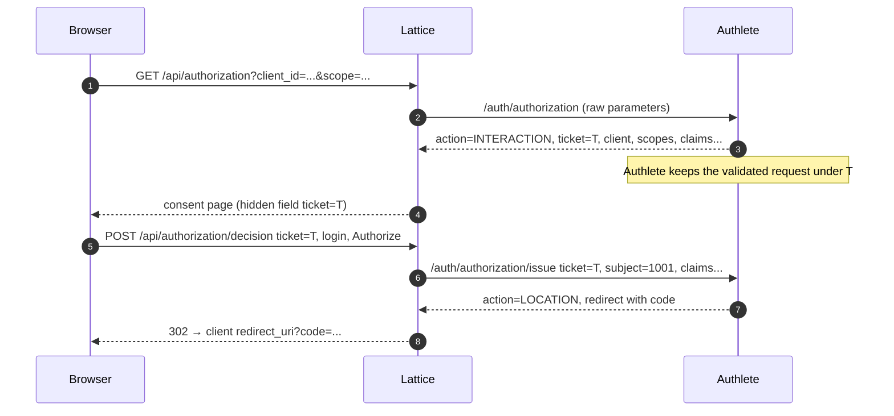

## Single sign-on

Once a browser has a login session at Lattice, other applications can reuse it without asking for the password again.

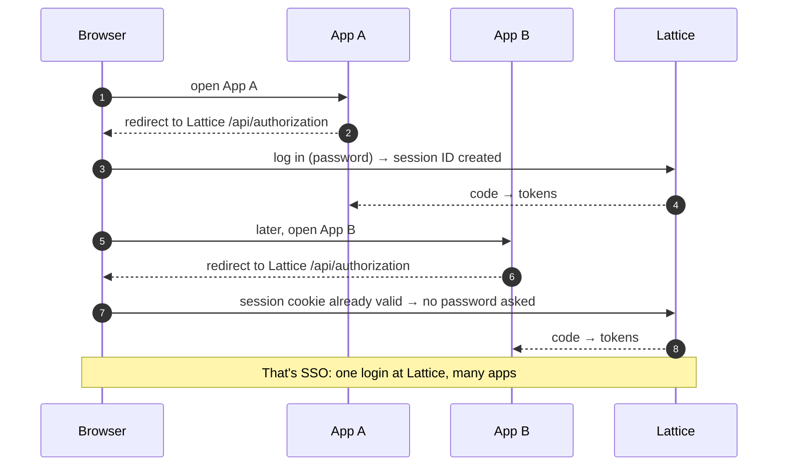

### Native SSO: the same for mobile apps

Native apps on a phone don't share a browser cookie. OpenID Connect Native SSO for Mobile Apps lets a second app from the same vendor sign the user in with the first app's tokens, without showing a login page. Lattice implements it with Authlete 3.0's `/nativesso` API, following [Authlete's guide](https://developers.authlete.com/protocols-and-flows/advanced-flows/native-sso). Authlete follows draft 07 of the specification.

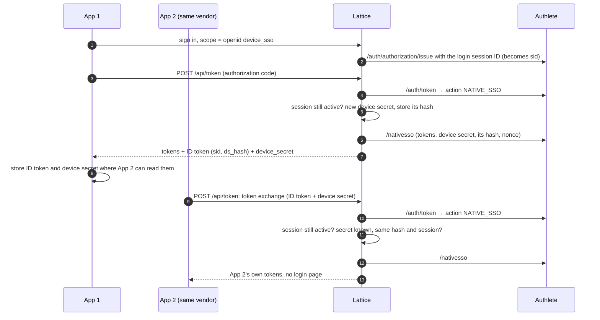

**App 2's request** is a token exchange:

| Parameter | Value |
| --- | --- |
| `grant_type` | `urn:ietf:params:oauth:grant-type:token-exchange` |
| `audience` | Lattice's issuer |
| `subject_token` | App 1's ID token |
| `subject_token_type` | `urn:ietf:params:oauth:token-type:id_token` |
| `actor_token` | The device secret |
| `actor_token_type` | `urn:openid:params:token-type:device-secret` |

**What Authlete does, and what Lattice must do** (`NativeSsoHandler`). Authlete checks the ID token's signature, issuer and claims, but can't know whether the user's session is still active or whether the device secret is genuine. Lattice does those checks:
- **The session must still be active.** The session ID comes from the ID token's `sid`, or from the refresh token. This check matters because Authlete accepts an *expired* ID token as the subject token, as the specification allows. An ended session gets `invalid_grant`.
- **Device secrets:**
  - Generated by Lattice: 32 random bytes.
  - Stored only as a SHA-256 hash, bound to the session they were issued in, and kept no longer than a session can last.
  - In a token exchange, the secret must be known, its hash must match the ID token's `ds_hash`, and it must belong to the same session. Otherwise the request gets `invalid_grant`.
  - In a code or refresh-token request, an unknown secret is replaced by a new one.
- **`nonce` and `s_hash`:** Authlete returns them in `additionalClaims`, and Lattice passes them to `/nativesso` unchanged, so the new ID token carries the original request's `nonce`.
- **Errors:** if `/nativesso` fails, the client gets a generic `server_error`; Authlete's message goes to the log only.
- **Logout:** ending the session calls `/nativesso/logout`, which deletes every token issued in that session. The device secrets stop working because their session has ended.

**Setting it up in Authlete:**
- **Service:**
  - Enable Native SSO (`nativeSsoSupported`), which publishes `native_sso_supported: true` in discovery.
  - Register the `device_sso` scope.
  - Allow the token exchange grant.
  - `tokenExchangeByConfidentialClientsOnly` and `tokenExchangeByPermittedClientsOnly` restrict which clients may exchange tokens.
- **Each client:**
  - Allow `device_sso` and the token exchange grant.
  - With `tokenExchangeByPermittedClientsOnly`, also set `extension.tokenExchangePermitted`.

**Not done yet: binding secrets to a device.** The specification expects a device secret to be tied to the device; Authlete's own sample leaves this empty. Lattice binds each secret to a login session instead. Binding it to a device would need a device identifier that apps can't forge, such as platform attestation.

## Identity brokering

Identity brokering lets users sign in to Lattice with an existing account at an external identity provider such as Okta, Azure AD or Google. Lattice delegates authentication to that provider, verifies the result, and maps the external identity to a local account (for example `alice@okta`) with its own Lattice session. Keycloak calls this feature Identity Brokering; it is also known as social login or upstream identity providers.

### `IdentityProvider`: one upstream provider

Code: `handlers/IdentityProvider.java` (Keycloak: `OIDCIdentityProvider`).

Each instance is the relying-party client for a single OpenID Provider (one entry in the identity providers file, for example `"okta"`). It does the actual protocol work with that provider:

- **Discovery**: fetches and caches the provider's `/.well-known/openid-configuration` and checks that `issuer` matches.
- `authenticationRequest(state, verifier, nonce)`: builds the redirect URL to the provider's authorization endpoint, using the code flow with PKCE, `state` and `nonce`. If the provider supports the `claims` parameter, it also asks for `auth_time` as an essential claim.
- `complete(callbackUrl, state, verifier, nonce)`:
  1. Parses the callback and checks `state`.
  2. Exchanges the code at the provider's token endpoint.
  3. Validates the ID token (signature from the provider's JWKS, issuer, audience, nonce).
  4. Calls UserInfo and checks that its `sub` matches the ID token's.
  5. Returns the user's claims and the ID token's `auth_time`.

**`auth_time` is the provider's, not the time of the callback.** Lattice didn't authenticate the user here; it accepted the provider's word, and the provider may have reused its own session from hours earlier without asking the user anything. The Lattice session, and so the `auth_time` of the ID tokens Lattice issues, takes the provider's `auth_time`. Only if the provider doesn't send one (or sends one in the future) is the time of the callback used. Otherwise a client asking for `max_age=300` could be satisfied by a sign-in far older than five minutes. When the user links the upstream account by entering their Lattice password, that password check is the authentication, so its time is used.

### `IdentityProviders`: the registry

Code: `handlers/IdentityProviders.java`. A `@Singleton` that holds every configured provider:

- At startup: reads the JSON file named by `lattice.identity-providers.file` (`IDENTITY_PROVIDERS_FILE`; `FEDERATIONS_FILE` is still accepted), skips incomplete entries with a warning, and creates one `IdentityProvider` per valid entry. The file has a top-level `identityProviders` array; the older top-level `federations` key is still accepted.
- A ready-made example with Okta, Microsoft, Google, Keycloak and PingFederate entries is in `conf/identity-providers.example.json`. Copy it, fill in your values, and point `IDENTITY_PROVIDERS_FILE` at it. Each `redirectUri` must be `<base URL>/api/federation/callback/<id>` and registered at the provider.
- `get(id)`: looks up the `IdentityProvider` for an ID such as "okta". `IdentityBrokerController` uses it in `/api/federation/initiation/:id` and `/api/federation/callback/:id`.
- `links()`: returns (id, name) pairs so the consent page can show "Or sign in with: Okta, …".

**Provider names.** The sign-in page names each provider by its `server.name` from the identity providers file. The demo's file comes from the test helper [FakeUpstreamProvider.java](test/com/lattice/oidc/handlers/FakeUpstreamProvider.java#L164), which writes `"name":"Upstream"`. "Upstream" there is just jargon for "the provider we sign in through".

```json
{ "id": "okta", "server": { "name": "Partner Inc (Okta)", "issuer": "https://partner.okta.com" },
  "domains": ["partner.example"], ... }
```

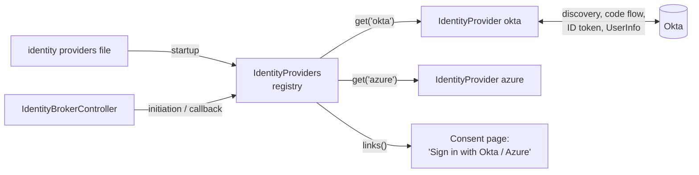

### The flow at a glance

Lattice is the client here, and an external provider (Okta, Azure AD, Google…) authenticates the user.

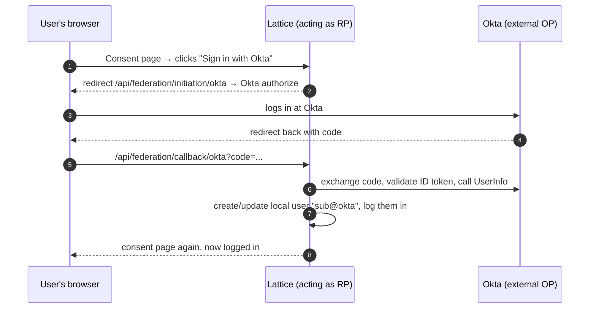

### The flow in detail

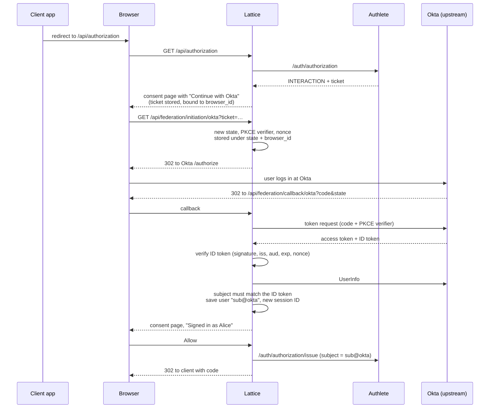

### Summary

- **Question it answers**: "Who is this user?" Another provider vouches for them.
- **Direction**: Lattice is the client of Okta. It has a client_id and secret at Okta.
- **Code**: `IdentityProvider`, `IdentityProviders`, and `IdentityBrokerController` (`initiation`, `callback`).
- **Configured in**: the identity providers file (`lattice.identity-providers.file`).
- **Spec**: plain OpenID Connect, with Lattice on the client side.

## OpenID Federation 1.0

OpenID Federation 1.0 is a trust framework that lets client applications and providers trust each other through a shared authority, so clients don't need to be registered manually. It is what `/.well-known/openid-federation` and `/api/federation/register` implement. Lattice is the provider here: instead of every client being registered in advance, a shared trust anchor (for example a national open-banking directory) vouches for both the provider and its clients, and trust is checked by following a chain of signed statements.

### Why it exists

In plain OpenID Connect, trust is set up one pair at a time. Before a relying party (RP, the client app) can use an OpenID Provider (OP), the two have to know each other:

| Approach                               | How the RP gets known to the OP                  | What's still missing                                                                                                           |
| -------------------------------------- | ------------------------------------------------ | ------------------------------------------------------------------------------------------------------------------------------ |
| Static registration                    | An admin registers the client by hand at each OP | Doesn't scale: 1,000 RPs × 50 OPs means 50,000 manual registrations                                                            |
| Dynamic Client Registration (RFC 7591) | The RP registers itself through an API           | It solves the mechanics, not trust: the OP still can't tell whether the client is a real, approved organisation or an attacker |

Large ecosystems hit this immediately: national eID schemes (Italy's SPID/CIE run on OpenID Federation), university networks, open banking, health networks and EU digital identity wallets. Thousands of parties that have never met still need to trust each other automatically.

**OpenID Federation's answer is to make trust hierarchical, the way TLS certificates work.** A single authority (the Trust Anchor) vouches for a set of intermediates, which in turn vouch for the relying parties and providers. The relying party can verify the chain of trust up to the anchor, and the provider can do the same. That way, a relying party can be registered automatically without any prior relationship with the provider.

Trust Anchors vouch for intermediates, intermediates vouch for the actual OPs and RPs, and each of these "vouches" is a signed JWT. Two parties that have never met can each follow a chain of these JWTs up to a Trust Anchor they both trust. If both chains reach it, they trust each other, with no prior registration.

### Where it's used

Real ecosystems hit that scale whenever many relying parties each have to accept many identity providers, usually because the user picks their own provider from a list. Every RP then needs a working relationship with every OP. Here are the real-world cases.

#### National digital identity: the best-known case

Italy's SPID is the textbook example, and it's one of the first large deployments of OpenID Federation.

- Citizens get their digital identity from one of about a dozen accredited private identity providers (Poste, Aruba, InfoCert and others).
- Thousands of relying parties (municipalities, ministries, tax and health services, universities, plus private companies) all show a "Sign in with SPID" button listing every provider.
- That's thousands × about a dozen pairwise relationships, all of which must carry correct keys and metadata, stay current through key rotation, and be cut off immediately when a party is suspended.

The real burden isn't the first registration but keeping all those pairs correct afterwards. That's the problem a Trust Anchor solves: a service joins once, and every provider trusts it automatically.

#### Research and education

Universities worldwide run identity providers, and services such as journal publishers, research tools, eduroam and cloud computing grants want to accept users from any university. National federations (InCommon, the UK federation, DFN and others) and eduGAIN, which links them, are the trust frameworks that make this work. They mostly run on SAML metadata today, and OpenID Federation 1.0 is designed partly as the OIDC counterpart of that model.

#### Open banking and open finance

Every bank (acting as the OP for its customers) must accept every licensed third-party provider (budgeting apps, payment initiators), and every provider wants to connect to every bank.

Brazil's Open Finance has hundreds of participating institutions, any of which may need to connect to any other.

This is already in Lattice. `ObbDcrHandler` handles the open banking solution to this exact problem. A central directory signs a software statement for every licensed provider, and banks trust the directory instead of each provider. That's a one-level version of federation: the directory plays the Trust Anchor and the software statement plays the Subordinate Statement. OpenID Federation generalises it with intermediates, metadata policies and trust marks.

#### Digital identity wallets (EU and others)

- Millions of wallets, many credential issuers (governments, universities, banks, employers) and very many verifiers (any shop, rental company or website checking an ID or diploma).
- A verifier needs to know whether an issuer is legitimate, and a wallet needs to know whether the verifier asking for your passport data is allowed to ask.
- This is the newest and biggest use case. OpenID Federation is one of the trust frameworks being used or considered with OID4VCI and OID4VP.

#### Health care

Hospitals, labs, insurers and patient apps across a region or country need to trust each other's systems for patient login and data exchange. Many independent organisations, each acting as both provider and consumer, again produce the many-to-many shape.

#### What decides whether you need it

The deciding factor isn't raw numbers. It's whether there's an ecosystem with a governing authority (a government, a banking regulator, a research network) that sets the rules and decides who's in. That authority becomes the Trust Anchor. Without one, there's nobody to anchor the trust to.

### Entities and roles

Every participant is an entity, identified by an Entity ID, which is an HTTPS URL (for example `https://op.lattice.example`).

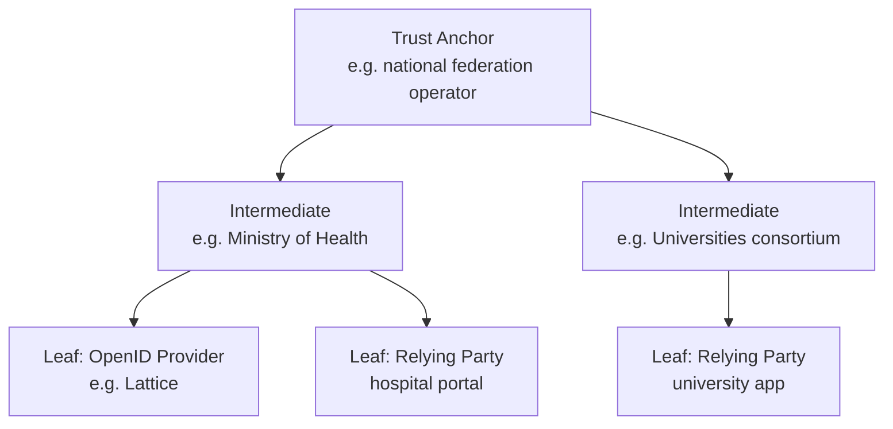

| Role                   | What it does                                                                                               |
| ---------------------- | ---------------------------------------------------------------------------------------------------------- |
| Trust Anchor (TA)      | The root of trust. Its keys are configured out-of-band, the way root CA certificates ship in a browser     |
| Intermediate Authority | Vouches for entities below it. Lets an ecosystem delegate, for example "the Ministry approves health apps" |
| Leaf entity            | Does the real work: an OP, an RP, a credential issuer, a wallet provider                                   |
| Trust Mark Issuer      | Issues signed badges such as "certified for the health sector" or "passed the security audit"              |

Every participant in the federation is an entity: Trust Anchors, Intermediates, leaves, Trust Mark Issuers and resolvers. The roles differ by where an entity sits in the tree:

- **A leaf** is an entity with no subordinates. It does the actual OIDC work.
- **A Trust Anchor** is an entity with no superior. Its Entity Configuration has no `authority_hints`, and its keys are trusted because you configured them, not because anyone vouched for it.
- **An Intermediate** has both: a superior above it and subordinates below it.

1. **The Trust Anchor publishes a self-signed Entity Configuration, like everyone else.** That's how others discover its fetch endpoint and current keys. But you don't trust it because of that file: you check that the keys in it match the ones you were configured with.
2. **Roles are relative to the chain.** An entity that is the Trust Anchor in one federation can be an Intermediate in another, for example a national federation that is itself a member of an EU-wide one. A trust chain always ends at whichever Trust Anchor you chose to trust.
3. **One entity can play several protocol roles at once.** Lattice is a single leaf entity that is both an `openid_provider` and an `openid_credential_issuer`. That's why `FederationController.java` asks Authlete for an Entity Configuration with both entity types.

### Entity Configuration: what an entity says about itself

Every entity publishes a self-signed JWT at `<entity-id>/.well-known/openid-federation`. Its media type is `application/entity-statement+jwt`, and its payload looks like this:

```json
{
  "iss": "https://op.lattice.example",
  "sub": "https://op.lattice.example",
  "iat": 1760000000,
  "exp": 1760086400,
  "jwks": { "keys": [ { "kty": "EC", "kid": "fed-1", ... } ] },
  "authority_hints": [ "https://health.gov.example" ],
  "metadata": {
    "federation_entity": { "organization_name": "Lattice" },
    "openid_provider": {
      "issuer": "https://op.lattice.example",
      "authorization_endpoint": "https://op.lattice.example/api/authorization",
      "token_endpoint": "https://op.lattice.example/api/token",
      "client_registration_types_supported": ["automatic", "explicit"],
      "federation_registration_endpoint": "https://op.lattice.example/api/federation/register"
    },
    "openid_credential_issuer": { ... }
  },
  "trust_marks": [ { "id": "https://health.gov.example/certified", "trust_mark": "eyJ..." } ]
}
```

- `iss` = `sub`: marks it as self-signed: the entity is talking about itself.
- `jwks`: holds the entity's federation keys. These sign federation statements only. They are separate from its normal OIDC signing keys, which go in the metadata as usual.
- `authority_hints`: says "my superiors are here", so others know where to look next.
- `metadata`: holds the normal OIDC/OAuth metadata, grouped by entity type, because one entity can play several roles. Ours is both an OP and a credential issuer.

On its own this proves nothing, since anyone can sign a statement about themselves. A superior has to vouch for it.

### Subordinate Statement: what a superior says about you

A superior publishes a Subordinate Statement about each entity it vouches for. It's served from the superior's fetch endpoint (`federation_fetch_endpoint?sub=<entity-id>`):

```json
{
  "iss": "https://health.gov.example",
  "sub": "https://op.lattice.example",
  "exp": 1760086400,
  "jwks": { "keys": [ { "kid": "fed-1", ... } ] },
  "metadata_policy": {
    "openid_provider": {
      "id_token_signing_alg_values_supported": { "subset_of": ["ES256", "PS256"] },
      "token_endpoint_auth_methods_supported": { "subset_of": ["private_key_jwt", "tls_client_auth"] }
    }
  },
  "constraints": { "max_path_length": 1 }
}
```

- It is signed by the superior's key (`iss` ≠ `sub`).
- Its `jwks` pins the subordinate's federation keys: "the real Lattice signs with key `fed-1`". This is what stops an impostor from publishing a fake Entity Configuration, because the impostor's key won't match the one the superior pinned.
- `metadata_policy` lets the superior restrict or modify the subordinate's metadata.
- `constraints` limits what can happen further down the tree, such as path length or allowed entity types.

### Trust chains

Each entity publishes its own Entity Configuration at `/.well-known/openid-federation`. Its superior publishes a Subordinate Statement about it at its fetch endpoint. A trust chain links the two: each Subordinate Statement names its subject (`sub`) and that subject's keys, so it binds the statement below it. The chain starts with the leaf's Entity Configuration and ends with the Trust Anchor's:

```text
.----------------.  .---------------------------.         .---------------------------.
| Role           |  | .well-known/              |         | Trust Chain               |
|                |  | openid-federation         |         |                           |
.----------------.  .---------------------------.         .---------------------------.
| .------------. |  | .-----------------------. |         | .-----------------------. |
| |            | |  | | Entity Configuration  | |         | | Entity Configuration  | |
| |Trust Anchor+-+--+->                       +-+---------+->                       | |
| |            | |  | | Federation Entity Keys| |         | | Federation Entity Keys| |
| '-----.------' |  | | Metadata              | |         | | Metadata              | |
|       |        |  | | Trust Mark Issuers    | |         | | Trust Mark Issuers    | |
|       |        |  | |                       | |         | |                       | |
|       |        |  | '-----------------------' |         | '-----------------------' |
|       |        |  |                           |         |                           |
|       |        |  |                           |Fetch    | .-----------------------. |
|       |        |  |                           |Endpoint | | Subordinate Statement | |
|       +--------+--+---------------------------+---------+->                       | |
|                |  |                           |         | | Federation Entity Keys| |
|                |  |                           |         | | Metadata Policy       | |
|                |  |                           |         | | Metadata              | |
|                |  |                           |         | | Constraints           | |
|                |  |                           |         | |                       | |
|                |  |                           |         | '-----------.-----------' |
| .------------. |  | .-----------------------. |         |             |             |
| |            | |  | | Entity Configuration  | |         |             |sub and key  |
| |Intermediate+-+--+->                       | |         |             | binding     |
| |            | |  | | Federation Entity Keys| |         | .-----------v-----------. |
| '------.-----' |  | | Metadata              | |         | | Subordinate Statement | |
|        |       |  | | Trust Marks           | |         | |                       | |
|        |       |  | |                       | |         | | Federation Entity Keys| |
|        |       |  | '-----------------------' |Fetch    | | Metadata Policy       | |
|        |       |  |                           |Endpoint | | Metadata              | |
|        +-------+--+---------------------------+---------+->                       | |
|                |  |                           |         | '-----------.-----------' |
|                |  |                           |         |             |sub and key  |
|                |  |                           |         |             | binding     |
| .------------. |  | .-----------------------. |         | .-----------v-----------. |
| |            | |  | | Entity Configuration  | |         | | Entity Configuration  | |
| | Leaf       +-+--+->                       +-+---------+->                       | |
| |            | |  | | Federation Entity Keys| |         | | Federation Entity Keys| |
| '------------' |  | | Metadata              | |         | | Metadata              | |
|                |  | | Trust Marks           | |         | | Trust Marks           | |
|                |  | |                       | |         | |                       | |
|                |  | '-----------------------' |         | '-----------------------' |
'----------------'  '---------------------------'         '---------------------------'
```

Read the right-hand column bottom-up, as a verifier does:
- **Leaf's Entity Configuration:** self-signed, carrying the leaf's own keys, metadata and Trust Marks.
- **Intermediate's Subordinate Statement about the leaf:** vouches for the leaf's keys and applies the intermediate's metadata policy.
- **Trust Anchor's Subordinate Statement about the intermediate:** the same, one level up, plus constraints such as how deep the chain may go.
- **Trust Anchor's Entity Configuration:** its keys must match the ones the verifier already trusts.

#### Building the chain

Suppose a hospital portal (RP) wants to trust Lattice (OP), and the RP is configured to trust `https://federation.gov.example` as its Trust Anchor.

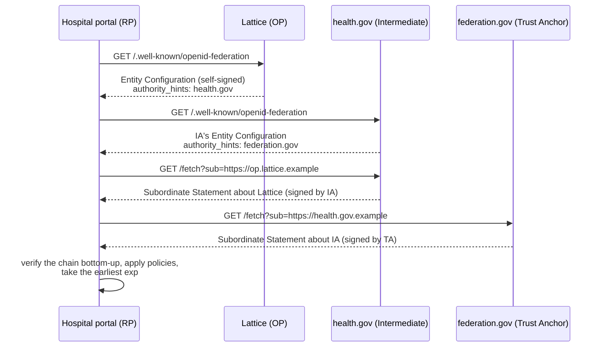

#### Verifying the chain

The resulting trust chain, a list of JWTs, is:

```text
[0] Lattice's Entity Configuration                 signed by Lattice's federation key (fed-1)
[1] health.gov's statement about Lattice           signed by health.gov's key
[2] federation.gov's statement about health.gov    signed by the Trust Anchor's key (known in advance)
```

**Verification runs from the top, which is the end you already trust:**

- Statement [2] is checked with the Trust Anchor's key, which the RP already has. Now `health.gov`'s keys are trusted.
- Statement [1] is checked with `health.gov`'s keys taken from [2]. Now Lattice's federation key `fed-1` is trusted.
- Statement [0] is checked with `fed-1` taken from [1]. Now Lattice's own metadata is trusted.
- The chain expires at the earliest `exp` in it, so trust is re-checked regularly.

If any link fails (a bad signature, an expired statement, or a superior that no longer issues a statement about you), the chain breaks and trust is gone. This is how revocation works: a superior simply stops vouching. Statements are short-lived, so removal spreads quickly without CRLs.

Leaves don't have to do all this fetching themselves. A federation can run a resolve endpoint that returns the already-verified chain and the final metadata in one call.

#### Who produces the chain

Each JWT in the chain is signed by a different entity, and the chain is simply those JWTs collected together.

| Piece                              | Produced (signed) by                  | Where it's published                                              |
| ---------------------------------- | ------------------------------------- | ----------------------------------------------------------------- |
| [0] Lattice's Entity Configuration | **Lattice** (self-signed)             | `https://op.lattice.example/.well-known/openid-federation`        |
| [1] Statement about Lattice        | **health.gov**                        | health.gov's fetch endpoint `?sub=https://op.lattice.example`     |
| [2] Statement about health.gov     | **federation.gov** (the Trust Anchor) | federation.gov's fetch endpoint `?sub=https://health.gov.example` |

Collecting the pieces into a chain is a separate job. Three different parties can do it:

- **The verifier assembles it.** This is the usual case. The party that wants to trust someone follows `authority_hints` upwards and fetches each piece, as in the sequence diagram above. When an unknown RP sends Lattice an authorization request, Authlete does this for Lattice.
- **The subject assembles it and presents it.** The RP fetches its own chain in advance and hands it over. Lattice's registration endpoint accepts exactly this: `POST /api/federation/register` with `Content-Type: application/trust-chain+json` (`FederationController.java`). This saves the verifier the network round trips.
- **A resolver assembles it.** A federation service with a resolve endpoint builds and verifies the chain, then returns the result.

Even when the subject hands over its own chain, the verifier still checks everything. It can't be faked: every piece carries a signature, and the top must be checked against a Trust Anchor key the verifier already has configured.

### Metadata policy: the ecosystem's rules, enforced automatically

Every superior in the chain can attach a `metadata_policy`. The policies are combined from the Trust Anchor down and then applied to the leaf's metadata. What comes out is the leaf's resolved metadata, the only metadata anyone actually uses.

| Operator      | Meaning                         | Example                                                         |
| ------------- | ------------------------------- | --------------------------------------------------------------- |
| `value`       | Force this value                | `"subject_type": {"value": "pairwise"}`                         |
| `default`     | Use this value if none is given | `"default_max_age": {"default": 3600}`                          |
| `add`         | Always include these            | `"contacts": {"add": ["soc@gov.example"]}`                      |
| `one_of`      | Must be one of these            | `"token_endpoint_auth_method": {"one_of": ["private_key_jwt"]}` |
| `subset_of`   | Keep only the allowed values    | Signing algorithms limited to `ES256` and `PS256`               |
| `superset_of` | Must include at least these     | Must support `S256` PKCE                                        |
| `essential`   | Must be present                 | `"jwks_uri": {"essential": true}`                               |

So a Trust Anchor can say "no RS256 anywhere in this federation" once, and it applies to every member automatically. A lower level can only tighten a rule from above, never loosen it. If two levels' policies conflict, the chain is invalid.

### How an RP registers with an OP

OpenID Federation offers two ways for an RP to start using an OP without manual setup.

#### Automatic registration (no registration step at all)

- The RP uses its Entity ID as its `client_id`.
- It sends a signed request object, so the authorization request proves it holds the RP's keys.
- The OP sees a `client_id` it has never seen before, builds the RP's trust chain up to a Trust Anchor it trusts, applies the policies, and checks the request signature against the resolved keys.
- If everything checks out, the flow continues as normal OIDC. The OP may cache the result until the chain expires.

#### Explicit registration (one call, then a normal client)

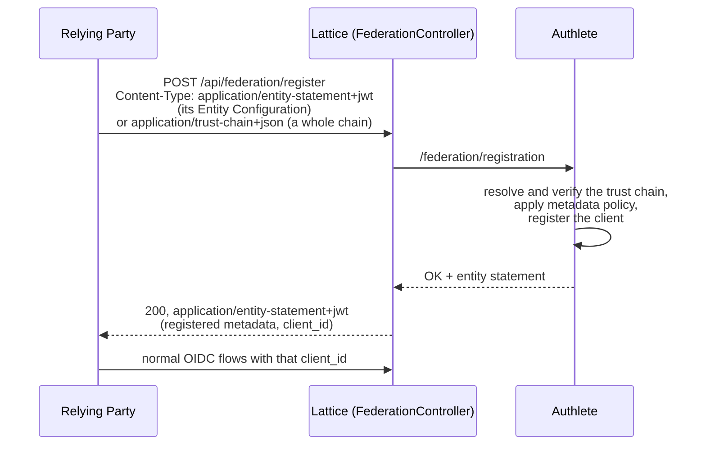

The OP's response is itself a signed entity statement containing the metadata it actually registered. The registration expires along with the trust chain.

### Trust goes both ways

The RP uses the same process to check the OP: it resolves Lattice's chain to its own Trust Anchor before sending users there. That protects users from fake identity providers, which plain OIDC discovery doesn't, because discovery just believes whatever `/.well-known/openid-configuration` returns.

### Keys and rotation

- Federation keys (`jwks` in the Entity Configuration) sign federation statements. They're pinned by your superior, so rotating them means your superior publishing a new statement. Rotation should be rare and coordinated.
- Protocol keys (`jwks` / `jwks_uri` inside `metadata.openid_provider`) sign ID tokens and similar. They're protected by the chain, so you can rotate them freely by publishing new metadata.
- There's a historical keys endpoint, so old signatures can still be checked after a rotation.

### Endpoints a federation uses

| Endpoint                                | Who serves it            | Purpose                                        |
| --------------------------------------- | ------------------------ | ---------------------------------------------- |
| `/.well-known/openid-federation`        | Every entity             | Its own Entity Configuration                   |
| `federation_fetch_endpoint`             | Superiors                | Subordinate Statement about a given `sub`      |
| `federation_list_endpoint`              | Superiors                | List of the subordinates it vouches for        |
| `federation_resolve_endpoint`           | Usually TAs or resolvers | Returns a verified chain and resolved metadata |
| `federation_trust_mark_status_endpoint` | Trust Mark Issuers       | Is this trust mark still valid?                |
| `federation_registration_endpoint`      | OPs                      | Explicit client registration                   |
| `federation_historical_keys_endpoint`   | Any                      | Retired federation keys                        |

### How Lattice implements it

Lattice is a leaf entity that acts as an OP and a credential issuer. `FederationController.java` serves two endpoints:

| Endpoint                             | What our code does                                                                                                                                                                                 | What Authlete does                                                                                                                                                         |
| ------------------------------------ | -------------------------------------------------------------------------------------------------------------------------------------------------------------------------------------------------- | -------------------------------------------------------------------------------------------------------------------------------------------------------------------------- |
| `GET /.well-known/openid-federation` | Asks Authlete for the Entity Configuration with entity types `OPENID_PROVIDER` and `OPENID_CREDENTIAL_ISSUER`, and returns it as `application/entity-statement+jwt`                                | Builds and signs the JWT from the service settings: Entity ID, federation keys, `authority_hints`, metadata, trust marks                                                   |
| `POST /api/federation/register`      | Accepts only `application/entity-statement+jwt` (an RP's Entity Configuration) or `application/trust-chain+json` (a full chain); anything else gets 415. Passes it to Authlete and maps the result | Resolves the RP's trust chain, verifies every signature up to a configured Trust Anchor, applies the metadata policies, registers the client and returns the signed result |

`GET /.well-known/openid-federation` is Lattice publishing its Entity Configuration as a leaf.

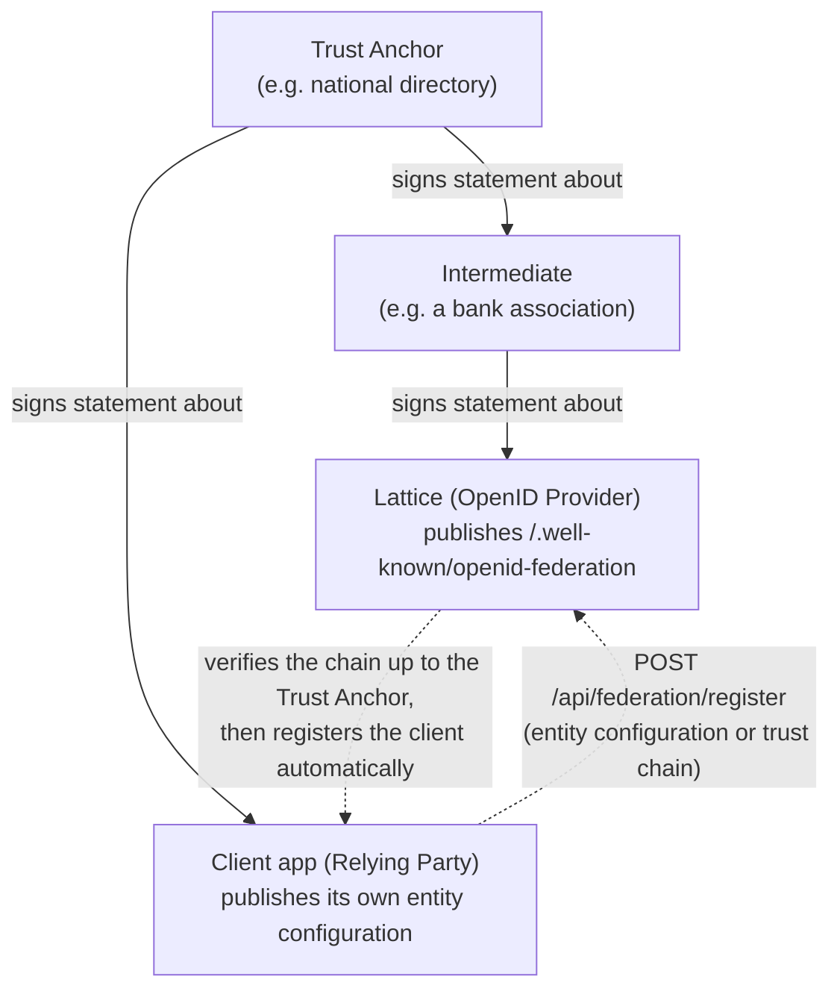

- **Question it answers**: "Can I trust this organization (client or provider)?" A common authority vouches for it.
- **Direction**: Lattice is the provider. Clients prove they belong to the federation, and Lattice registers them automatically.
- **Endpoints**:
  - `GET /.well-known/openid-federation` returns Lattice's entity configuration, a signed JWT describing it as a provider and credential issuer.
  - `POST /api/federation/register` handles explicit registration: a client sends its entity configuration or trust chain, and Authlete verifies it and creates the client.
- **Code**: `FederationController.configuration()` and `register()`. Authlete does the verification.
- **Configured in**: the Authlete service settings (trust anchors, entity ID, keys), not the identity providers file.
- **Spec**: OpenID Federation 1.0, final since 17 February 2026.

#### Setting it up in Authlete

From [Authlete's OpenID Federation guide](https://developers.authlete.com/guides/flows-and-protocols/identity-and-federation/openid-federation-1-0). Federation needs Authlete 2.3 or later; the details below are for 3.x.

| Setting | Why |
| --- | --- |
| `feature.oidc_federation.enabled=true` (server deployment) | Turns the feature on for the Authlete server |
| **Federation Support** on (`federationEnabled`) | Turns it on for this service |
| **Authorities** (`authority_hints`), at least one Entity ID | The superiors that vouch for Lattice. Without one, Authlete can't build the Entity Configuration. |
| **Trust Anchors**, at least one, each with its JWK Set | Whose chains Lattice accepts. Without one, no client's chain can be trusted. |
| **JWK Set > Federation**, with a private signing key, and **Signature Key ID** | Signs the Entity Configuration and the registration responses. Separate from the keys that sign tokens. |
| **Organization Name** (`organization_name`) and **Entity Configuration Duration** | Shown in the Entity Configuration, and how long it is valid (`exp`); `0` uses Authlete's default |
| **Client Registration Types**: `automatic`, `explicit` or both | Which registration flows Lattice offers, published as `client_registration_types_supported` |
| **Registration Endpoint**: `https://<lattice>/api/federation/register` | Required with `explicit`. Published as `federation_registration_endpoint`, so it must be Lattice's URL, not Authlete's. |

Lattice's discovery document comes from Authlete, so these appear there without any change to Lattice.

#### Automatic registration: no registration request at all

The RP simply starts a flow using its Entity ID as its `client_id`, for example `client_id=https://rp.example.com`. Lattice forwards authorization, PAR, CIBA and token requests to Authlete unchanged, so this needs no extra code. Authlete looks the client up as a numeric ID, then as an alias, then as an Entity ID. If none matches and the service allows `automatic`, it resolves the RP's trust chain, applies the metadata policies, checks that the RP's metadata allows `automatic`, authenticates the request, registers the client and carries on with the request.

The request must prove it comes from the RP. Since 3.0.32 Authlete no longer publishes the methods in discovery, but still requires one of them:

| Method | Authorization endpoint | PAR and CIBA | Token and device authorization |
| --- | :-: | :-: | :-: |
| A signed request object (`request`) | ✓ | ✓ | |
| `private_key_jwt` | | ✓ | ✓ |
| `tls_client_auth`, `self_signed_tls_client_auth` | | ✓ | ✓ |

Lattice passes the request object, the client assertion and the TLS client certificate to Authlete, so all of these work through it.

#### Explicit registration: `POST /api/federation/register`

- **Request:** the RP's Entity Configuration (`application/entity-statement+jwt`) or a whole trust chain (`application/trust-chain+json`). Any other content type gets `415 invalid_request`, and an empty body gets `400 invalid_request`, both without a call to Authlete.
- **Response:** a JWT signed by Authlete, with the `trust_anchor` Authlete chose (called `trust_anchor_id` before Authlete 3.0.32). The `client_id` it returns may differ from the Entity ID. The RP's own metadata must allow `explicit`.
- **Media type:** the final specification gives the response its own media type and `typ`, `explicit-registration-response+jwt` (§12.2.3). The drafts, and Authlete's guide, use `entity-statement+jwt`. Lattice reads the `typ` of the JWT Authlete returns and serves the matching media type, so it follows Authlete as Authlete adopts the final specification.
- **Errors:** passed on as Authlete returned them, as JSON `{"error", "error_description"}` (§8.9), for example `invalid_trust_chain` or Authlete's `A320308` (unsupported client metadata).
- **Audit:** a registration is recorded as `CLIENT_REGISTERED` with `via=federation`, the Entity ID and the trust anchor.

#### When the trust chain expires

Every statement in a chain has an `exp`, and the chain expires with the earliest one. Authlete then updates clients registered with `automatic`. If an RP sends a fresh `trust_chain` with a request, Authlete always tries the update, and a failure leaves the client in place. Without one, Authlete re-resolves the chain only after it expires, and **deletes the client** if the chain can't be rebuilt. Clients registered only with `explicit` aren't updated automatically.

#### Not handled by Lattice

- **The other federation endpoints:** Lattice is a leaf, so it doesn't serve the fetch, list or resolve endpoints that Trust Anchors and Intermediates do. Authlete doesn't host them either.
- **Trust marks:** Authlete's guide doesn't describe how it handles them.

Federation trust chains work like X.509 certificate chains. [crypto-notes.md](crypto-notes.md#appendix-how-certificate-validation-works-x509) shows how the JDK builds and verifies those.


DCR stands for Dynamic Client Registration and, depending on the context, refers to OpenID Connect Dynamic Client Registration 1.0, RFC 7591 OAuth 2.0 Dynamic Client Registration Protocol, or both.

[cimd-metadata-policy](https://darutk.medium.com/cimd-metadata-policy-c25969b538b6)

 a mechanism that allows a client ID to be shared across all authorization servers has already been realized in the OpenID Federation 1.0 specification. In this specification, a client ID is a globally unique URL starting with `https://`. The client’s metadata is then provided at the location obtained by appending `/.well-known/openid-federation` to that URL

 A new specification called the `OAuth Client ID Metadata Document (CIMD)` has been proposed in a landscape where a prior specification already exists. In this specification as well, the client ID is a URL starting with `https://`, and the client metadata is provided from the location indicated by that URL.

 [protocol-extensions/oauth-client-id-metadata-document-cimd)](https://developers.authlete.com/protocols-and-flows/protocol-extensions/oauth-client-id-metadata-document-cimd)

 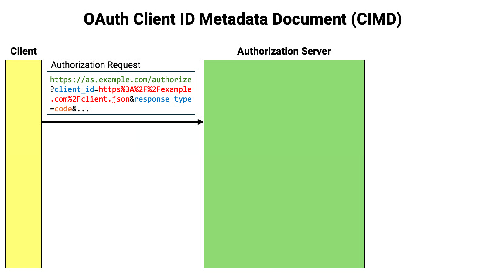

 The authorization request includes the client_id request parameter, and the value of that parameter is a URL beginning with `https://`.