# Exploring FAPI 2.0: The Latest in API Security Technology

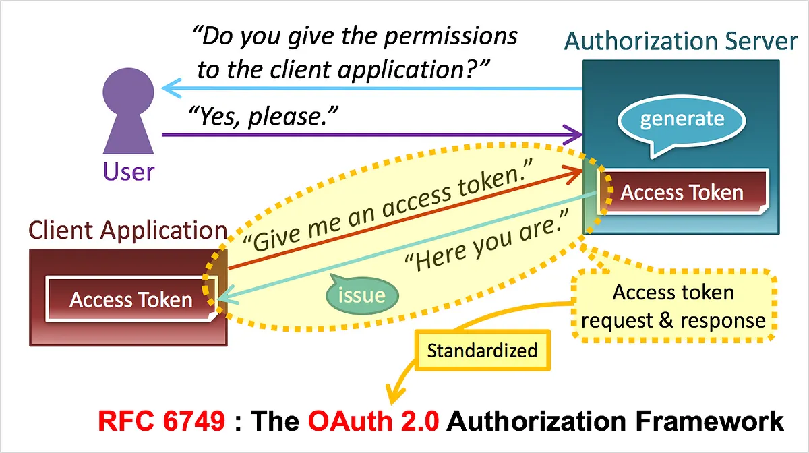

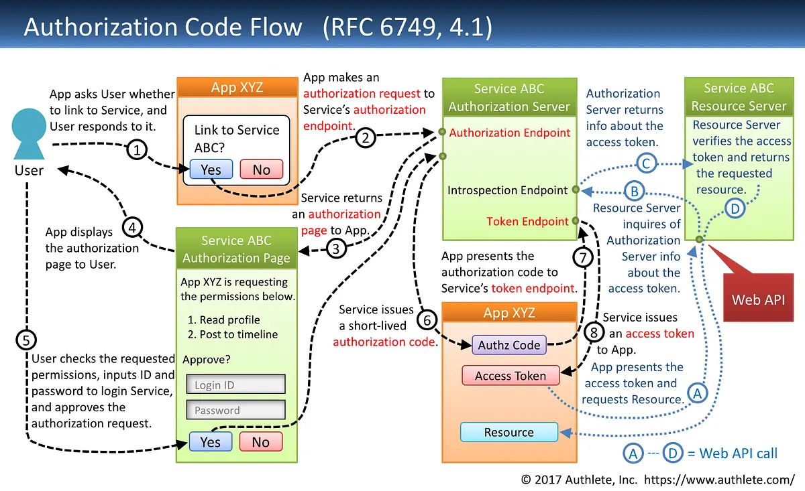

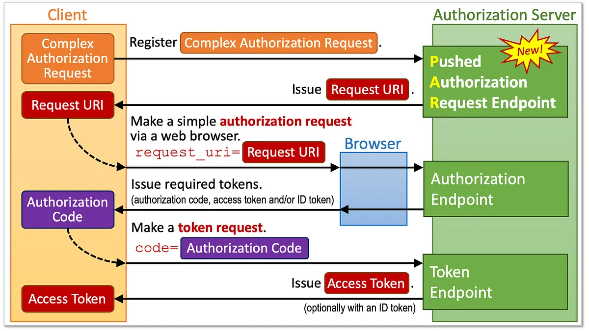

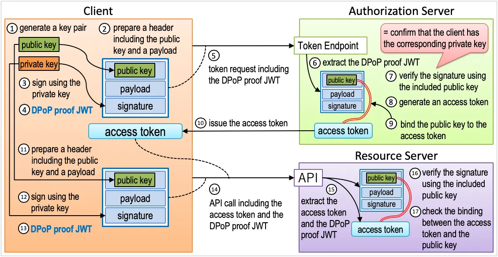

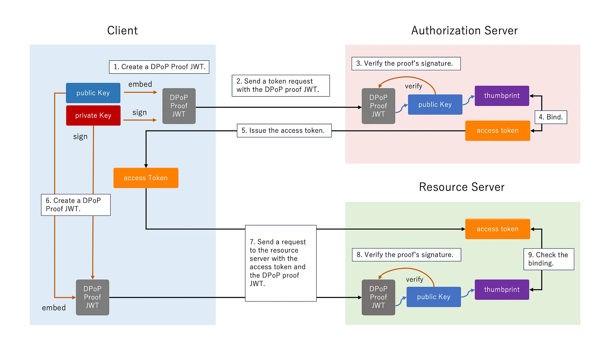

DPoP (RFC 9449: OAuth 2.0 Demonstrating Proof of Possession) is another access token sender-constraining mechanism allowed in FAPI 2.0 Security Profile. Here’s how it works.

1. The client creates a DPoP proof JWT, which is a signed JWT, using a private key possessed by the client.
2. The client sends a token request including the DPoP proof JWT.
3. Upon receiving the request, the authorization server verifies the signature of the DPoP proof JWT, using the public key contained in the proof.
4. Then the authorization server binds the thumbprint of the public key to the issued access token.
5. The authorization server issues the access token.
6. Before accessing resources, the client creates a new DPoP proof JWT using the same private key.
7. The client sends a request to the resource server with the access token and the DPoP proof JWT.
8. Upon receiving the request, the resource server verifies the signature of the DPoP proof JWT, using the public key contained in the proof.
9. The resource server verifies the DPoP proof and ensures the access token is bound to the public key. This process ensures the client who presented the access token to the resource server is the client to whom the access token is issued.

### Authorization Code Binding to DPoP Key
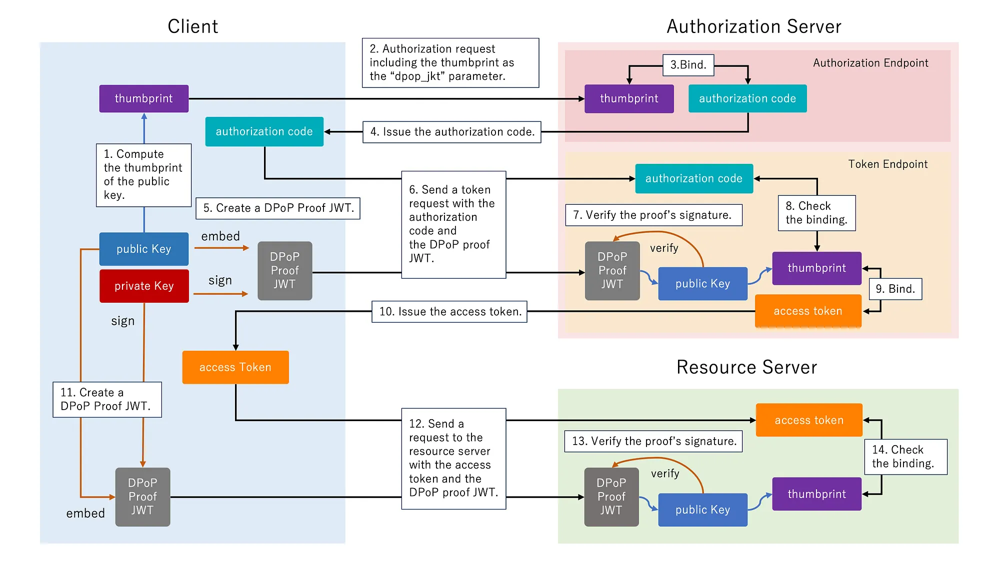

RFC 9449 also introduces the `dpop_jkt` request parameter in authorization requests. This parameter ensures proof-of-possession for authorization codes by binding the authorization code to the thumbprint of a public key possessed by the client. This mechanism can enable end-to-end binding of the entire authorization flow. Here’s how it works.

1. The client computes a thumbprint of the public key.
2. The client sends an authorization request including the thumbprint as the `dpop_jkt` parameter.
3. The authorization server binds the `dpop_jkt` value with the authorization code.
4. The authorization server issues the authorization code.
5. The client creates a DPoP proof JWT, which is a signed JWT, using the corresponding private key.
6. The client sends a token request including the DPoP proof JWT.
7. Upon receiving the request, the authorization server verifies the signature of the DPoP proof JWT, using the public key contained in the proof.
8. Then, the authorization server ensures the authorization code is bound to the thumbprint of the public key in the DPoP proof JWT.
9. Then, the authorization server binds the public key to the issued access token.
10. The authorization server issues the access token.
11. Before accessing resources, the client creates a new DPoP proof JWT using the same private key.
12. The client sends a request to the resource server with the access token and the DPoP proof JWT.
13. Upon receiving the request, the resource server verifies the signature of the DPoP proof JWT, using the public key contained in the proof.
14. The resource server verifies the DPoP proof and ensures the access token is bound to the public key in the presented DPoP proof. This process ensures the client who presented the access token to the resource server is the client to whom the access token is issued.

### DPoP Nonce
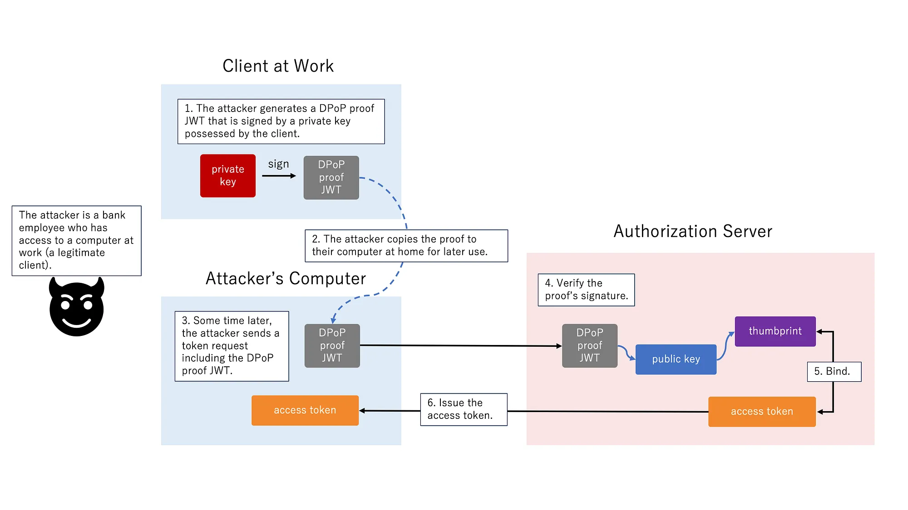

DPoP nonce is a mitigation to prevent DPoP proof pre-generation attack.
Without DPoP nonce, a pre-generation attack could be executed as follows:

1. An attacker is a bank employee who has access to a computer at work (a legitimate client application).
2. The attacker creates a DPoP proof on the computer at work for later use.
3. The attacker sends the DPoP proof to their personal computer at home.
4. Some time later, the attacker sends a token request (from home) including the stolen DPoP proof.
5. The authorization server checks the DPoP proof contained in the token request. Because the proof is correctly signed by the private key possessed by the client, it passes the verification.
6. The authorization server binds the thumbprint of the public key contained in the DPoP proof to the issued access token.
7. The authorization server issues the new access token to the attacker.

### How the Nonce Flow Works
Because a DPoP proof is a signed JWT containing the HTTP method and URL, it prevents an attacker from using it for a different endpoint. However, if intercepted, it could theoretically be replayed against the same endpoint within its short lifespan. To prevent this, a server can require the client to include a server-generated nonce:

- The client sends a request with a DPoP proof (initially without a nonce).
- The server rejects the request (typically returning `HTTP 400 Bad Request with error=use_dpop_nonce` for the AS, or `HTTP 401 Unauthorized for the RS`) and includes a `DPoP-Nonce` HTTP header containing a fresh, random string.
- The client generates a new DPoP proof, adding the `nonce` claim inside the JWT payload with the exact value the server just provided, and retries the request.

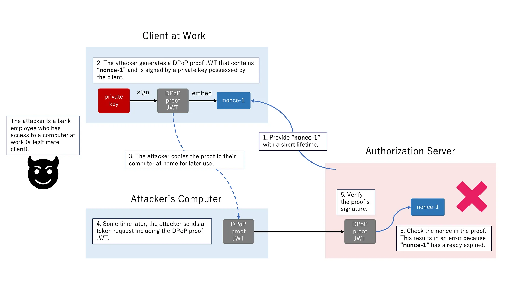

With DPoP nonce, the attack can be mitigated by its limited lifetime as follows:

1. The authorization server provides a DPoP nonce, ”nonce-1”, which has a short lifetime (e.g., 10 minutes).
2. The attacker generates a DPoP proof JWT that contains “nonce-1” and is signed by the client’s private key.
3. The attacker copies the DPoP proof to their computer at home for later use.
4. Some time later, the attacker sends a token request including the DPoP proof JWT to the authorization server.
5. The authorization server verifies the proof’s signature. Because the proof is correctly signed by the private key possessed by the client, it passes the verification.
6. The authorization server validates the nonce in the proof (“nonce-1”). This results in an error because “nonce-1” has already expired.

### DPoP Proof Pre-generation

An attacker who controls a client can create DPoP proofs in advance by choosing a future `iat` value and signing each proof with the proof-of-possession key. The attacker may be the legitimate user of the client: for example, a bank employee could generate proofs on a work computer, copy them to a personal device, and use them later. Without an unpredictable server-provided nonce, a relying server may only establish that the requester possesses a previously generated proof, not that they currently possess the key used to sign it.

Server-provided nonce values prevent this by requiring proofs to contain a fresh value that the server chooses and can expire. This demonstrates current possession of the proof-of-possession key. The `ath` claim also binds a resource-server proof to the access token, limiting that proof's usefulness to the token's lifetime. Deployments that do not use nonces SHOULD avoid long-lived DPoP-bound access tokens and prefer short-lived access tokens with refresh tokens. Although a proof could be pre-generated for a refresh token, the client cannot realistically pre-generate proofs for access tokens that have not yet been issued.

### Signed JWT Swapping

Servers accepting signed DPoP proof JWTs MUST verify that the JOSE header's `typ` parameter is `dpop+jwt`. This prevents an adversary from substituting a JWT that was validly signed for a different purpose.

## Introduction: FAPI 2.0

FAPI 2.0 Security Profile is a security profile built on OAuth 2.0 (RFC 6749), aiming to meet the security goals in the Attacker Model and follow OAuth Security BCP (RFC9700) recommendations. It excludes public clients from its scope, as no mechanism is currently known to secure them to the same degree. While it is possible to implement from scratch, implementers are encouraged to build on top of existing OpenID Connect or OAuth 2.0 implementations for completeness and correctness.

`The Authorization Endpoint is for Humans, not Scripts`

OpenID Connect is a specification as to how to request and issue ID tokens

This method is not limited to JWE but used in various places; sometimes encryption is performed two times as follows.

- Encrypt data using a shared symmetric key.
- Encrypt the key used above using another different asymmetric key.

By using two-step encryption, we can minimize the time needed to encrypt data by using a symmetric key while we can benefit from advantages of asymmetric encryption. It should be noted that the shared key used in two-step encryption doesn't have to be shared in advance and that the party which encrypts data can generate the shared key randomly. It is because, even if the shared key is generated randomly, if the shared key is encrypted by an asymmetric key and passed to the opposite party, the shared key can be decrypted on the opposite party's side by using the paired asymmetric key.

*Encryption Algorithms*

JWE uses two-step encryption. Therefore, two encryption algorithms are used.

Algorithms used to encrypt data are listed in “5.1. "enc" (Encryption Algorithm) Header Parameter Values for JWE” in RFC 7518.

On the other hand, algorithms used to encrypt shared keys are listed in “4.1. "alg" (Algorithm) Header Parameter Values for JWE” in RFC 7518.

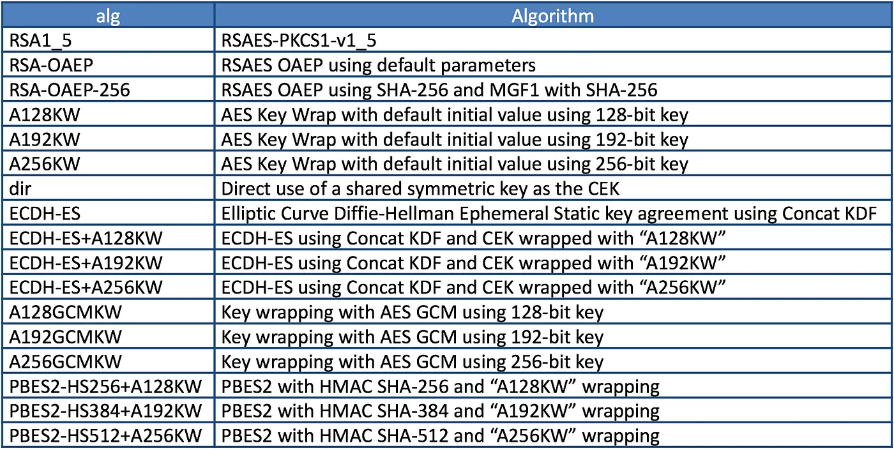

It should be noted that RFC 7518 does not define any rule as to how to decide the shared key but that OpenID Connect Core 1.0 defines a rule in “10.2. Encryption” as follows:

## Symmetric Encryption
The symmetric encryption key is derived from the `client_secret` value by using a left truncated SHA-2 hash of the octets of the UTF-8 representation of the `client_secret`. For keys of 256 or fewer bits, SHA-256 is used; for keys of 257-384 bits, SHA-384 is used; for keys of 385-512 bits, SHA-512 is used. The hash value MUST be left truncated to the appropriate bit length for the AES key wrapping or direct encryption algorithm used, for instance, truncating the SHA-256 hash to 128 bits for `A128KW`. If a symmetric key with greater than 512 bits is needed, a different method of deriving the key from the `client_secret` would have to be defined by an extension. Symmetric encryption MUST NOT be used by public (non-confidential) Clients because of their inability to keep secrets.

`key = leftmost_bits( SHA-2(UTF8(client_secret)), key_length )`
"Left truncated" means you keep the first bytes of the hash and drop the rest. The hash is chosen by how many key bits are needed:

| Algorithm (alg / enc) | Key bits | Hash | Hash bits kept |
| --- | ---: | --- | --- |
| A128KW, A128GCMKW, dir+A128GCM | 128 | SHA-256 | first 16 bytes |
| A192KW, dir+A192GCM | 192 | SHA-256 | first 24 bytes |
| A256KW, dir+A256GCM, dir+A128CBC-HS256 | 256 | SHA-256 | all 32 bytes |
| dir+A192CBC-HS384 | 384 | SHA-384 | all 48 bytes |
| dir+A256CBC-HS512 | 512 | SHA-512 | all 64 bytes |

JWT is either JWS or JWE which contains a collection of “claims” in JSON format.

### Nested JWT

How can we do both signing and encrypting? It can be achieved by either wrapping a JWS in a JWE or wrapping a JWE in a JWS. JWT which wraps JWS or JWE inside it is called “Nested JWT”

ID Token is a kind of JWT. In the context of ID Token, signing is mandatory. As a result, ID Token is verifiable. On the other hand, encrypting is optional, but if encryption is performed, the order must be “signed and then encrypted” as stated in “2. ID Token” in OpenID Connect Core 1.0.

>> ID Tokens MUST be signed using JWS and optionally both signed and then encrypted using JWS and JWE respectively, thereby providing authentication, integrity, non-repudiation, and optionally, confidentiality, per Section 16.14. If the ID Token is encrypted, it MUST be signed then encrypted, with the result being a Nested JWT, as defined in JWT.

Therefore, if an ID token is encrypted, its format is “JWS in JWE” 

Both orders are technically possible, but RFC 7519 (§11.2) recommends sign first, then encrypt: put the JWS inside a JWE. OpenID Connect requires that order for ID tokens, userinfo responses and request objects.

Sign-then-encrypt has one known weakness. The recipient can decrypt the inner JWS and re-encrypt it to someone else, who will then accept a valid signature. Checking `aud` (and `iss`) on the inner JWT prevents this.

>> The primary extension that OpenID Connect makes to OAuth 2.0 to enable End-Users to be Authenticated is the ID Token data structure. The ID Token is a security token that contains Claims about the Authentication of an End-User by an Authorization Server when using a Client, and potentially other requested Claims. The ID Token is represented as a JSON Web Token (JWT).

An ID token is issued as a result of user authentication, and the identifier of the authenticated user is included in the ID token as the value of the `sub` claim.

### Nonce Claim
ID token requests may come with a nonce request parameter to protect from replay attacks.
If an attacker intercepts a valid ID Token from a user's previous login session, they might try to inject that stolen token into a new login flow to impersonate the user. Because the client generates a brand new nonce for every single login attempt, the stolen ID Token will contain an old nonce claim that does not match the client's current expected value. The client instantly detects the mismatch and rejects the forged login attempt.

Note: This is the exact opposite of the DPoP-Nonce. In DPoP, the server originates the nonce to protect itself. In OIDC, the client originates the nonce to protect itself.

### amr
RFC 8176 registry (pwd, otp, sms, mfa, hwk, swk, face, fpt, …)

### acr (Authentication Context Class Reference)

It acts as a grade or a tier. Your application asks the Authorization Server, "I need this user logged in at Level 3 security." The Authorization Server handles the complexity of figuring out what methods satisfy Level 3, and returns the `acr` claim confirming that standard was met.

Examples: `"urn:nist.gov:800-63:3"` (NIST Level 3), "phishing-resistant", or a custom business value like "gold-level-auth".

A banking application might have a strict policy that transferring large sums of money requires an `acr` of "urn:nist.gov:800-63:3". The banking app does not need to care how the Authorization Server achieved that level—whether it was a YubiKey, FaceID, or a smart card. It only checks the `acr` claim to authorize the transfer. It might then log the `amr` claim purely for security auditing or displaying the login history to the user.

### HMAC with SHA-2 Functions
Hash-based Message Authentication Codes (HMACs) enable one to use a secret plus a cryptographic hash function to generate a MAC.  This can be used to demonstrate that whoever generated the MAC was in possession of the MAC key
A key of the same size as the hash output (for instance, 256 bits for "HS256") or larger MUST be used with this algorithm.the effective security strength is the minimum of the security strength of the key and two times the size of the internal hash value

Both signatures and MACs provide for integrity checking … However, MACs provide for origination identification only under specific circumstances. It can normally be assumed that a private key used for a signature is only in the hands of a single entity … however, a MAC key needs to be in the hands of all the entities that use it … Validation of a MAC only provides corroboration that the message was generated by one of the parties that knows the symmetric MAC key. … MAC validation cannot be used to prove origination to a third party.

### AMR Values (RFC 8176)

The `amr` (Authentication Methods References) claim identifies the authentication methods used during an authentication event. RFC 8176 defines these values:

| Value | Authentication method |
| --- | --- |
| `face` | Biometric authentication using facial recognition. |
| `fpt` | Biometric authentication using a fingerprint. |
| `geo` | Geolocation information used for authentication. |
| `hwk` | Proof of possession of a hardware-secured key. |
| `iris` | Biometric authentication using an iris scan. |
| `kba` | Knowledge-based authentication. |
| `mca` | Multiple-channel authentication using more than one distinct communication channel. |
| `mfa` | Multiple-factor authentication; specific methods may also be listed. |
| `otp` | One-time password, including HOTP or TOTP. |
| `pin` | A PIN or pattern used to unlock a device key, with protection against repeated guessing. |
| `pwd` | Password-based authentication. |
| `rba` | Risk-based authentication. |
| `retina` | Biometric authentication using a retina scan. |
| `sc` | Smart card. |
| `sms` | Confirmation using an SMS sent to the user's registered number. |
| `swk` | Proof of possession of a software-secured key. |
| `tel` | Confirmation by telephone call to the user's registered number. |
| `user` | A test showing that the user is present and interacting with the device. |
| `vbm` | Biometric authentication using a voiceprint. |
| `wia` | Windows integrated authentication. |

### AMR and ACR

`amr` describes the particular authentication methods used. `acr` (Authentication Context Class Reference) describes the authentication context or set of business rules that the authentication satisfied. A requested `acr_values` asks the authorization server to meet one or more such contexts; the returned `acr` identifies the context satisfied, not the specific methods used. Multiple different methods or combinations can satisfy the same `acr`, and the `amr` claim can report those methods separately.

### Choosing the JWE "alg" (the table above)

`alg` only decides how the random content key is protected; `enc` (A256GCM, A128CBC-HS256, …) encrypts the payload. Not every row of the table is safe to offer:

| alg | Use it? | Why |
| --- | --- | --- |
| `RSA-OAEP-256` | Prefer | RSA key wrapping with OAEP padding and SHA-256. |
| `RSA-OAEP` | Yes | OAEP with SHA-1 inside MGF1; still sound, and what Open Banking Brasil mandates. |
| `RSA1_5` | **Refuse** | PKCS#1 v1.5 padding is open to Bleichenbacher's padding-oracle attack: error or timing differences reveal the content key (RFC 8725 §3.2). |
| `ECDH-ES`, `ECDH-ES+A*KW` | Yes | Key agreement with the client's EC key; no RSA. Plain `ECDH-ES` derives the content key directly, `+A*KW` wraps it. |
| `A*KW`, `A*GCMKW`, `dir` | Only with `client_secret` | Symmetric: the key comes from the client secret (table above). Never for public clients, and anyone who knows the secret can read the token. |
| `PBES2-*` | **Refuse** | Password-based: meant for a person's passphrase, not server keys. The JWE header sets its own iteration count (`p2c`), so a crafted token can make the server run millions of PBKDF2 rounds (CVE-2023-52428). |

Lattice refuses `RSA1_5` and `PBES2-*` at dynamic client registration (`JoseAlgorithms`, applied in `ClientRegistrationController` for both create and update), and at startup for resource servers' JWT introspection settings (`IntrospectionController.check`). Open Banking Brasil registrations are further pinned to `PS256` / `RSA-OAEP` / `A256GCM` (`ObbDcrHandler`).

`none` is decided per member, because the specs differ:

| Member | `none` | Why |
| --- | --- | --- |
| `id_token_signed_response_alg` | Refused | OIDC allows it for code-flow-only clients; Lattice is stricter, as FAPI 2.0 and RFC 8725 are: an unsigned ID token that ever reaches the client through the browser is forgeable. |
| `token_endpoint_auth_signing_alg` | Refused | An unsigned client assertion authenticates nobody (OIDC Registration forbids it). |
| `introspection_signed_response_alg` | Refused | RFC 9701 §6 forbids it. |
| `authorization_signed_response_alg` | Refused | JARM forbids it. |
| `backchannel_authentication_request_signing_alg` | Refused | CIBA forbids it. |
| `userinfo_signed_response_alg` | Allowed | OIDC permits it, and an unsigned UserInfo JWT is no weaker than the plain JSON returned by default. |
| `request_object_signing_alg` | Allowed | OIDC permits it, and an unsigned request object is no weaker than ordinary query parameters. |

HMAC keys must be at least the hash size (RFC 7518 §3.2): 32 bytes for HS256, 48 for HS384, 64 for HS512. Lattice checks a resource server's `shared-key-for-sign` against this at startup.

FAPI 2.0 does not require encryption at all; it requires signatures with `PS256`, `ES256` or `EdDSA`, and never `none`.

## FAPI 2.0 Security Profile: authorization server checklist

From the final spec, with where Lattice stands. "Authlete setting" means the behaviour lives in the Authlete service or client configuration rather than in Lattice's code, so it has to be checked in the Authlete console.

| Requirement | Where | Lattice |
| --- | --- | --- |
| Only authorization code flow; reject implicit, hybrid, ROPC | Authlete setting (supported response/grant types) | Not enforced in Lattice's code |
| Every authorization request via PAR, client-authenticated | Authlete setting; per client `parRequired` | Console has a per-client "Require PAR" checkbox; FAPI needs it on for every client (or the service-wide setting) |
| PKCE with `S256` only | Authlete setting | Upstream logins (identity brokering) use S256 |
| `redirect_uri` required in the PAR request; no `http` except loopback | Authlete + Lattice | `RedirectUris.problem` implements the rule; not yet wired into the console form |
| `iss` in the authorization response (RFC 9207) | Authlete | Passed through |
| Authorization code lifetime ≤ 60 s; `request_uri` `expires_in` < 600 s | Authlete setting | Check service settings |
| Sender-constrained access tokens only: DPoP or mTLS | Authlete | Every endpoint forwards the `DPoP` header and client certificate chain |
| If DPoP: support `dpop_jkt` (code bound to the key) | Authlete | Supported |
| Client authentication: `private_key_jwt` or mTLS only | Authlete + Lattice | OBB registrations enforce it; the console still offers `client_secret_*` and `none` for non-FAPI clients |
| Accept the issuer as `aud` of client assertions | Authlete | — |
| No refresh token rotation, unless a client can retry with the old token | Authlete setting | Check service settings |
| JWTs: `PS256`, `ES256`, `EdDSA`; never `none`; RSA ≥ 2048 bits | Authlete + Lattice | `none` refused at registration |
| Codes and tokens with ≥ 128 bits of entropy | Authlete; Lattice's own links and sessions | Lattice's own tokens use 256 random bits |
| No open redirectors | Lattice | Return URLs are an allowlist (`safeNext`) |
| TLS 1.2+ only, HSTS on browser endpoints | Deployment (proxy) + Lattice | `HstsFilter`, off unless `lattice.security.hsts.enabled` is set |

The "Message Signing" profile (signed authorization requests and responses, i.e. JAR and JARM, signed introspection) is a separate, optional profile on top.

## ID token validation (OpenID Connect Core 3.1.3.7)

What a client must check, and what Lattice's identity brokering checks on upstream ID tokens (nimbus `IDTokenValidator` against the provider's JWKS):

1. Decrypt first if encrypted (JWS in JWE, see above), then verify the signature with the provider's key; the `alg` must be the one registered, never `none`.
2. `iss` equals the provider's issuer exactly.
3. `aud` contains the client's own `client_id`. If there are several audiences, `azp` should be present and equal the client ID.
4. `exp` is in the future and `iat` is recent (allow a little clock skew).
5. `nonce` equals the value the client sent in this login (required for implicit and hybrid flows; always use it).
6. `auth_time` is present and recent enough if the client sent `max_age`.
7. `acr` meets what was asked for, if the client depends on it.
8. Hash claims bind the ID token to what came with it: `at_hash` (access token, when both come from the authorization endpoint), `c_hash` (code, hybrid flow), `s_hash` (state, FAPI 1). Each is the left half of the hash of the value's ASCII bytes, base64url-encoded, using the hash of the ID token's `alg` (SHA-256 for PS256/ES256).

An ID token is for the client, not for APIs: resource servers take access tokens.

## Pushed Authorization Requests (RFC 9126)

1. The client POSTs the authorization parameters to the PAR endpoint, authenticating as it would at the token endpoint (and with a DPoP proof, if it uses DPoP).
2. The server validates them now and returns a `request_uri` (`urn:ietf:params:oauth:request_uri:…`) with a short `expires_in`.
3. The browser goes to the authorization endpoint with only `client_id` and `request_uri`.

Why it helps:
- **Integrity and confidentiality:** the parameters never travel through the browser, so they can't be changed or read there, and aren't left in URL logs or history.
- **Client authenticated up front:** an attacker can't start a flow in a client's name.
- **Errors go to the client, not the user:** a bad request fails at the PAR call instead of on an error page.
- **No URL length limits:** large `authorization_details` or `claims` fit.

`request_uri` should be single-use. In Lattice, `PushedAuthorizationController` passes the client credentials, certificate chain and `DPoP` header to Authlete.

## DPoP proof checks on the server (RFC 9449 §4.3)

In production Authlete verifies proofs (every Lattice endpoint passes the `DPoP` header through). `com.lattice.oidc.DPoP` is a reference implementation with tests, applying the checks in this order:

1. Exactly one `DPoP` header, a well-formed JWS.
2. `typ` is `dpop+jwt` (stops signed-JWT swapping, above).
3. `alg` is asymmetric and allowed (`ES256`, `ES384`, `PS256`, `EdDSA`); never `none` or `HS*`.
4. `jwk` header present and public only; the signature verifies with it.
5. `jti`, `htm`, `htu`, `iat` present; `htm` equals the request method; `htu` equals the request URL without query and fragment (scheme and host lower-cased, default port dropped).
6. `nonce` equals the server's current nonce, if nonces are used.
7. `iat` within a short window (60 s).
8. At a resource server: `ath` equals the access token's hash, and the key's thumbprint equals the token's `cnf.jkt`.
9. `jti` not seen before. Done last, so junk proofs can't fill the replay cache. With several server instances the cache has to be shared (Redis or the database), or a proof can be replayed against another instance.

`under the hood, the Authorization Server handles Delegated Consent, while the Resource Server handles Access Enforcement.`

## Lessons from a from-scratch OAuth/OIDC implementation

From Takahiko Kawasaki's "Full-Scratch Implementor of OAuth and OpenID Connect Talks About Findings" (2016), with where Lattice stands.

**You need an OAuth server only if third parties will act on your users' data** without being given the users' credentials. "Log in with Google" makes you an OAuth *client*, not a server. Lattice is both: an authorization server for its own clients, and a client of upstream providers in identity brokering.

**OpenID Connect is not a thin layer on OAuth.** `response_type` can be any combination of `code`, `token`, `id_token` (or `none`), and each combination changes where the response goes (query, fragment, form post) and what must be in it. Code written for "either `code` or `token`" has to be rewritten. Lattice leaves this to Authlete; FAPI 2.0 removes the problem by allowing `code` only.

**Client metadata is large, and a few gaps matter:**
- *Client type* (confidential or public) isn't a registration metadata field, yet the server needs it: public clients must register redirect URIs, can't keep secrets, and can't use symmetric algorithms (keys derived from `client_secret`).
- *Client secret entropy:* a secret used as an HMAC key must be at least the hash size (OIDC Core §16.19): ≥ 32 bytes for HS256, which every OIDC server must support. Authlete generates 512-bit secrets (86 base64url characters) so HS512 works too. Lattice's resource-server secrets are its own: it warns at startup if one is shorter than 43 characters (256 bits).
- *`none` differs per member* (table above).
- *Self-service registration:* opening APIs to outside developers needs a console where each developer manages their own clients, so clients need an owner. Lattice's console is administrators-only; self-service would need that owner and an authentication step for developers.

**Access tokens: random strings or self-contained (JWT).**
- A random token needs a lookup (introspection) on every use, and revoking it is just deleting the record.
- A self-contained token can be checked locally, but revoking it needs a unique ID (`jti`) and a "revoked" record kept until the token would have expired; delete that record early and the token comes back to life. Without IDs, a server can't revoke at all, so it must issue only short-lived tokens and no refresh tokens.
- Either way, checking revocation means asking the server, so self-contained tokens save less than they seem to.

**Decide when generated things are deleted, when you decide to generate them.** Expired tokens must be purged, and clients that keep asking for new tokens while old ones are valid fill the database; record "last used" and purge long-unused tokens if the service allows it. Lattice: Authlete holds the tokens; Lattice's own short-lived records (links, sessions, interactions) are purged by `StorageCleanup`.

**Redirect URIs are where implementations show their quality.**
- OIDC: `redirect_uri` is required and compared by simple string comparison.
- Plain RFC 6749 is looser: it may be omitted when exactly one is registered, and some servers compare component by component (case-insensitive host, default port).
- If the authorization request had a `redirect_uri`, the token request must repeat the identical value (RFC 6749 §4.1.3).
- The article's native-app rules (no `https`; `http` only with host `localhost`) predate RFC 8252, which replaced them: native apps may use claimed `https` URLs, private-use schemes (reverse domain names), or `http` on the loopback *IP literals* `127.0.0.1`/`[::1]` with any port — not `localhost`.
- Today OAuth 2.1 and the security BCP (RFC 9700) require exact string matching for every client. Lattice's `RedirectUris` follows that, with only the RFC 8252 loopback-port exception.

`authorization in the context of OAuth can be said to be the process where a user grants permissions to a client application`

`(Identity, Authentication) + OAuth 2.0 = OpenID Connect`
Thanks to this, authentication by OpenID Connect can be executed at the same time during the authorization process by OAuth.

In any user-driven OAuth 2.0 flow, the Authorization Server always authenticates the user. The critical difference is whether the server provides a secure, verifiable "receipt" of that event to the client application.

The `aud` (audience) claim in an access token points to the Resource Server (the API), not the Client Application. This is exactly why it fails to prevent the confused deputy attack when used for authentication

## Who authenticates: Lattice, not Authlete

> "Authlete focuses on authorization and does not do anything for authentication although it supports OpenID Connect."

This doesn't mean the authorization server skips user authentication. RFC 6749 §3.1 requires it: "The authorization server MUST first verify the identity of the resource owner." In the Authlete model, the authorization server is two parts, and only one of them is Authlete:

| Part | Built by | Does |
| --- | --- | --- |
| Authorization server implementation | You (Lattice) | Endpoints, login and consent pages, user authentication (password, TOTP, passkeys, brokering, LDAP), sessions, user claims |
| Backend engine | Authlete | Request validation, client handling, PKCE/PAR/DPoP checks, minting and signing codes and tokens, grant records, introspection |

From outside, the two are one authorization server: clients only see Lattice's URLs and never talk to Authlete. "Does nothing for authentication" describes the engine, not the server.

Why the line is drawn there:

- **Authentication is product-specific.** Your user database, password policy, MFA, passkeys, social login, branding, legal pages and support flows differ for every deployment. The protocol mechanics are the same everywhere and dense with detail, so they're the part worth sharing.
- **Authlete never holds user data.** It sees only the subject identifier and the claims Lattice chooses to send at issue time. Passwords and user records never leave your system.
- **Responsibility stays with you.** Authlete signs what Lattice reports, so the truth of `sub`, `auth_time` and `acr`, and whether tokens die when an account is recovered, is Lattice's job.
- **Delegating further doesn't move the responsibility.** Lattice can hand sign-in to an upstream provider or LDAP, but it still decides whether that sign-in is good enough for the request and vouches for it in the ID token.

Step by step, during an authorization request:

| Step | Who |
| --- | --- |
| Show the login page, check the password, TOTP code or passkey, broker to an upstream provider, keep the session | **Lattice** |
| Decide whether that sign-in is recent and strong enough for the request (`max_age`, `prompt=login`, `acr_values`) | **Lattice** (Authlete parses the request and hands these over) |
| Show the consent page; record what the user allowed | **Lattice** |
| Validate the request, issue the code, tokens and ID token, sign them | **Authlete** |

The hand-over is one call, `/auth/authorization/issue` (`AuthorizationHandler.issue`). Lattice tells Authlete:

- `subject` (and `sub`, the pairwise value for this client)
- `authTime`: when the user authenticated
- `acr`: which authentication context the sign-in satisfied
- `claims`: the user's claims for the ID token
- `sessionId`: for the `sid` claim

Authlete signs whatever it is told. It can't know whether the password was checked or when. So the authentication claims in the ID token (`auth_time`, `acr`, `amr`) are exactly as truthful as Lattice's report. "Authlete supports OpenID Connect" means Authlete produces correct ID tokens *from Lattice's statement*.

What that means for Lattice:

- **`auth_time` must be the real sign-in time, not "now".** For a session, it is the time the session's sign-in happened, kept in the session, so single sign-on doesn't refresh it. For a brokered sign-in it is the *upstream provider's* `auth_time`: Lattice didn't authenticate the user, it relayed the provider's statement, and the provider may have reused a session from hours earlier (fixed: `IdentityBrokerController.authTime`).
- **`acr` only when earned.** Lattice asserts an `acr` only if the session's own sign-in satisfied it, or it is configured as satisfied by any sign-in (`lattice.login.satisfied-acrs`).
- **`amr` is not reported yet.** Authlete has no `amr` field; it would go in `claims`. Lattice knows the method (the session records "Password", "Password + totp", "Passkey", a provider name) but doesn't pass it on. Mapping: password → `pwd`; with an authenticator app → `pwd`, `otp`, `mfa`; passkey → `hwk` or `swk` depending on the authenticator, which Lattice can't always tell; brokered → the provider's `amr`, if it sent one.

The consent page follows the same split. The bar at the top ("Signed in as … · Switch") is the *authentication* part: who is the user. The rest ("Allow … to access your account?", the permissions, Deny/Allow) is the *authorization* part: what this user grants this client. The `openid` scope is shown as "Sign you in with your account", which is the one permission that asks for identity rather than data.

## Authorization request parameters: the client asks, the server enforces, the client verifies

The client sends these in the authorization request (directly, in a request object, or through PAR). The authorization server enforces them. Then the client checks the outcome in the ID token, because a parameter is a request, not a guarantee: a server that ignores `max_age` still returns a validly signed ID token.

| Parameter | The client asks | Lattice does | The client checks |
| --- | --- | --- | --- |
| `prompt=none` | "Show nothing; answer from the existing session or fail." | `noInteraction`: `login_required` with no session, or when `max_age` has passed or an account action is pending; otherwise issues at once. | An error means "start an interactive sign-in". |
| `prompt=login` | "Make the user sign in again." | Ignores the session and shows the login page. | `auth_time` is recent. |
| `prompt=consent` | "Ask for consent again." | Shows the consent page even when a remembered consent covers the request. | — |
| `prompt=select_account` | "Let the user pick the account." | **Not handled yet**: the signed-in user is used (the consent page does offer "Switch"). Should show the account choice, or fail with `account_selection_required` under `prompt=none`. | `sub` is the expected account. |
| `max_age` | "The sign-in must be at most N seconds old." | Compares with the session's `auth_time`: a new sign-in, or `login_required` with `prompt=none`. | `auth_time` is present (required when `max_age` was sent) and recent enough. |
| `acr_values` | "The sign-in should meet this level." | Asserts an `acr` only if the session meets it. If essential and unmet, fails with `ACR_NOT_SATISFIED`; asking for a stronger sign-in (step-up) would be friendlier. | `acr` is acceptable; if absent or weaker, refuse or ask again. |
| `id_token_hint` | "I mean the user of this earlier ID token." | A session for someone else isn't reused; issuing for another user fails with `DIFFERENT_SUBJECT`. | `sub` equals the hinted one. |
| `login_hint` | "Probably this user" (e.g. an email), for the UI only. | Pre-fills the login ID. Proves nothing, enforces nothing. | — |

## The token endpoint is a security token service

A security token service (STS) validates a token presented to it and issues a new one under its policy (the term comes from WS-Trust; RFC 8693, Token Exchange, applies it to OAuth). Every grant at the token endpoint is "token in, token out":

| Grant | Input it validates | Output |
| --- | --- | --- |
| `authorization_code` | code + PKCE verifier + client credentials | access, refresh and ID tokens |
| `refresh_token` | refresh token | new access token |
| token exchange | subject token (+ actor token) | a token for another audience or scope |
| `jwt-bearer` | signed assertion | access token |
| `client_credentials` | the client's own credentials | access token |

An authorization server is an STS **plus** the place where a user's authorization is obtained (sign-in and consent at the authorization endpoint) and remembered (consents, refresh tokens, revocation, introspection). A deployment with no users (`client_credentials`, token exchange between services) is just an STS.

**Who authenticates whom at the token endpoint:**

- **The client: Authlete.** It holds each client's secret, keys and registered method. Lattice must not pre-check (it has none of that), but it must pass the credentials through faithfully and only from trustworthy sources:
  - `Authorization: Basic`, form-decoded as RFC 6749 §2.3.1 requires (`Requests.basicCredentials`);
  - `client_assertion` (for `private_key_jwt`) as-is;
  - the mTLS certificate from Lattice's own TLS connection, or from a proxy header only with `lattice.mtls.trust-proxy-headers` (off by default). The proxy must strip any such header the client sends, or anyone could claim any certificate;
  - the `DPoP` header and the public request URL (behind a proxy, a wrong URL fails `htu`).
- **The user: nobody, usually.** The user isn't present; the code or refresh token carries the earlier sign-in. Authlete hands control back to Lattice only where the request itself carries something to verify: the password grant (`PASSWORD`: Lattice checks the password with lockout, and refuses accounts needing a second factor), JWT bearer and token exchange (Lattice verifies the assertion against trusted issuers), and Native SSO (Lattice checks the device secret against a live session).

## Revoking tokens when the sign-in behind them is withdrawn

Because the token endpoint never re-asks about the user, a refresh token keeps working for as long as Authlete thinks it's valid, even after the user's password is reset, the account is recovered from an attacker, or the account is closed. Withdrawing trust means invalidating the inputs.

Where Lattice stands:

- **Removing one app** on the account page calls `deleteClientAuthorization`: that app's tokens and its consent are gone.
- **Password reset, password change, and "Sign out other sessions"** (when "Sign out everywhere else, including apps" is ticked, the default) end the other sessions, send back-channel logout, and **revoke every token issued for the account** (`LogoutHandler.endSessionsOf`).

Before that fix, only the sessions were ended. The tokens in Authlete stayed valid, so an app without back-channel logout stayed signed in, and someone who copied a refresh token before a reset (account takeover) could keep minting access tokens until it expired.

How it's revoked: one call to Authlete's `/auth/token/revoke` with only `subject` (`TokenRevokeRequest.setSubject`, Authlete 2.2.29+). Authlete revokes that user's access and refresh tokens in every app; consents stay. Notes:

- **It can't spare this device's apps.** Revoking by subject is all-or-nothing, so apps used here need a new token too. The Lattice session here survives and consents are remembered, so they get one without a password or consent page.
- **Ending one other session doesn't revoke.** Tokens aren't tied to a session, so revoking would sign the user out of their apps everywhere.
- **If Authlete can't be reached,** the password is still changed and the sessions still ended. The failure is logged as an error and recorded in the audit event (`"tokens_revoked": "failed"`); a success records the number revoked.
- **Account closure** (not built yet) should remove every app authorization instead (`deleteClientAuthorization` per client), which also forgets the consents.

>> In Section 10.1 and Section 10.2, keys are derived from the client_secret value. Thus, when used with symmetric signing or encryption operations, client_secret values MUST contain sufficient entropy to generate cryptographically strong keys. Also, client_secret values MUST also contain at least the minimum of number of octets required for MAC keys for the particular algorithm used. So for instance, for HS256, the client_secret value MUST contain at least 32 octets (and almost certainly SHOULD contain more, since client_secret values are likely to use a restricted alphabet)

## The authorization page: what Authlete gives Lattice, what Lattice shows

> "The job of an authorization server is to issue access tokens to client applications. An access token represents that a user has granted permissions to a client application." Before issuing one, the server asks the user, on an authorization page.

Authlete holds the OAuth/OIDC logic and the data that must persist (tokens, grants, client records). The page itself is Lattice's job: Authlete's `/auth/authorization` API returns everything the page needs, and Lattice renders it.

| What the page must show | Where it comes from in Authlete's answer | Lattice |
| --- | --- | --- |
| Who is asking: name, logo, description | `Client.getClientName()`, `getLogoUri()`, `getDescription()` | Heading, logo (or a monogram of the initials), description |
| Where to learn more about the app | `Client.getClientUri()`, `getPolicyUri()`, `getTosUri()` | Website, Privacy policy, Terms links |
| What the app is asking for | `AuthorizationResponse.getScopes()` with each `Scope`'s description | "… will be able to" list, in plain language (`ConsentLabels`); a scope's own description wins if configured |
| What user data it will receive | `getClaims()` (ID token), `getClaimsAtUserInfo()`, verified claims | "Information shared" chips |
| Why (identity assurance) | `getPurpose()` | "Why this is requested" |
| Fine-grained permissions (payments, Open Banking) | `getAuthorizationDetails()` | Technical details, or the Open Banking consent view |
| Who the user is | the login session, `getSubject()` / `getLoginHint()` | "Signed in as … · Switch"; the login form is a separate step before the consent page |
| The decision | — | Deny / Allow, posted with a CSRF token and bound to the browser that started the request |

Two things worth keeping in mind:

- **Sign-in and consent are separate steps in Lattice.** The reference server's authorization page (`authorization.jsp`) is one form: client name, scope list, Login ID and Password fields, and Authorize / Deny buttons. In Lattice the identifier comes first (`signIn.scala.html`, which also offers passkeys), then the password (`signInPassword.scala.html`), then consent (`authorization.scala.html`). A user who is already signed in sees only the consent step, and "Allow" is never the same click as typing a password. `login.scala.html` is the sign-in for pages outside an authorization request (account, CIBA approval, console).
- **The consent page shows what the client registered about itself, so the client controls those words.** Name, logo and description are the client's own claims, and a malicious client can pick a name that looks like a bank's. Lattice shows the client's website and policy links so the user has something to check, and `RedirectUris` limits where a registered client can send the result. Authlete also provides the client's `developer` and `contacts`, and Lattice doesn't show either. Showing the app's website host prominently, or marking clients that registered themselves dynamically as unverified, would be the next step if third-party clients are allowed to register.

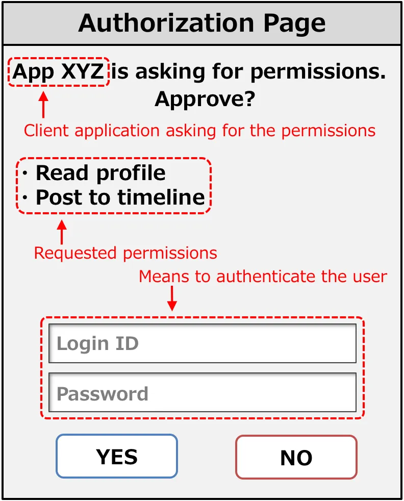

An authorization server implementation has to generate an authorization page like this and show it to the user.

>>The authorization endpoint is used to interact with the resource owner and obtain an authorization grant. The authorization server MUST first verify the identity of the resource owner. The way in which the authorization server authenticates the resource owner (e.g., username and password login, session cookies) is beyond the scope of this specification.

However, because user authentication is included as one step during the authorization process, an authorization server has to implement a mechanism for user authentication.

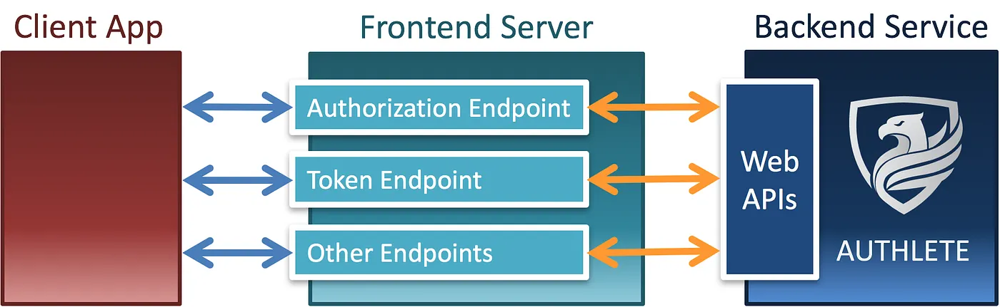

The primary advantage of this architecture is in that the backend service can focus on implementing OAuth 2.0 and OpenID Connect without caring about other components such as identity management, user authentication, login session management, API management and fraud detection. And, consequently, it leads to another major advantage which enables the backend service (implementation of OAuth 2.0 and OpenID Connect) to be combined with any solution of other components and thus gives flexibility to frontend server implementations.

[new-architecture-of-oauth-2-0-and-openid-connect-implementation](https://darutk.medium.com/new-architecture-of-oauth-2-0-and-openid-connect-implementation-18f408f9338d)

TLS works only my protecting the stream of bits in transit. It does not allow for message-level and application-level security operations. But what if we could sign the messages themselves?