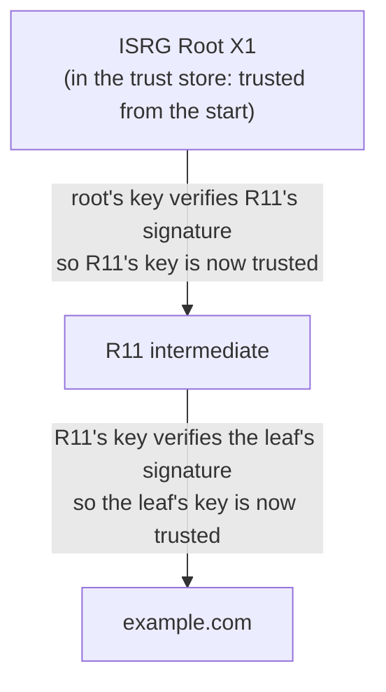

# Cryptography notes

Background notes behind the cryptography Lattice uses. They were in the README; the README now keeps only what's needed to run and understand Lattice. See also [modular-arithmetic.md](modular-arithmetic.md) and [nimbus-crypto-design.md](nimbus-crypto-design.md).

## Keyspace and brute-force resistance

A keyspace is the theoretical set of all keys an algorithm can use. For uniformly random binary keys of length `n` bits, the keyspace contains `2^n` possible keys. A larger keyspace makes exhaustive brute-force search more difficult, assuming keys are generated securely.

- **AES-128:** 2^128 possible keys, roughly 3.4 * 10^38.
- **AES-256:** 2^256 possible keys, roughly 1.1 * 10^77.

Because a 256-bit ECC key provides about the same security as a much larger 3072-bit RSA key (128 bits, per NIST SP 800-57), ECC offers significant performance advantages. For example, ECDSA with the P-256 curve is widely used in TLS and other protocols, providing strong security with smaller key sizes and faster computations.

When a cryptographic library executes an algorithm, the speed depends heavily on whether the operands fit cleanly inside the CPU's hardware registers.

- `ECC 256`: A 256-bit number is relatively small. It fits entirely into just four standard 64-bit CPU registers, or a single 256-bit SIMD register (AVX2's YMM registers). The CPU can execute arithmetic on these numbers using a highly optimized, short pipeline of micro-operations entirely within the CPU core, without constantly hitting the memory bus.
- `RSA 3072`: A 3072-bit integer is massive; it completely exceeds native hardware register capacities. To process it, the CPU must break the number down into an array of forty-eight 64-bit words and perform arbitrary-precision ("BigInteger") arithmetic. Multiplying two 3072-bit numbers requires thousands of CPU cycles, constant load/store instructions to shuttle data back and forth from memory, and heavy utilization of the instruction decoder just to manage the arrays.


`RSA (Modular Exponentiation)`: RSA operations rely on equations like $c \equiv m^e \pmod{n}$. Exponentiating a 3072-bit number requires a process called "repeated squaring and multiplication." Even with algorithmic shortcuts like the Chinese Remainder Theorem, the CPU is forced to perform computationally expensive, multi-word multiplications over and over again until the exponent is resolved.
- `ECC (Elliptic Curve Point Multiplication)`: ECC operations involve finding a point on a curve defined by $y^2 = x^3 + ax + b$. The mathematics of elliptic curves allows for much smaller numbers to be used while still providing equivalent security. At equal security, ECC signing and key generation are much faster than RSA's. Verification is the exception: RSA verifies with the small public exponent 65537, which is cheap, so RSA verification is usually faster than ECDSA verification.


`The mathematics of RSA require the resulting digital signature to be exactly the same size as the cryptographic modulus (the key size)`

- When you sign a token with a 3072-bit RSA key, the algorithm outputs a 3072-bit signature.
- In computer memory, 3072 bits translates to exactly 384 bytes of raw binary data.

An Elliptic Curve signature (like ECDSA used in ES256) consists of two distinct coordinates, commonly referred to as r and s. Each of these coordinates is the size of the curve itself.

- When you sign a token with a 256-bit ECC key, the algorithm outputs two 256-bit numbers, totaling 512 bits.
- In computer memory, 512 bits translates to exactly 64 bytes of raw binary data.

## Keys from passwords: Argon2id

A random 256-bit key can't be guessed, so it is expanded with a fast function such as HKDF. A password comes from a tiny space by comparison: an attacker who has the encrypted data guesses passwords, deriving a key from each guess. A password-based key derivation function makes every guess expensive: one derivation is unnoticeable to the user, but it multiplies the attacker's work by billions. Argon2id (RFC 9106) also makes each guess fill a large block of memory, which removes most of a GPU's advantage. In Lattice, `PasswordHasher` uses it to check sign-in passwords, and `Argon2idKdf` to turn a password into an encryption key.

Where it's used in production:

| Product | What it does |
| --- | --- |
| Bitwarden | Offers Argon2id for deriving the master key since client version 2023.2.0, by default with 64 MiB, 3 passes and 4 lanes. PBKDF2-HMAC-SHA256 with 600,000 iterations remains the default option. |
| LUKS2 (Linux disk encryption) | cryptsetup has made Argon2id the default for new key slots since version 2.4.0. |
| Signal | Stretches a user's PIN with Argon2 before using it in Secure Value Recovery. |

Two limits show up in the same products:
- **Stretching can't save a very weak secret.** Signal also caps guesses, in a secure enclave, because no feasible amount of stretching protects a 4-digit PIN.
- **FIPS.** Argon2 isn't NIST-approved. SUSE builds cryptsetup with PBKDF2 as the LUKS2 default instead, because a disk using Argon2 would be unbootable once the kernel switched to FIPS mode.

Signal also shows the limit of stretching. Its blog says some passwords are so weak that no feasible amount of stretching stops brute force. So Signal adds a second protection: a server-side secure enclave that allows only a few guesses before the data is gone. Stretching makes each guess expensive; only a guess limit protects a 4-digit PIN

Sources: [Bitwarden: KDF algorithms](https://bitwarden.com/en-gb/help/kdf-algorithms/), [cryptsetup 2.4.0 release notes](https://www.kernel.org/pub/linux/utils/cryptsetup/v2.4/v2.4.0-ReleaseNotes), [Signal: secure value recovery](https://signal.org/blog/secure-value-recovery/).


## The pattern
1. Data key: a random key that encrypts the actual data, such as the disk, the file or the database rows.
2. Key-encryption key: a second key that encrypts ("wraps") the data key. The wrapped data key is stored next to the data.
To read the data, you first unwrap the data key with the key-encryption key, then decrypt the data with the data key.

```sh
data ──encrypted with──► data key ──wrapped by──► key-encryption key
                                                   (where does this come from?)
```


### Where the KEK comes from

A KMS is only one way to hold the KEK. Envelope encryption works the same with any KEK, and the products below differ only in where it comes from:

| | Key-encryption key | Who can unwrap |
| --- | --- | --- |
| LUKS | Derived from your passphrase with Argon2id | Anyone who knows the passphrase |
| Apple data protection | Derived from your passcode, mixed with a key fused into the device's hardware | Someone with the passcode, on that device |
| AWS KMS / Google Cloud KMS | A key generated inside the KMS, in hardware security modules. It never leaves. | Anyone the KMS's access policy allows to call "decrypt" |

With a passphrase, the KEK is something you know, turned into a key by a password-based key derivation function. With a KMS, it's something a service holds, and access depends on who you are to that service. The benefits below come from the pattern, whichever KEK is used. For example, LUKS stores one wrapped copy of the volume key per passphrase, so changing a passphrase rewrites one small key slot, not the disk.

Argon2id takes a password, a salt and cost settings, and outputs a fixed number of pseudorandom bytes. You choose the length, commonly 32 bytes. The specification (RFC 9106) calls this output a tag, and describes Argon2 as both a password hashing function and a key derivation function (KDF).

```sh
Argon2id(password, salt, m=19456, t=2, p=1, length=32)  →  32 random-looking bytes
```
## Used as a key: encrypting with a password
Example: an encrypted backup or password-manager vault that only the user's password can open.
```sh
key = Argon2id(password, salt, m, t, p, length=32)    ← exactly 32 bytes = an AES-256 key
ciphertext = AES-256-GCM(key, data)
store: salt + settings + ciphertext                   ← the key itself is NEVER stored
```

- You never store the output. You recompute it from the password each time.
- It's used directly as an encryption key. A wrong password gives a different key, so the GCM auth tag check fails

Argon2id itself only outputs raw bytes. The $argon2id$… string is built afterwards by code, by joining the parts into a standard text layout called the PHC string format.

Some libraries build the string for you, such as the C reference library, password4j and Spring Security's `Argon2PasswordEncoder`. Others, like Bouncy Castle, only return the raw bytes and leave the formatting to you. Your Lattice project uses Bouncy Castle, so it builds the string itself
```sh
byte[] salt = new byte[SALT_BYTES];          // 1. 16 random bytes
RANDOM.nextBytes(salt);

byte[] hash = argon2(ARGON2_id, ARGON2_VERSION_13,   // 2. raw Argon2id output: 32 bytes
        memoryKib, iterations, parallelism, salt, HASH_BYTES, password);

return "$argon2id$v=19$m=" + memoryKib + ",t=" + iterations + ",p=" + parallelism   // 3. glue it together
     + "$" + BASE64.encodeToString(salt)
     + "$" + BASE64.encodeToString(hash);
```

```sh
$argon2id $v=19 $m=19456,t=2,p=1 $Q9cF7Mm8oZnGIhV+rpOk/w $nzkxl54lCGjQeQIYviXqRY5BQPT586xWoU/eTwAo2c4
 │         │     │                 │                       │
 │         │     │                 │                       └─ 5. the 32-byte Argon2id output, Base64
 │         │     │                 └─ 4. the 16-byte random salt, Base64
 │         │     └─ 3. the cost settings used: memory KiB, passes, lanes
 │         └─ 2. algorithm version 1.3, written as decimal 19 (= 0x13)
 └─ 1. which Argon2 variant
```

```sh
byte[] salt = /* 16 bytes you choose and store */;
Argon2Function f = Argon2Function.getInstance(19456, 2, 1, 32, Argon2.ID);  // m, t, p, output length, variant
Hash h = Password.hash("correct horse").addSalt(salt).with(f);

h.getResult();         // "$argon2id$v=19$m=19456,t=2,p=1$ABEiM0RV...$ggG5eVD9..."  ← PHC string, for storing
h.getBytes();          // 32 raw bytes: 8201b979...d1ab                            ← usable as an AES-256 key
h.getResultAsBytes();  // 97 bytes                                                   ← the PHC string's bytes, NOT a key
```

`SecretKey key = new SecretKeySpec(h.getBytes(), "AES");`

```java
 private String encodeHash(byte[] hash, byte[] salt)
{
return "$argon2" + variant.name()
.toLowerCase() + "$v=" + version + "$m=" + memory + ",t=" + iterations + ",p=" + parallelism + "$"
+ Utils.encodeBase64(salt, false) + "$"
 + Utils.encodeBase64(hash, false);
}
```
## The Base64Url Encoding Penalty

JWTs cannot be transmitted over HTTP as raw binary; they must be encoded into text using Base64Url. Base64Url encoding expands the size of binary data by roughly 33%. This is where the size difference explodes and severely impacts your server's HTTP traffic

## Elliptic curve keys: how they work

### The curve

An elliptic curve over a prime field is the set of points $(x, y)$ that satisfy

$$
y^2 \equiv x^3 + ax + b \pmod{p}
$$

The symbol $\equiv$ means "congruent": their difference is a multiple of $p$. Equivalently, both sides leave the same remainder from $0$ to $p - 1$ when divided by $p$. It is used instead of $=$ because the two sides usually only match after wrapping around $p$. For example, $6^2 = 36$, and $36 \equiv 2 \pmod{17}$ because $36 - 2 = 34$ is a multiple of 17.

**Formal definition.** Let $a, r, m \in \mathbb{Z}$ with $m > 0$. We write

$$
a \equiv r \pmod{m}
$$

if $m$ divides $a - r$, written $m \mid (a - r)$. In the example, $17 \mid (36 - 2)$ because $34 = 2 \times 17$. This is the same as saying $a$ and $r$ leave the same remainder from $0$ to $m - 1$ when divided by $m$.

**The remainder is not unique.** Any $r$ that differs from 2 by a multiple of 17 works too, so $36 \equiv 2 \equiv 19 \equiv -15 \pmod{17}$: $36 - 19 = 17$ and $36 - (-15) = 51 = 3 \times 17$. When a single value is wanted, the convention is the one from $0$ to $m - 1$, written $36 \bmod 17 = 2$.

Every coordinate is an integer from $0$ to $p - 1$. The curve also has one extra point, the **point at infinity** $\mathcal{O}$.

The points on the curve, together with the point at infinity, form a **group** under the addition rule. A group is closed: adding any two members gives another member. $\mathcal{O}$ is the group's zero: adding it to any point leaves that point unchanged.

### Adding points

Points can't be added by adding their coordinates. Over the real numbers the curve looks like a smooth, sideways bell, and addition is geometric. To compute $G + G = 2G$:

1. Draw the tangent line that touches the curve at $G$.
2. Extend it until it meets the curve again.
3. Reflect that point across the x-axis. The reflected point is $2G$.

To get $3G = 2G + G$, draw the line through $2G$ and $G$, find where it meets the curve, and reflect. In general, $P + Q$ is the reflection of the third point on the line through $P$ and $Q$.

Over a prime field the same rule is written with the line's slope $\lambda$, all mod $p$:

$$
\lambda = \frac{y_2 - y_1}{x_2 - x_1} \quad \text{(two different points)} \qquad
\lambda = \frac{3x_1^2 + a}{2y_1} \quad \text{(doubling)}
$$

$$
x_3 = \lambda^2 - x_1 - x_2 \qquad y_3 = \lambda(x_1 - x_3) - y_1
$$

On the toy curve below, doubling $G = (5, 1)$ gives $\lambda = 77 / 2 \equiv 13$, then $x_3 = 6$ and $y_3 = 3$: so $2G = (6, 3)$.

$k \times G$ means $G$ added to itself $k$ times. Nobody does $k$ additions: double-and-add reaches $k \times G$ in about $2 \log_2 k$ steps, by doubling and adding according to the bits of $k$.

### Why the modulus must be prime

The curve's addition rule divides: the slope of the line through two points is $\frac{y_2 - y_1}{x_2 - x_1}$. Modular arithmetic has no division, so "dividing by $a$" means multiplying by the **inverse** of $a$: the number $a^{-1}$ with $a \times a^{-1} \equiv 1 \pmod{p}$. When $p$ is prime, every non-zero number has an inverse. When it isn't, some don't.

**The trap of composite numbers.** Take a non-prime modulus such as 6. The numbers are 0 to 5. To find the inverse of 2, we need an $x$ with $2 \times x \equiv 1 \pmod{6}$:

| $x$ | $2 \times x$ | $\bmod 6$ |
| --: | --: | --: |
| 1 | 2 | 2 |
| 2 | 4 | 4 |
| 3 | 6 | **0** |
| 4 | 8 | 2 |
| 5 | 10 | 4 |

- **No inverse.** $2 \times x$ never equals 1, because 2 shares a factor with 6. So 2 has no inverse, and nothing can be divided by 2.
- **A zero divisor.** Worse, $2 \times 3 \equiv 0$: two non-zero numbers multiply to zero. Information is lost (you can't tell what was multiplied by 2 to get 0), equations that rely on division have no answer, and the curve's addition rule stops working. This breaks the algorithm itself, not just an attacker's attempts.

**The prime guarantee.** Now use a prime modulus such as 7. The numbers are 0 to 6. Find the inverse of 2 again:

| $x$ | $2 \times x$ | $\bmod 7$ |
| --: | --: | --: |
| 1 | 2 | 2 |
| 2 | 4 | 4 |
| 3 | 6 | 6 |
| 4 | 8 | **1** |

The inverse of 2 is 4. This isn't luck: a prime has no divisors other than 1 and itself, so no number from 1 to $p - 1$ shares a factor with it. That guarantees:

- every non-zero number has exactly one inverse, so division always works;
- no two non-zero numbers multiply to zero, so nothing collapses.

This holds for 7 and equally for the 256-bit prime behind P-256 (`secp256r1`). That is why the modulus of a curve is always prime: it keeps the addition rule, and with it the one-way function, well defined for every point.

### A toy example

Take

$$
y^2 \equiv x^3 + 2x + 2 \pmod{17}
$$

For each $x$ from 0 to 16, compute the right side and look for $y$ values whose square matches it. For $x = 0$ the right side is 2, and $6^2 \equiv 2$ and $11^2 \equiv 2$, so $(0, 6)$ and $(0, 11)$ are on the curve. Solutions come in pairs: $11 = 17 - 6$, and in general if $y$ is a solution then so is $p - y$.

```
x=0  → 2   → y = 6, 11
x=1  → 5   → none
x=2  → 14  → none
x=3  → 1   → y = 1, 16
x=4  → 6   → none
x=5  → 1   → y = 1, 16    ← G = (5, 1) is here
x=6  → 9   → y = 3, 14
x=7  → 2   → y = 6, 11
x=8  → 3   → none
x=9  → 1   → y = 1, 16
x=10 → 2   → y = 6, 11
x=11 → 12  → none
x=12 → 3   → none
x=13 → 15  → y = 7, 10
x=14 → 3   → none
x=15 → 7   → none
x=16 → 16  → y = 4, 13
```

Nine values of $x$ give two points each, so 18 points. With the point at infinity, the curve has **19 points**.

### Keys

Pick a fixed public point $G$, the **generator**. A key pair is

$$
P = k \times G
$$

where $k$ is a random integer (the **private key**) and $P$ is a point (the **public key**). Multiplying means adding $G$ to itself $k$ times with the curve's addition rule. $P$ can be published, for example in a JWKS; $k$ never leaves its owner.

On the toy curve with $G = (5, 1)$:

| $k$ | $k \times G$ | | $k$ | $k \times G$ |
| --: | :-- | --- | --: | :-- |
| 1 | $(5, 1)$ | | 11 | $(13, 10)$ |
| 2 | $(6, 3)$ | | 12 | $(0, 11)$ |
| 3 | $(10, 6)$ | | 13 | $(16, 4)$ |
| 4 | $(3, 1)$ | | 14 | $(9, 1)$ |
| 5 | $(9, 16)$ | | 15 | $(3, 16)$ |
| 6 | $(16, 13)$ | | 16 | $(10, 11)$ |
| 7 | $(0, 6)$ | | 17 | $(6, 14)$ |
| 8 | $(13, 7)$ | | 18 | $(5, 16)$ |
| 9 | $(7, 6)$ | | 19 | $\mathcal{O}$ |
| 10 | $(7, 11)$ | | | |

The list reaches the point at infinity at $19 \times G$ and then repeats, so 19 is the **order** of $G$. Because 19 is prime, $G$ visits every point on the curve once. Look at the $x$ values: 5, 6, 10, 3, 9, 16, 0, 13, ... They jump around with no visible pattern.

- **The point at infinity.** When $k$ is a multiple of the order, you get infinity (on the toy curve, $19 \times G = \mathcal{O}$). That is still a valid group element, but not a usable public key. Real private keys are chosen in the range $1$ to $n - 1$, so this never happens for them.
- **Wrapping.** After $19 \times G = \mathcal{O}$, the sequence repeats: $20 \times G = G$. So $k$ and $k + 19$ give the same point, which is why private keys are taken mod the order $n$.

### Why $k$ is hard to recover

**The trapdoor is the finite field.** Over the real numbers, the bouncing and reflecting could be traced backwards: points that are close stay close, so you could measure where the path went. Cryptography computes everything mod a large prime instead. Like clock arithmetic (10:00 plus 4 hours is 2:00, not 14:00), every value wraps around $p$: it is replaced by its remainder mod $p$, which is called **modular reduction**. Two things follow:

- the smooth curve becomes a scatter of seemingly random dots on a $p \times p$ grid, as the toy table shows;
- each time a value passes $p$ it wraps to the other side, so nearby points no longer stay near each other.

Given $G$ and a public point $P$, you see two dots in what looks like random static. The path between them isn't a line, and nothing records how many times it wrapped.

- **Forward is fast.** Double-and-add computes $k \times G$ with about 256 doublings and about 128 additions for a 256-bit $k$, which takes microseconds.
- **Backward is a search.** Given $P$ and $G$, nothing about $P$'s coordinates tells you how many additions produced it. There is no ordering or distance on the curve, and wrapping around $p$ scrambles any pattern. Finding $k$ is the **Elliptic Curve Discrete Logarithm Problem (ECDLP)**.
- **The best known attack** (Pollard's rho) takes about $\sqrt{n}$ steps, where $n$ is the order of $G$. For a 256-bit curve that is about $2^{128}$ steps, which is infeasible.
- **This is an assumption, not a proof.** No faster classical attack is known for well-chosen curves, but a large quantum computer running Shor's algorithm would break ECDLP. That is why post-quantum algorithms such as ML-KEM and ML-DSA are being standardized.

The naive attack computes $2G$, $3G$, $4G$, ... and compares each to $P$. On the toy curve that finishes after at most 18 tries. On P-256 the list has about $2^{256} \approx 1.2 \times 10^{77}$ entries, close to the number of atoms in the observable universe (about $10^{80}$). Even the best attack, at $2^{128}$ steps, is far out of reach.

### Real curves: P-256

P-256 (also called `secp256r1`, the curve behind `ES256` JWTs) has a prime $p$ of 256 bits and a generator $G$ whose order $n$ is about $2^{256}$. The private key is a random $k$ from $1$ to $n - 1$, and the public key is $k \times G$. With Pollard's rho costing about $2^{128}$ steps, P-256 is rated at **128-bit security**, comparable to AES-128 and RSA-3072, with far smaller keys and faster operations than RSA.

### ECDH: agreeing on a shared secret

Two parties, A and B, can agree on a secret over an open network without ever sending it.

1. **Generate key pairs.** Each picks a private scalar and computes its public point on the same curve:

   $$
   P_A = k_A \times G \qquad P_B = k_B \times G
   $$

2. **Exchange public keys.** An eavesdropper sees $P_A$, $P_B$, the curve and $G$, but can't recover $k_A$ or $k_B$ (ECDLP).
3. **Compute the shared secret.** Each side multiplies the *other's* public key by its *own* private scalar:

   $$
   S = k_A \times P_B = k_B \times P_A = (k_A k_B) \times G
   $$

4. **Validate the peer's key first.** Before step 3, an implementation must check that the received point is on the curve, in range and not the identity element, or an attacker can send a bad point to leak bits of $k$. The JDK does this in `ECDHKeyAgreement` (NIST SP 800-56A full public-key validation). For X25519 it rejects an all-zero result (`XDHKeyAgreement`: "Point has small order").

**Authentication is a separate problem.** Unauthenticated ECDH is open to a man-in-the-middle who substitutes their own public keys. TLS prevents this by having the server sign its handshake with its certificate key. The signature proves who sent the public key, not the key agreement itself.

### Why the shared secret isn't uniformly random

An encryption key should be **uniform**: every possible bit string equally likely.

**What uniform means, with a 2-bit key.** Each bit is 0 or 1, so 2 bits give $2 \times 2 = 2^2 = 4$ patterns:

| Bits | Value | Probability |
| :-: | :-: | :-: |
| `00` | 0 | $\frac{1}{4}$ |
| `01` | 1 | $\frac{1}{4}$ |
| `10` | 2 | $\frac{1}{4}$ |
| `11` | 3 | $\frac{1}{4}$ |

- **The count:** the values run from $0$ to $3$, which is $2^2 - 1$. Counting starts at 0, so the largest value is one less than the number of values.
- **The probability:** uniform means each pattern is equally likely, so each gets an equal share of the total probability, 1: $\frac{1}{4} = 2^{-2}$. The four shares add up to $4 \times \frac{1}{4} = 1$, because the key is always one of them.

**The same rule for any length.** An $n$-bit key has $2^n$ patterns, with values from $0$ to $2^n - 1$, each with probability $\frac{1}{2^n} = 2^{-n}$:

| Bits | Patterns | Values | Probability of each |
| --: | --: | :-- | :-- |
| 2 | $2^2 = 4$ | 0 to 3 | $2^{-2} = 0.25$ |
| 8 (one byte) | $2^8 = 256$ | 0 to 255 | $2^{-8} \approx 0.004$ |
| 256 | $2^{256} \approx 1.2 \times 10^{77}$ | 0 to $2^{256} - 1$ | $2^{-256} \approx 8.6 \times 10^{-78}$ |

**As a formula.** A key generated with true randomness follows a uniform distribution: every outcome in the sample space, here every 256-bit string, is exactly as likely as any other. The probability of one specific string $x$ is one outcome divided by the number of possible outcomes:

$$
P(x) = \frac{1}{2^{256}} = 2^{-256}
$$


A random 256-bit key is the last row: an attacker's best guess is right with probability $2^{-256}$, whichever value they pick, because no value is more likely than another. That's the assumption the security proofs make about keys.

**The ECDH shared secret isn't like that.** Some 256-bit values can never occur, so the others are more likely than $2^{-256}$, and an attacker who knows which values are impossible can skip them. It's the x-coordinate of a point on the curve, $S = (k_A k_B) \times G$, and that has **structure**: it must obey mathematical rules that anyone can check, which a random string obeys only by chance.

A valid credit card number is the everyday example. Its last digit is a check digit computed from the others (the Luhn formula), so anyone can tell whether 16 digits could be a real card number. Most random strings of digits fail the check; real card numbers always pass. The check digit doesn't reveal anyone's card, but it makes card numbers recognisably non-random. The ECDH secret is the same: an outsider can't compute *which* value it is (the Diffie-Hellman assumption), but it always belongs to a recognisable set of values, smaller than all 256-bit strings. Three rules make that set smaller:

**1. Only about half of all numbers are x-coordinates.** A value $x$ appears only if $x^3 + ax + b$ has a square root modulo $p$, which holds for about half of the numbers. The [toy curve](#a-toy-example) above shows it:

| $x$ values that occur | $x$ values that never occur |
| --- | --- |
| 0, 3, 5, 6, 7, 9, 10, 13, 16 | 1, 2, 4, 8, 11, 12, 14, 15 |

A shared secret on that curve is never 1, 2 or 4. On P-256 the same holds at scale: about half of all 256-bit values can never be the output.

**Where the square root comes from.** It comes from the curve equation itself. A point $(x, y)$ is on the curve when

$$
y^2 \equiv x^3 + ax + b \pmod{p}
$$

Pick an $x$, and the right side becomes a number. Call it $r = x^3 + ax + b$. The equation becomes

$$
y^2 \equiv r \pmod{p}
$$

For a point with that $x$ to exist, you need a $y$ whose square leaves the same remainder as $r$ when divided by $p$. That $y$ is a **square root of $r$ modulo $p$**. If none exists, no point on the curve has that $x$, so it can never be a shared secret.

**Two different "mod"s.** This section writes "mod" in two ways, and they mean different things:

| Written | What kind of thing | Read it as | Gives |
| --- | --- | --- | --- |
| $36 \bmod 17$ | An **operation**, like $+$ or $\times$ | "the remainder when 36 is divided by 17" | One number: $2$ |
| $36 \equiv 2 \pmod{17}$ | A **statement**, like $=$ | "36 and 2 leave the same remainder when divided by 17" | True or false: true |

- **The operation** answers "what's the remainder?": $36 \bmod 17 = 2$, $121 \bmod 17 = 2$, $35 \bmod 17 = 1$. It makes a number smaller.
- **The statement** compares two numbers. $36 \equiv 2 \pmod{17}$ is true, because both leave remainder 2; put another way, $36 - 2 = 34 = 2 \times 17$. But $36 \equiv 3 \pmod{17}$ is false.
- **In the statement, "(mod 17)" belongs to the $\equiv$ sign,** not to the number beside it. It qualifies the whole comparison: "equal, as far as remainders after dividing by 17 go". A clock works the same way: on a 12-hour clock, 14:00 and 2:00 are the same time.

**The curve equation is a statement.** $y^2 \equiv x^3 + ax + b \pmod{p}$ says $y^2$ and $x^3 + ax + b$ leave the same remainder. Neither side has to be reduced first: $y^2$ can be 36 while the right side is 2. That's why $r = x^3 + ax + b$ needs no "mod" of its own; the statement already takes care of it.

**The operation appears when we simplify.** The table's column $r \bmod 17$, and the attacker's check below, compute a remainder to get a small number to compare with the list of quadratic residues. That's an operation used inside a statement, and it's harmless, because reducing a number never changes its remainder: $r \equiv (r \bmod p) \pmod{p}$, always. So $y^2 \equiv r$ and $y^2 \equiv (r \bmod p)$ have exactly the same solutions. For $x = 3$, $y^2 \equiv 35$ and $y^2 \equiv 1 \pmod{17}$ are the same question, since $35 \equiv 1$.

So when "mod" appears twice, it's always one statement (comparing remainders) with an operation inside it (making a number smaller to work with). The operation never changes the statement's answer.

**What $y^2 \equiv 2 \pmod{17}$ asks** (the toy curve below, at $x = 0$). Find a $y$ from 0 to 16 whose square leaves remainder 2 when divided by 17, or equivalently, where $y^2 - 2$ is a multiple of 17. Trying values:

| $y$ | $y^2$ | $y^2 \bmod 17$ |
| --: | --: | --: |
| 5 | 25 | 8 |
| 6 | 36 | 2 ✓ |
| 7 | 49 | 15 |
| 11 | 121 | 2 ✓ |

So $y = 6$ and $y = 11$, because $36 - 2 = 34 = 2 \times 17$ and $121 - 2 = 119 = 7 \times 17$. That gives the points $(0, 6)$ and $(0, 11)$.

**$x = 0$ on any curve.** Plug $x = 0$ into $y^2 \equiv x^3 + ax + b \pmod{p}$, and the $x^3$ and $ax$ terms vanish, leaving

$$
y^2 \equiv b \pmod{p}
$$

So a curve has a point with $x = 0$ only if its constant $b$ is a quadratic residue modulo $p$:
- **If $b$ is a residue,** its two square roots give the points $(0, y)$ and $(0, p - y)$. On the toy curve, $b = 2$ is a residue modulo 17, hence $(0, 6)$ and $(0, 11)$.
- **If $b$ is a non-residue,** no point has $x = 0$, so 0 can never be a shared secret on that curve.

Bitcoin's secp256k1 is an example of the second case. Its equation is $y^2 \equiv x^3 + 7 \pmod{p}$, with $p = 2^{256} - 2^{32} - 977$, so the question is whether 7 is a residue. Euler's criterion answers it: $b^{(p-1)/2} \bmod p$ is 1 for a residue and $p - 1$ for a non-residue. For $b = 7$ it's $p - 1$. So $y^2 \equiv 7$ has no solution, and secp256k1 has no point with $x = 0$. (Checked by computing it. Because $p \bmod 4 = 3$, the only candidate square root is $7^{(p+1)/4} \bmod p$, and squaring it doesn't give 7.)

Modulo a prime, many numbers have no square root, just as $-1$ has no square root among the real numbers. On the toy curve $y^2 \equiv x^3 + 2x + 2 \pmod{17}$:

| $x$ | $r = x^3 + 2x + 2$ | $r \bmod 17$ | Square root of $r$ modulo 17? | Points |
| --: | --: | --: | --- | --- |
| 0 | 2 | 2 | yes: $6^2 = 36 \equiv 2$, and $11^2 = 121 \equiv 2$ | $(0, 6)$, $(0, 11)$ |
| 1 | 5 | 5 | none | none |
| 2 | 14 | 14 | none | none |
| 3 | 35 | 1 | yes: $1^2 = 1$, and $16^2 = 256 \equiv 1$ | $(3, 1)$, $(3, 16)$ |

The numbers with a square root modulo 17, the **quadratic residues**, are 0, 1, 2, 4, 8, 9, 13, 15 and 16. Compare $r \bmod 17$ with that list: 5 and 14 aren't on it, so $x = 1$ and $x = 2$ never appear.

**Why about half.** Square every number from 1 to 16 modulo 17. Each square comes out exactly twice, because $y$ and $p - y$ have the same square:

$$
(p - y)^2 = p^2 - 2py + y^2 \equiv y^2 \pmod{p}
$$

For example, $6^2 \equiv 11^2 \equiv 2$. So the 16 non-zero numbers produce only 8 different squares, exactly half: in general, $\frac{p - 1}{2}$ of the $p - 1$ non-zero numbers. The other half have no square root: they are the **quadratic non-residues**. This is the check an attacker can run on any guess: compute $x^3 + ax + b \bmod p$, and if it's a non-residue, that $x$ can't be a point, so it was never a shared secret. Since $r$ behaves much like a random number as $x$ varies, about half the x-values give a square and the other half give none. That pairing is also cause 3 below: $(x, y)$ and $(x, p - y)$ are the two square roots of the same $r$.

**2. The values stop below $p$, not at a power of 2.** Coordinates run from $0$ to $p - 1$:
- **P-256:** $p = 2^{256} - 2^{224} + 2^{192} + 2^{96} - 1$, about $2^{256}(1 - 2^{-32})$. The values from $p$ to $2^{256} - 1$ never appear: a tiny bias, but a real one.
- **X25519:** $p = 2^{255} - 19$, written in 32 bytes, so the output's top bit is always 0.

**3. $+y$ and $-y$ share an x-coordinate.** Each x-coordinate comes from two points, $(x, y)$ and $(x, p - y)$, so there are about half as many possible secrets as points: about 255 bits of unpredictability, spread unevenly over 256-bit strings.

Classic Diffie-Hellman, $g^{ab} \bmod p$, is uneven in the same ways. How much depends on the group:
- **Safe primes,** $p = 2q + 1$ with $q$ prime, such as the RFC 7919 groups TLS 1.3 uses: $g$ generates the subgroup of order $q$, which is exactly the quadratic residues, half of all values. Every output is a quadratic residue, and anyone can test that with the Legendre symbol. It's a property of the whole number, not a pattern in particular bits.
- **Groups with a small prime subgroup,** such as DSA-style groups with a 256-bit $q$ inside a 2048-bit $p$: the output lies in a subgroup that is a tiny fraction of the values below $p$ (about $2^{256}$ of $2^{2048}$).
- **Values below $p$:** RFC 7919's primes have their top 64 bits set to 1, so the values above $p$ are a fraction of about $2^{-64}$. Tiny, like P-256's.

Each of these removes about a bit of unpredictability or less. Nothing about a particular key leaks, but the output is distinguishable from random, which is what the security proofs rule out.

**Why it matters.** The proofs for AES-GCM, ChaCha20-Poly1305 and HMAC assume a uniformly random key. A key that is merely hard to compute, with visible structure, doesn't meet that assumption, even when no practical attack follows from it. So the shared secret goes through **HKDF-Extract** (RFC 5869), which compresses an input that is unpredictable but unevenly distributed into a uniform-looking key (a "randomness extractor"). From 255 bits of unpredictability, a 256-bit key loses almost nothing. The result is pseudorandom: no feasible computation can tell it apart from uniform, although strictly it isn't uniform. The standards require this step:
- **NIST SP 800-56A** requires a key-derivation function on the shared secret.
- **RFC 7748,** which defines X25519, says the same.
- **TLS 1.3** feeds it into its HKDF key schedule (below).
- **JWE's `ECDH-ES`** (RFC 7518 §4.6), used for encrypted tokens, runs it through the Concat KDF from NIST SP 800-56A instead of HKDF. Same job, older construction.

### Deriving the traffic keys

The raw result of ECDH isn't used directly as an encryption key. By the standard it is the x-coordinate of $S$ (or the u-coordinate for X25519), which [isn't uniformly random](#why-the-shared-secret-isnt-uniformly-random). It is fed into a key-derivation function:

- **TLS 1.3:** HKDF (HMAC-based), mixed with a hash of the handshake transcript. This gives separate keys for each direction and purpose.
- **TLS 1.2:** the TLS PRF (also HMAC-based), which first makes a master secret.

The outputs are symmetric keys for an AEAD cipher such as AES-GCM or ChaCha20-Poly1305. After that, both sides use fast symmetric encryption for the data.

### The TLS 1.3 key schedule

How TLS 1.3 turns the ECDHE shared secret into the keys it encrypts with (RFC 8446 §7.1), and where the JDK does each step. The JDK excerpts are from `sun.security.ssl`; line numbers are JDK 25's.

#### Both sides derive the same keys

```sh
ECDHE shared secret  ──┐
                       ▼
  HKDF-Extract(salt, shared secret)  =  handshake secret      (both sides compute the same)
                       │
         HKDF-Expand with label, mixed with the transcript hash
          ┌────────────┴─────────────┐
   "c hs traffic"             "s hs traffic"                  ← different secrets
          │                          │
   client→server key/iv       server→client key/iv           ← different keys
```

After the key exchange, client and server hold the same inputs:
- The shared secret $Z$, the same on both sides.
- The salt and labels, fixed by the protocol.
- In TLS 1.3, a hash of the handshake messages, which both sides have seen.

HKDF is deterministic, so both compute the same result:

```sh
Client:  Z ──HKDF-Extract──► PRK ──HKDF-Expand("c hs traffic")──► client key ┐
                                  └─HKDF-Expand("s hs traffic")──► server key │ identical
Server:  Z ──HKDF-Extract──► PRK ──HKDF-Expand("c hs traffic")──► client key │ on both
                                  └─HKDF-Expand("s hs traffic")──► server key ┘ sides
```

The output is completely different from $Z$, and different for each label, but the same on both sides for the same label.

#### The whole schedule

```sh
 ══►  HKDF-Extract: builds the chain, one per stage
 ──►  HKDF-Expand: label → derived secret
 [ ]  root secret: only ever the key for expands, never used directly
 { }  working keys: what actually encrypts or MACs

 PSK or zeros ══IKM══► [ EARLY SECRET ] ◄── salt: zeros
                              ├──► "ext binder" / "res binder" → binder key ──► {binder MAC key}   PSK only
                              ├──► "c e traffic"  → client early traffic ──► {key, iv}               0-RTT only
                              ├──► "e exp master" → early exporter secret                            PSK only
                              │
                              └──► "derived"      → salt₁
                                                    │ salt
 ECDHE secret ══IKM══► [ HANDSHAKE SECRET ] ◄───────┘
 (zeros in psk_ke)            ├──► "c hs traffic" → client handshake traffic ──► {key, iv, finished key}
                              ├──► "s hs traffic" → server handshake traffic ──► {key, iv, finished key}
                              │
                              └──► "derived"      → salt₂
                                                    │ salt
 zeros ═════════IKM══► [ MASTER SECRET ] ◄──────────┘
                              ├──► "c ap traffic" → client application traffic ──► {key, iv}
                              ├──► "s ap traffic" → server application traffic ──► {key, iv}
                              ├──► "exp master"   → exporter secret
                              └──► "res master"   → resumption secret ──► one PSK per ticket
```

- **Binder labels:** `"ext binder"` is for an external PSK (set up outside TLS), and `"res binder"` for a resumption PSK.
- **The handshake stage's IKM** is the ECDHE secret, except in `psk_ke` mode (a PSK with no key exchange), where it is zeros.
- **Next connection's PSK:** the resumption secret isn't used directly. Each ticket's PSK is `HKDF-Expand-Label(resumption secret, "resumption", ticket_nonce, Hash.length)`.

The three Extract stages:

```sh
stage             salt (from previous)        IKM (new input)
early secret      zeros                       PSK, or zeros if none
handshake secret  derived(early secret)       ECDHE shared secret (zeros in psk_ke)
master secret     derived(handshake secret)   zeros          ← nothing new to add
```

Each stage's salt slot holds what was carried forward from the previous stage, and the IKM slot holds what's new.

The roles of each secret:

| Secret | Created by | Then used as |
| --- | --- | --- |
| PSK | outside, or a ticket | IKM of early extract |
| early secret | Extract(zeros, PSK/zeros) | expand key → derived gives `salt₁` |
| ECDHE secret | key agreement | IKM of handshake extract |
| handshake secret | Extract(salt₁, ECDHE) | expand key → `c/s hs traffic`, and `derived` gives `salt₂` |
| master secret | Extract(salt₂, zeros) | expand key → app, exporter and resumption secrets |

#### Why the master stage's IKM is zeros

`HKDF-Extract(salt = derived-from-handshake-secret, IKM = zeros)`. The ECDHE shared secret was already folded in at the handshake-secret stage, so the master secret's input is all zeros. It still depends on the ECDHE secret through the salt.

The early and handshake stages each bring in fresh input. The master stage has none. The ECDHE secret is already inside the handshake secret, and the master secret inherits it through the salt. The RFC keeps the same shape for all three, so the master stage uses a block of zeros as a placeholder, as long as the hash output (`new byte[hashAlg.hashLength]`).

HKDF-Extract is `PRK = HMAC(salt, IKM)`, with the salt as the HMAC key. The entropy here is in the salt, which is derived from the handshake secret, and so from the ECDHE secret. Zeros as the message don't reduce that. An attacker without the salt can't compute the PRK, whatever the message is.

```sh
early secret     ──kd.deriveKey("TlsSaltSecret")──►  salt₁ ─┐
                                                            ├─► Extract(salt₁, ECDHE secret) = handshake secret
                                                  ECDHE ────┘

handshake secret ──kd.deriveKey("TlsSaltSecret")──►  salt₂ ─┐
                                                            ├─► Extract(salt₂, zeros) = master secret
                                                  zeros ────┘
```

#### Stage 1: the early secret

```sh
no PSK:    early secret = HKDF-Extract(salt = zeros, IKM = zeros)
with PSK:  early secret = HKDF-Extract(salt = zeros, IKM = PSK)
```

The salt is always zeros, because there is no earlier stage to derive one from. Only the IKM changes. In both cases "zeros" means a block of zero bytes as long as the hash output (32 for SHA-256, 48 for SHA-384).

*No PSK (`KAKeyDerivation.deriveHandshakeSecret`)*:

```java
if (kd == null) {   // No PSK is in use.
    // If PSK is not in use, Early Secret will still be
    // HKDF-Extract(0, 0).
    byte[] zeros = new byte[hashAlg.hashLength];
    earlySecret = hkdf.deriveKey("TlsEarlySecret",
            HKDFParameterSpec.ofExtract().addSalt(zeros)
            .addIKM(zeros).extractOnly());
```

*With a PSK (`ServerHello.java`)*:

```java
SecretKey earlySecret = hkdf.deriveKey("TlsEarlySecret",
        HKDFParameterSpec.ofExtract().addIKM(psk)
        .addSalt(new byte[hashAlg.hashLength]).extractOnly());
```

- **Without a PSK,** the early secret is a public constant. Everyone computes the same value for a given hash, and it carries no secret. That's fine, because the real secret (ECDHE) enters at the next stage.
- **With a PSK** (session resumption, or a pre-shared key set up outside TLS), the early secret is secret, and the PSK flows into every later key through the salts. With `psk_dhe_ke`, ECDHE is added at the handshake stage too, so the keys depend on both.

#### Stage 2: the handshake secret

1. Compute the ECDHE shared secret.
2. Early secret, then salt₁, then the handshake secret.

*`KAKeyDerivation.deriveHandshakeSecret`*, annotated:

```java
SSLKeyDerivation kd = context.handshakeKeyDerivation;
try {
    if (kd == null) {   // No PSK is in use.
        // Early Secret = HKDF-Extract(0, 0)
        byte[] zeros = new byte[hashAlg.hashLength];
        KDF hkdf = KDF.getInstance(hashAlg.hkdfAlgorithm);
        earlySecret = hkdf.deriveKey("TlsEarlySecret",
                HKDFParameterSpec.ofExtract().addSalt(zeros)
                .addIKM(zeros).extractOnly());
        kd = new SSLSecretDerivation(context, earlySecret);
    }

    // salt₁ = Expand-Label(early secret, "derived", Hash(""))
    saltSecret = kd.deriveKey("TlsSaltSecret");

    // handshake secret = HKDF-Extract(salt₁, ECDHE)
    // NOTE (the JDK's own): do not reuse the HKDF object for "TlsEarlySecret" for
    // the handshake secret key derivation (below) as it may not
    // work with the "sharedSecret" obj.
    KDF hkdf = KDF.getInstance(hashAlg.hkdfAlgorithm);
    var spec = HKDFParameterSpec.ofExtract().addSalt(saltSecret);
    spec = spec.addIKM(sharedSecret);
    return hkdf.deriveKey(label, spec.extractOnly());
} finally {
    KeyUtil.destroySecretKeys(earlySecret, saltSecret);   // wipe early secret and salt₁
}
```

**Hybrid key exchange (newer JDKs, not JDK 25).** JDKs with hybrid post-quantum key exchange (such as X25519 combined with ML-KEM) feed both shared secrets as IKM, in order: `spec.addIKM(hsk.k1()).addIKM(hsk.k2())` when the shared secret is a `Hybrid.SecretKeyImpl`. Their key-share code also has a KEM path:
- **ECDHE path:** `ServerHello.java` calls `handshakeKD.deriveKey("TlsHandshakeSecret")`, which passes it as `type` to `t13DeriveKey(type)`, which passes it to `deriveHandshakeSecret(type, sharedSecret)`.
- **KEM path:** `KeyShareExtension.java` calls `handshakeKD.encapsulate("TlsHandshakeSecret", ...)`, which calls `deriveHandshakeSecret(algorithm, sharedSecret)`.

JDK 25's `KAKeyDerivation` has only the single-secret form (the extract is at line 133), and its `KeyShareExtension` has no `encapsulate`.

The `TlsSaltSecret` call runs `SSLSecretDerivation.deriveKey`, which picks the empty-hash context:

```java
if (ks == SecretSchedule.TlsSaltSecret) {
    expandContext = sha256EmptyDigest;          // or sha384EmptyDigest
} else {
    expandContext = transcriptHash;
}
byte[] hkdfInfo = createHkdfInfo(ks.label, expandContext, hashAlg.hashLength);
return hkdf.deriveKey(type, HKDFParameterSpec.expandOnly(
        secret, hkdfInfo, hashAlg.hashLength));
```

Within `SSLSecretDerivation`, every other secret uses the transcript hash as context, and only `TlsSaltSecret` uses the empty-string hash.

Back in `ServerHello`, the server derives the handshake traffic keys and stores the handshake secret:

```java
SSLKeyDerivation kd = new SSLSecretDerivation(shc, handshakeSecret);

// update the handshake traffic read keys.
SecretKey readSecret = kd.deriveKey("TlsClientHandshakeTrafficSecret");   // "c hs traffic"
SSLKeyDerivation readKD = kdg.createKeyDerivation(shc, readSecret);
...                                              // then "s hs traffic" for the write side
// Update the context for master key derivation.
shc.handshakeKeyDerivation = kd;
```

`kd` now wraps the handshake secret. Its constructor also captured the transcript hash at this point (`ClientHello..ServerHello`), which is the context the `c hs traffic` and `s hs traffic` expansions use.

#### Deriving the handshake traffic secrets

Right after ServerHello, both sides derive **both** handshake traffic secrets from the handshake secret, each with HKDF-Expand-Label:
- Label `"s hs traffic"` gives `server_handshake_traffic_secret`.
- Label `"c hs traffic"` gives `client_handshake_traffic_secret`.
- The context for both is the transcript hash of ClientHello..ServerHello. The label and the context are separate inputs: `"s hs traffic"` is the label, not the context.

Each side needs both: its own secret to encrypt what it sends, and the peer's to decrypt what it receives. The JDK server derives the client's secret first, as its read key:

```java
// update the handshake traffic read keys.
SecretKey readSecret = kd.deriveKey("TlsClientHandshakeTrafficSecret");   // "c hs traffic"
SSLKeyDerivation readKD = kdg.createKeyDerivation(shc, readSecret);
SecretKey readKey = readKD.deriveKey("TlsKey");
IvParameterSpec readIv = new IvParameterSpec(readKD.deriveData("TlsIv"));
```

The two secrets are unrelated values because their labels differ, but both sides know both.

#### From each traffic secret, the AEAD key and IV

A traffic secret isn't used to encrypt directly. Two more expands, with an empty context, turn it into the actual AEAD key and IV:

```sh
handshake secret ─Expand("s hs traffic", transcript)─► server_handshake_traffic_secret
                                                         ├─Expand("key", "")─► AEAD key
                                                         └─Expand("iv",  "")─► IV
```

Both sides then switch to AEAD (AES-GCM or ChaCha20-Poly1305) for the rest of the handshake:
- The server encrypts EncryptedExtensions, CertificateRequest (if mutual TLS), Certificate, CertificateVerify and Finished.
- The client encrypts its Certificate and CertificateVerify (if mutual TLS) and Finished.

Each Finished is `HMAC(finished_key, transcript hash)`, where `finished_key` is derived from the sender's handshake traffic secret with label `"finished"` and an empty context. It proves the handshake wasn't tampered with.

**Privacy.** TLS 1.2 sent the server's certificate in plaintext. TLS 1.3 encrypts it, so a passive observer can't read it from the handshake. That doesn't hide which domain you're visiting:
- The ClientHello carries the server name (SNI) in plaintext, unless Encrypted Client Hello (ECH) is used. JDK 25 doesn't implement ECH, so a Java client sends SNI in the clear.
- DNS lookups and IP addresses can also reveal the destination.

#### Stage 3: salt₂ and the master secret

Separately, the handshake secret goes through Derive-Secret with label `"derived"` and an empty transcript, so the context is `Hash("")`. That output, salt₂, is the salt for the final HKDF-Extract, whose IKM is all zeros. The result is the master secret.

`"s hs traffic"`, `"c hs traffic"` and `"derived"` are independent expands of the same handshake secret, so their order doesn't matter: any order gives the same results. The JDK happens to derive salt₂ late, in `Finished.java`, after the server's Finished is written:

```java
// Change client/server application traffic secrets.
SSLKeyDerivation kd = shc.handshakeKeyDerivation;        // wraps the handshake secret
...
SecretKey saltSecret = null;
try {
    // salt₂ = Expand-Label(handshake secret, "derived", Hash(""))
    saltSecret = kd.deriveKey("TlsSaltSecret");

    // master secret = HKDF-Extract(salt₂, zeros)
    HashAlg hashAlg = shc.negotiatedCipherSuite.hashAlg;
    KDF hkdf = KDF.getInstance(hashAlg.hkdfAlgorithm);
    byte[] zeros = new byte[hashAlg.hashLength];
    SecretKey masterSecret = hkdf.deriveKey("TlsMasterSecret",
            HKDFParameterSpec.ofExtract().addSalt(saltSecret)
            .addIKM(zeros).extractOnly());
    SSLKeyDerivation secretKD = new SSLSecretDerivation(shc, masterSecret);

    // update the handshake traffic write keys.
    SecretKey writeSecret = secretKD.deriveKey("TlsServerAppTrafficSecret");   // "s ap traffic"
    SSLKeyDerivation writeKD = kdg.createKeyDerivation(shc, writeSecret);
    SecretKey writeKey = writeKD.deriveKey("TlsKey");
    IvParameterSpec writeIv = new IvParameterSpec(writeKD.deriveData("TlsIv"));
    ...
```

`secretKD` is built after the server's Finished, so its transcript hash covers ClientHello through the server's Finished. That is the context for the application traffic secrets.

In the code, the handshake and master extracts are the same call:

```java
// handshake (KAKeyDerivation.java:133 in JDK 25)
HKDFParameterSpec.ofExtract().addSalt(saltSecret).addIKM(sharedSecret)   // saltSecret = salt₁

// master (Finished.java:816-818 in JDK 25)
HKDFParameterSpec.ofExtract().addSalt(saltSecret).addIKM(zeros)          // saltSecret = salt₂
```

#### From the master secret

```sh
early secret → handshake secret → MASTER SECRET
                                      │  HKDF-Expand, label + transcript hash
         ┌────────────────┬───────────┼────────────────┐
   "c ap traffic"   "s ap traffic"  "exp master"   "res master"
   client→server    server→client   exporter       resumption
   app keys         app keys        secret         secret
```

```sh
master secret ─► Expand(master, "c ap traffic", transcript up to server Finished)
              ─► Expand(master, "s ap traffic", transcript up to server Finished)
              ─► Expand(master, "exp master",   transcript up to server Finished)
              ─► Expand(master, "res master",   transcript up to client Finished)
```

The resumption secret is the only one that waits for the client's Finished, so it also covers the client's Certificate, CertificateVerify and Finished when mutual TLS is used.

Every extract is followed by one or more expands. An extract on its own never produces a usable key.

That's HKDF's two-step design:
- Extract turns its inputs into one uniform pseudorandom key (a PRK). It produces exactly one output, of hash length.
- Expand takes that PRK and produces labeled outputs of any length, as many as needed.
So the pattern is always extract once, then expand as many times as there are purposes.
### Static ECDH versus ECDHE

Static ECDH reuses the same private key across many connections, for months or years. ECDHE generates a new key pair for each handshake, on **both** the client and the server, and discards the private keys after the secrets are derived.

**The static-key risk.** An attacker records traffic for five years. If they steal the long-lived private key in year six, they can recompute the shared secret for every recorded session and decrypt it all. The JDK disables static `ECDH` and `TLS_RSA_*` suites by default in `jdk.tls.disabledAlgorithms`.

**How ECDHE gives forward secrecy:**

1. Each side generates a temporary key pair and exchanges the public keys. Both derive the same shared secret locally, then derive the traffic keys from it.
2. The temporary private keys and the shared secret are discarded after key establishment. The traffic keys stay in memory until the connection ends.
3. The server's certificate key only authenticates the handshake. It plays no part in deriving the traffic keys.
4. So if the certificate key leaks later, an attacker with a recording can't derive past traffic keys from it.

**In a TLS 1.3 handshake:**

1. Each side generates a fresh key pair and sends its public key. The server proves who it is by signing the handshake transcript, which includes both shares, with its long-term key (the `CertificateVerify` message).
2. Each side computes the same ECDH shared secret, then runs it through the key schedule (HKDF in 1.3) to get the session keys.
3. Each side discards the ephemeral private key and the shared secret. The session keys stay in memory until the connection closes.


## NIST FIPS 186-5
NIST states that digital signatures are used both to:
- detect unauthorized modification of data; and
- authenticate the identity of the signatory.
That directly supports the concepts of integrity and origin authentication

A MAC provides data origin authentication and data integrity protection. MACs are used to authenticate both the source of a message and its integrity.

### Data Origin Authentication
The verification that information was generated by a system entity and has not been subsequently altered.

> Both signatures and MACs provide for integrity checking -- verifying that the
> message has not been modified since the integrity value was computed. However,
> MACs provide for origination identification only under specific circumstances.
> It can normally be assumed that a private key used for a signature is only in
> the hands of a single entity (although perhaps a distributed entity, in the
> case of replicated servers); however, a MAC key needs to be in the hands of
> all the entities that use it for integrity computation and checking.
> Validation of a MAC only provides corroboration that the message was generated
> by one of the parties that knows the symmetric MAC key. This means that
> origination can only be determined if a MAC key is known only to two entities
> and the recipient knows that it did not create the message. MAC validation
> cannot be used to prove origination to a third party.


## Appendix: how certificate validation works (X.509)

Federation chains and certificate chains share two phases that run in opposite directions:

- **Finding the chain goes bottom-up.** The client starts from the leaf, because that's all it has.
- **Trust flows top-down.** The root is the only thing trusted to begin with, so trust is passed down from it, one signature at a time.

### Example: a browser visiting https://example.com

#### Phase 1: build the path, bottom-up

The server sends its certificate plus the intermediate (leaf first):

```text
example.com     issued by "R11"
R11             issued by "ISRG Root X1"
```

The browser follows the issuer names upwards:

- The leaf says its issuer is "R11", and that certificate was sent along.
- R11 says its issuer is "ISRG Root X1", and that one is in the trust store that ships with the OS or browser. The search stops there.

#### Phase 2: verify, trust flowing top-down



- The root's key checks the signature on R11's certificate, so R11's key can be trusted.
- R11's key checks the signature on the leaf certificate, so the leaf's key can be trusted.
- Then the leaf-specific checks: does the name match `example.com`, is it within its dates, is it allowed for TLS servers, has it been revoked?

### In the JDK source

#### Phase 1: build the path (bottom-up)

In `SunCertPathBuilder.java`, `depthFirstSearchForward` starts at the leaf and looks up each certificate's issuer.

```java
// SunCertPathBuilder.java:269-296 (abridged)
builder.getMatchingCerts(currentState, buildParams.certStores());   // find candidate issuers
...
builder.verifyCert(cert, nextState, cpList);                        // quick checks on each candidate
...
if (builder.isPathCompleted(cert)) { ... }                          // line 316: reached a trust anchor?
...
depthFirstSearchForward(cert.getIssuerX500Principal(), nextState, ...); // line 540: recurse upward
```

The stopping test is `ForwardBuilder.isPathCompleted` (`ForwardBuilder.java:748`):

```java
for (TrustAnchor anchor : trustAnchors) {
    if (anchor.getTrustedCert() != null) {
        if (cert.equals(anchor.getTrustedCert())) {   // the cert IS a trusted root
            this.trustAnchor = anchor;
            return true;
        }
        ...
```

#### Phase 2: verify (trust flows top-down)

`PKIXCertPathValidator.validate` (`PKIXCertPathValidator.java:162`) is given one trust anchor and builds a list of checkers. `BasicChecker` is the key one:

```java
BasicChecker bc = new BasicChecker(anchor, params.date(), params.sigProvider(), false);
```

Its constructor seeds the "previous key" with the anchor's public key (`BasicChecker.java:83-93`):

```java
this.trustedPubKey = anchor.getTrustedCert().getPublicKey();
this.caName        = anchor.getTrustedCert().getSubjectX500Principal();
...
this.prevPubKey    = trustedPubKey;
```

`PKIXMasterCertPathValidator.validate` then walks the certificates in order, root side first (it takes a `reversedCertList`), and runs every checker on each. For each certificate, `BasicChecker.check` does this (lines 137-150):

```java
verifyValidity(currCert);       // cert.checkValidity(date)      — dates
verifyNameChaining(currCert);   // cert issuer DN must equal prevSubject
verifySignature(currCert);      // cert.verify(prevPubKey, ...)  — the key above verifies this cert
updateState(currCert);          // prevPubKey = currCert.getPublicKey(); prevSubject = currCert's subject
```

The initial "previous key" is the root's public key. The first certificate that gets checked is not the root.
