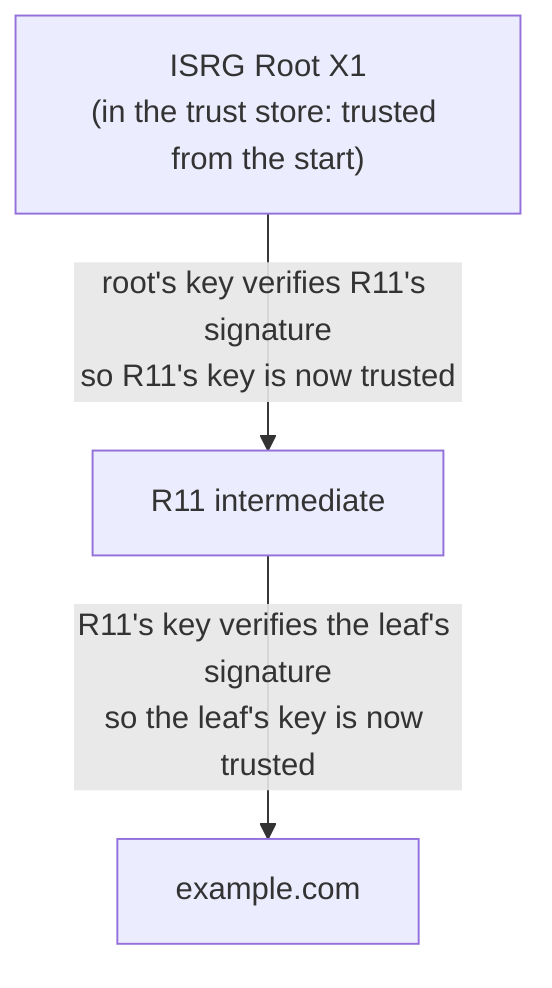

# Cryptography notes

Background notes behind the cryptography Lattice uses. They were in the README; the README now keeps only what's needed to run and understand Lattice. See also [modular-arithmetic.md](modular-arithmetic.md) and [nimbus-crypto-design.md](nimbus-crypto-design.md).

## Keyspace and brute-force resistance

A keyspace is the theoretical set of all keys an algorithm can use. For uniformly random binary keys of length `n` bits, the keyspace contains `2^n` possible keys. A larger keyspace makes exhaustive brute-force search more difficult, assuming keys are generated securely.

- **AES-128:** 2^128 possible keys, roughly 3.4 * 10^38.
- **AES-256:** 2^256 possible keys, roughly 1.1 * 10^77.

Because a 256-bit ECC key provides about the same security as a much larger 3072-bit RSA key (128 bits, per NIST SP 800-57), ECC offers significant performance advantages. For example, ECDSA with the P-256 curve is widely used in TLS and other protocols, providing strong security with smaller key sizes and faster computations.

When a cryptographic library executes an algorithm, the speed depends heavily on whether the operands fit cleanly inside the CPU's hardware registers.

- `ECC 256`: A 256-bit number is relatively small. It fits entirely into just four standard 64-bit CPU registers, or a single 256-bit SIMD register (AVX2's YMM registers). The CPU can execute arithmetic on these numbers using a highly optimized, short pipeline of micro-operations entirely within the CPU core, without constantly hitting the memory bus.
- `RSA 3072`: A 3072-bit integer is massive; it completely exceeds native hardware register capacities. To process it, the CPU must break the number down into an array of forty-eight 64-bit words and perform arbitrary-precision ("BigInteger") arithmetic. Multiplying two 3072-bit numbers requires thousands of CPU cycles, constant load/store instructions to shuttle data back and forth from memory, and heavy utilization of the instruction decoder just to manage the arrays.


`RSA (Modular Exponentiation)`: RSA operations rely on equations like $c \equiv m^e \pmod{n}$. Exponentiating a 3072-bit number requires a process called "repeated squaring and multiplication." Even with algorithmic shortcuts like the Chinese Remainder Theorem, the CPU is forced to perform computationally expensive, multi-word multiplications over and over again until the exponent is resolved.
- `ECC (Elliptic Curve Point Multiplication)`: ECC operations involve finding a point on a curve defined by $y^2 = x^3 + ax + b$. The mathematics of elliptic curves allows for much smaller numbers to be used while still providing equivalent security. At equal security, ECC signing and key generation are much faster than RSA's. Verification is the exception: RSA verifies with the small public exponent 65537, which is cheap, so RSA verification is usually faster than ECDSA verification.


`The mathematics of RSA require the resulting digital signature to be exactly the same size as the cryptographic modulus (the key size)`

- When you sign a token with a 3072-bit RSA key, the algorithm outputs a 3072-bit signature.
- In computer memory, 3072 bits translates to exactly 384 bytes of raw binary data.

An Elliptic Curve signature (like ECDSA used in ES256) consists of two distinct coordinates, commonly referred to as r and s. Each of these coordinates is the size of the curve itself.

- When you sign a token with a 256-bit ECC key, the algorithm outputs two 256-bit numbers, totaling 512 bits.
- In computer memory, 512 bits translates to exactly 64 bytes of raw binary data.

## The Base64Url Encoding Penalty

JWTs cannot be transmitted over HTTP as raw binary; they must be encoded into text using Base64Url. Base64Url encoding expands the size of binary data by roughly 33%. This is where the size difference explodes and severely impacts your server's HTTP traffic

## Elliptic curve keys: how they work

### The curve

An elliptic curve over a prime field is the set of points $(x, y)$ that satisfy

$$
y^2 \equiv x^3 + ax + b \pmod{p}
$$

The symbol $\equiv$ means "congruent": their difference is a multiple of $p$. Equivalently, both sides leave the same remainder from $0$ to $p - 1$ when divided by $p$. It is used instead of $=$ because the two sides usually only match after wrapping around $p$. For example, $6^2 = 36$, and $36 \equiv 2 \pmod{17}$ because $36 - 2 = 34$ is a multiple of 17.

**Formal definition.** Let $a, r, m \in \mathbb{Z}$ with $m > 0$. We write

$$
a \equiv r \pmod{m}
$$

if $m$ divides $a - r$, written $m \mid (a - r)$. In the example, $17 \mid (36 - 2)$ because $34 = 2 \times 17$. This is the same as saying $a$ and $r$ leave the same remainder from $0$ to $m - 1$ when divided by $m$.

**The remainder is not unique.** Any $r$ that differs from 2 by a multiple of 17 works too, so $36 \equiv 2 \equiv 19 \equiv -15 \pmod{17}$: $36 - 19 = 17$ and $36 - (-15) = 51 = 3 \times 17$. When a single value is wanted, the convention is the one from $0$ to $m - 1$, written $36 \bmod 17 = 2$.

Every coordinate is an integer from $0$ to $p - 1$. The curve also has one extra point, the **point at infinity** $\mathcal{O}$.

The points on the curve, together with the point at infinity, form a **group** under the addition rule. A group is closed: adding any two members gives another member. $\mathcal{O}$ is the group's zero: adding it to any point leaves that point unchanged.

### Adding points

Points can't be added by adding their coordinates. Over the real numbers the curve looks like a smooth, sideways bell, and addition is geometric. To compute $G + G = 2G$:

1. Draw the tangent line that touches the curve at $G$.
2. Extend it until it meets the curve again.
3. Reflect that point across the x-axis. The reflected point is $2G$.

To get $3G = 2G + G$, draw the line through $2G$ and $G$, find where it meets the curve, and reflect. In general, $P + Q$ is the reflection of the third point on the line through $P$ and $Q$.

Over a prime field the same rule is written with the line's slope $\lambda$, all mod $p$:

$$
\lambda = \frac{y_2 - y_1}{x_2 - x_1} \quad \text{(two different points)} \qquad
\lambda = \frac{3x_1^2 + a}{2y_1} \quad \text{(doubling)}
$$

$$
x_3 = \lambda^2 - x_1 - x_2 \qquad y_3 = \lambda(x_1 - x_3) - y_1
$$

On the toy curve below, doubling $G = (5, 1)$ gives $\lambda = 77 / 2 \equiv 13$, then $x_3 = 6$ and $y_3 = 3$: so $2G = (6, 3)$.

$k \times G$ means $G$ added to itself $k$ times. Nobody does $k$ additions: double-and-add reaches $k \times G$ in about $2 \log_2 k$ steps, by doubling and adding according to the bits of $k$.

### Why the modulus must be prime

The curve's addition rule divides: the slope of the line through two points is $\frac{y_2 - y_1}{x_2 - x_1}$. Modular arithmetic has no division, so "dividing by $a$" means multiplying by the **inverse** of $a$: the number $a^{-1}$ with $a \times a^{-1} \equiv 1 \pmod{p}$. When $p$ is prime, every non-zero number has an inverse. When it isn't, some don't.

**The trap of composite numbers.** Take a non-prime modulus such as 6. The numbers are 0 to 5. To find the inverse of 2, we need an $x$ with $2 \times x \equiv 1 \pmod{6}$:

| $x$ | $2 \times x$ | $\bmod 6$ |
| --: | --: | --: |
| 1 | 2 | 2 |
| 2 | 4 | 4 |
| 3 | 6 | **0** |
| 4 | 8 | 2 |
| 5 | 10 | 4 |

- **No inverse.** $2 \times x$ never equals 1, because 2 shares a factor with 6. So 2 has no inverse, and nothing can be divided by 2.
- **A zero divisor.** Worse, $2 \times 3 \equiv 0$: two non-zero numbers multiply to zero. Information is lost (you can't tell what was multiplied by 2 to get 0), equations that rely on division have no answer, and the curve's addition rule stops working. This breaks the algorithm itself, not just an attacker's attempts.

**The prime guarantee.** Now use a prime modulus such as 7. The numbers are 0 to 6. Find the inverse of 2 again:

| $x$ | $2 \times x$ | $\bmod 7$ |
| --: | --: | --: |
| 1 | 2 | 2 |
| 2 | 4 | 4 |
| 3 | 6 | 6 |
| 4 | 8 | **1** |

The inverse of 2 is 4. This isn't luck: a prime has no divisors other than 1 and itself, so no number from 1 to $p - 1$ shares a factor with it. That guarantees:

- every non-zero number has exactly one inverse, so division always works;
- no two non-zero numbers multiply to zero, so nothing collapses.

This holds for 7 and equally for the 256-bit prime behind P-256 (`secp256r1`). That is why the modulus of a curve is always prime: it keeps the addition rule, and with it the one-way function, well defined for every point.

### A toy example

Take

$$
y^2 \equiv x^3 + 2x + 2 \pmod{17}
$$

For each $x$ from 0 to 16, compute the right side and look for $y$ values whose square matches it. For $x = 0$ the right side is 2, and $6^2 \equiv 2$ and $11^2 \equiv 2$, so $(0, 6)$ and $(0, 11)$ are on the curve. Solutions come in pairs: $11 = 17 - 6$, and in general if $y$ is a solution then so is $p - y$.

```
x=0  → 2   → y = 6, 11
x=1  → 5   → none
x=2  → 14  → none
x=3  → 1   → y = 1, 16
x=4  → 6   → none
x=5  → 1   → y = 1, 16    ← G = (5, 1) is here
x=6  → 9   → y = 3, 14
x=7  → 2   → y = 6, 11
x=8  → 3   → none
x=9  → 1   → y = 1, 16
x=10 → 2   → y = 6, 11
x=11 → 12  → none
x=12 → 3   → none
x=13 → 15  → y = 7, 10
x=14 → 3   → none
x=15 → 7   → none
x=16 → 16  → y = 4, 13
```

Nine values of $x$ give two points each, so 18 points. With the point at infinity, the curve has **19 points**.

### Keys

Pick a fixed public point $G$, the **generator**. A key pair is

$$
P = k \times G
$$

where $k$ is a random integer (the **private key**) and $P$ is a point (the **public key**). Multiplying means adding $G$ to itself $k$ times with the curve's addition rule. $P$ can be published, for example in a JWKS; $k$ never leaves its owner.

On the toy curve with $G = (5, 1)$:

| $k$ | $k \times G$ | | $k$ | $k \times G$ |
| --: | :-- | --- | --: | :-- |
| 1 | $(5, 1)$ | | 11 | $(13, 10)$ |
| 2 | $(6, 3)$ | | 12 | $(0, 11)$ |
| 3 | $(10, 6)$ | | 13 | $(16, 4)$ |
| 4 | $(3, 1)$ | | 14 | $(9, 1)$ |
| 5 | $(9, 16)$ | | 15 | $(3, 16)$ |
| 6 | $(16, 13)$ | | 16 | $(10, 11)$ |
| 7 | $(0, 6)$ | | 17 | $(6, 14)$ |
| 8 | $(13, 7)$ | | 18 | $(5, 16)$ |
| 9 | $(7, 6)$ | | 19 | $\mathcal{O}$ |
| 10 | $(7, 11)$ | | | |

The list reaches the point at infinity at $19 \times G$ and then repeats, so 19 is the **order** of $G$. Because 19 is prime, $G$ visits every point on the curve once. Look at the $x$ values: 5, 6, 10, 3, 9, 16, 0, 13, ... They jump around with no visible pattern.

- **The point at infinity.** When $k$ is a multiple of the order, you get infinity (on the toy curve, $19 \times G = \mathcal{O}$). That is still a valid group element, but not a usable public key. Real private keys are chosen in the range $1$ to $n - 1$, so this never happens for them.
- **Wrapping.** After $19 \times G = \mathcal{O}$, the sequence repeats: $20 \times G = G$. So $k$ and $k + 19$ give the same point, which is why private keys are taken mod the order $n$.

### Why $k$ is hard to recover

**The trapdoor is the finite field.** Over the real numbers, the bouncing and reflecting could be traced backwards: points that are close stay close, so you could measure where the path went. Cryptography computes everything mod a large prime instead. Like clock arithmetic (10:00 plus 4 hours is 2:00, not 14:00), every value wraps around $p$: it is replaced by its remainder mod $p$, which is called **modular reduction**. Two things follow:

- the smooth curve becomes a scatter of seemingly random dots on a $p \times p$ grid, as the toy table shows;
- each time a value passes $p$ it wraps to the other side, so nearby points no longer stay near each other.

Given $G$ and a public point $P$, you see two dots in what looks like random static. The path between them isn't a line, and nothing records how many times it wrapped.

- **Forward is fast.** Double-and-add computes $k \times G$ with about 256 doublings and about 128 additions for a 256-bit $k$, which takes microseconds.
- **Backward is a search.** Given $P$ and $G$, nothing about $P$'s coordinates tells you how many additions produced it. There is no ordering or distance on the curve, and wrapping around $p$ scrambles any pattern. Finding $k$ is the **Elliptic Curve Discrete Logarithm Problem (ECDLP)**.
- **The best known attack** (Pollard's rho) takes about $\sqrt{n}$ steps, where $n$ is the order of $G$. For a 256-bit curve that is about $2^{128}$ steps, which is infeasible.
- **This is an assumption, not a proof.** No faster classical attack is known for well-chosen curves, but a large quantum computer running Shor's algorithm would break ECDLP. That is why post-quantum algorithms such as ML-KEM and ML-DSA are being standardized.

The naive attack computes $2G$, $3G$, $4G$, ... and compares each to $P$. On the toy curve that finishes after at most 18 tries. On P-256 the list has about $2^{256} \approx 1.2 \times 10^{77}$ entries, close to the number of atoms in the observable universe (about $10^{80}$). Even the best attack, at $2^{128}$ steps, is far out of reach.

### Real curves: P-256

P-256 (also called `secp256r1`, the curve behind `ES256` JWTs) has a prime $p$ of 256 bits and a generator $G$ whose order $n$ is about $2^{256}$. The private key is a random $k$ from $1$ to $n - 1$, and the public key is $k \times G$. With Pollard's rho costing about $2^{128}$ steps, P-256 is rated at **128-bit security**, comparable to AES-128 and RSA-3072, with far smaller keys and faster operations than RSA.

### ECDH: agreeing on a shared secret

Two parties, A and B, can agree on a secret over an open network without ever sending it.

1. **Generate key pairs.** Each picks a private scalar and computes its public point on the same curve:

   $$
   P_A = k_A \times G \qquad P_B = k_B \times G
   $$

2. **Exchange public keys.** An eavesdropper sees $P_A$, $P_B$, the curve and $G$, but can't recover $k_A$ or $k_B$ (ECDLP).
3. **Compute the shared secret.** Each side multiplies the *other's* public key by its *own* private scalar:

   $$
   S = k_A \times P_B = k_B \times P_A = (k_A k_B) \times G
   $$

4. **Validate the peer's key first.** Before step 3, an implementation must check that the received point is on the curve, in range and not the identity element, or an attacker can send a bad point to leak bits of $k$. The JDK does this in `ECDHKeyAgreement` (NIST SP 800-56A full public-key validation). For X25519 it rejects an all-zero result (`XDHKeyAgreement`: "Point has small order").

**Authentication is a separate problem.** Unauthenticated ECDH is open to a man-in-the-middle who substitutes their own public keys. TLS prevents this by having the server sign its handshake with its certificate key. The signature proves who sent the public key, not the key agreement itself.

### Deriving the traffic keys

The raw result of ECDH isn't used directly as an encryption key. By the standard it is the x-coordinate of $S$ (or the u-coordinate for X25519), which isn't uniformly random. It is fed into a key-derivation function:

- **TLS 1.3:** HKDF (HMAC-based), mixed with a hash of the handshake transcript. This gives separate keys for each direction and purpose.
- **TLS 1.2:** the TLS PRF (also HMAC-based), which first makes a master secret.

The outputs are symmetric keys for an AEAD cipher such as AES-GCM or ChaCha20-Poly1305. After that, both sides use fast symmetric encryption for the data.

### Static ECDH versus ECDHE

Static ECDH reuses the same private key across many connections, for months or years. ECDHE generates a new key pair for each handshake, on **both** the client and the server, and discards the private keys after the secrets are derived.

**The static-key risk.** An attacker records traffic for five years. If they steal the long-lived private key in year six, they can recompute the shared secret for every recorded session and decrypt it all. The JDK disables static `ECDH` and `TLS_RSA_*` suites by default in `jdk.tls.disabledAlgorithms`.

**How ECDHE gives forward secrecy:**

1. Each side generates a temporary key pair and exchanges the public keys. Both derive the same shared secret locally, then derive the traffic keys from it.
2. The temporary private keys and the shared secret are discarded after key establishment. The traffic keys stay in memory until the connection ends.
3. The server's certificate key only authenticates the handshake. It plays no part in deriving the traffic keys.
4. So if the certificate key leaks later, an attacker with a recording can't derive past traffic keys from it.

**In a TLS 1.3 handshake:**

1. Each side generates a fresh key pair and sends its public key. The server proves who it is by signing the handshake transcript, which includes both shares, with its long-term key (the `CertificateVerify` message).
2. Each side computes the same ECDH shared secret, then runs it through the key schedule (HKDF in 1.3) to get the session keys.
3. Each side discards the ephemeral private key and the shared secret. The session keys stay in memory until the connection closes.


## NIST FIPS 186-5
NIST states that digital signatures are used both to:
- detect unauthorized modification of data; and
- authenticate the identity of the signatory.
That directly supports the concepts of integrity and origin authentication

A MAC provides data origin authentication and data integrity protection. MACs are used to authenticate both the source of a message and its integrity.

### Data Origin Authentication
The verification that information was generated by a system entity and has not been subsequently altered.

> Both signatures and MACs provide for integrity checking -- verifying that the
> message has not been modified since the integrity value was computed. However,
> MACs provide for origination identification only under specific circumstances.
> It can normally be assumed that a private key used for a signature is only in
> the hands of a single entity (although perhaps a distributed entity, in the
> case of replicated servers); however, a MAC key needs to be in the hands of
> all the entities that use it for integrity computation and checking.
> Validation of a MAC only provides corroboration that the message was generated
> by one of the parties that knows the symmetric MAC key. This means that
> origination can only be determined if a MAC key is known only to two entities
> and the recipient knows that it did not create the message. MAC validation
> cannot be used to prove origination to a third party.


## Appendix: how certificate validation works (X.509)

Federation chains and certificate chains share two phases that run in opposite directions:

- **Finding the chain goes bottom-up.** The client starts from the leaf, because that's all it has.
- **Trust flows top-down.** The root is the only thing trusted to begin with, so trust is passed down from it, one signature at a time.

### Example: a browser visiting https://example.com

#### Phase 1: build the path, bottom-up

The server sends its certificate plus the intermediate (leaf first):

```text
example.com     issued by "R11"
R11             issued by "ISRG Root X1"
```

The browser follows the issuer names upwards:

- The leaf says its issuer is "R11", and that certificate was sent along.
- R11 says its issuer is "ISRG Root X1", and that one is in the trust store that ships with the OS or browser. The search stops there.

#### Phase 2: verify, trust flowing top-down



- The root's key checks the signature on R11's certificate, so R11's key can be trusted.
- R11's key checks the signature on the leaf certificate, so the leaf's key can be trusted.
- Then the leaf-specific checks: does the name match `example.com`, is it within its dates, is it allowed for TLS servers, has it been revoked?

### In the JDK source

#### Phase 1: build the path (bottom-up)

In `SunCertPathBuilder.java`, `depthFirstSearchForward` starts at the leaf and looks up each certificate's issuer.

```java
// SunCertPathBuilder.java:269-296 (abridged)
builder.getMatchingCerts(currentState, buildParams.certStores());   // find candidate issuers
...
builder.verifyCert(cert, nextState, cpList);                        // quick checks on each candidate
...
if (builder.isPathCompleted(cert)) { ... }                          // line 316: reached a trust anchor?
...
depthFirstSearchForward(cert.getIssuerX500Principal(), nextState, ...); // line 540: recurse upward
```

The stopping test is `ForwardBuilder.isPathCompleted` (`ForwardBuilder.java:748`):

```java
for (TrustAnchor anchor : trustAnchors) {
    if (anchor.getTrustedCert() != null) {
        if (cert.equals(anchor.getTrustedCert())) {   // the cert IS a trusted root
            this.trustAnchor = anchor;
            return true;
        }
        ...
```

#### Phase 2: verify (trust flows top-down)

`PKIXCertPathValidator.validate` (`PKIXCertPathValidator.java:162`) is given one trust anchor and builds a list of checkers. `BasicChecker` is the key one:

```java
BasicChecker bc = new BasicChecker(anchor, params.date(), params.sigProvider(), false);
```

Its constructor seeds the "previous key" with the anchor's public key (`BasicChecker.java:83-93`):

```java
this.trustedPubKey = anchor.getTrustedCert().getPublicKey();
this.caName        = anchor.getTrustedCert().getSubjectX500Principal();
...
this.prevPubKey    = trustedPubKey;
```

`PKIXMasterCertPathValidator.validate` then walks the certificates in order, root side first (it takes a `reversedCertList`), and runs every checker on each. For each certificate, `BasicChecker.check` does this (lines 137-150):

```java
verifyValidity(currCert);       // cert.checkValidity(date)      — dates
verifyNameChaining(currCert);   // cert issuer DN must equal prevSubject
verifySignature(currCert);      // cert.verify(prevPubKey, ...)  — the key above verifies this cert
updateState(currCert);          // prevPubKey = currCert.getPublicKey(); prevSubject = currCert's subject
```

The initial "previous key" is the root's public key. The first certificate that gets checked is not the root.
