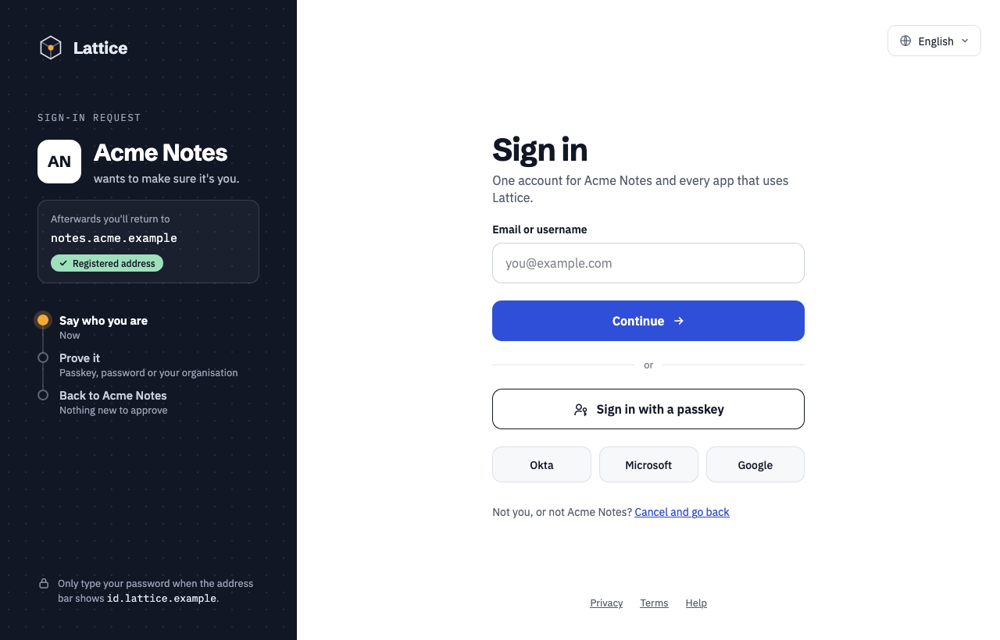
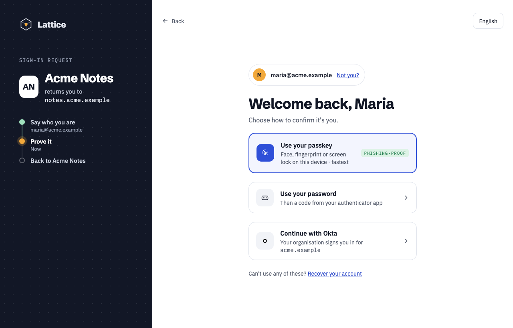
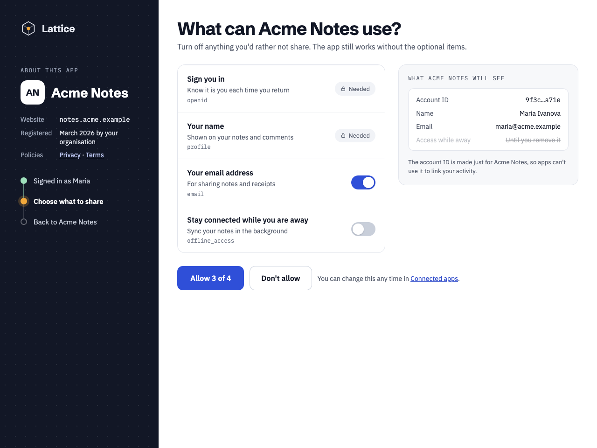
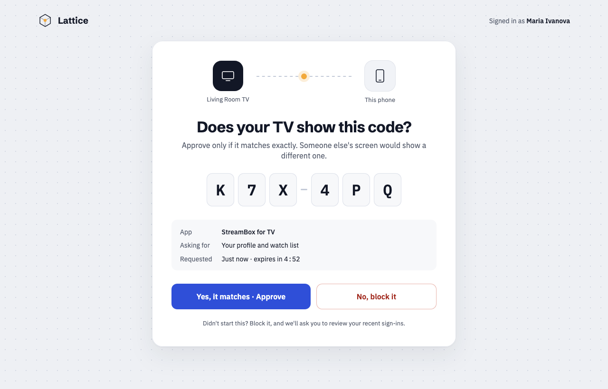
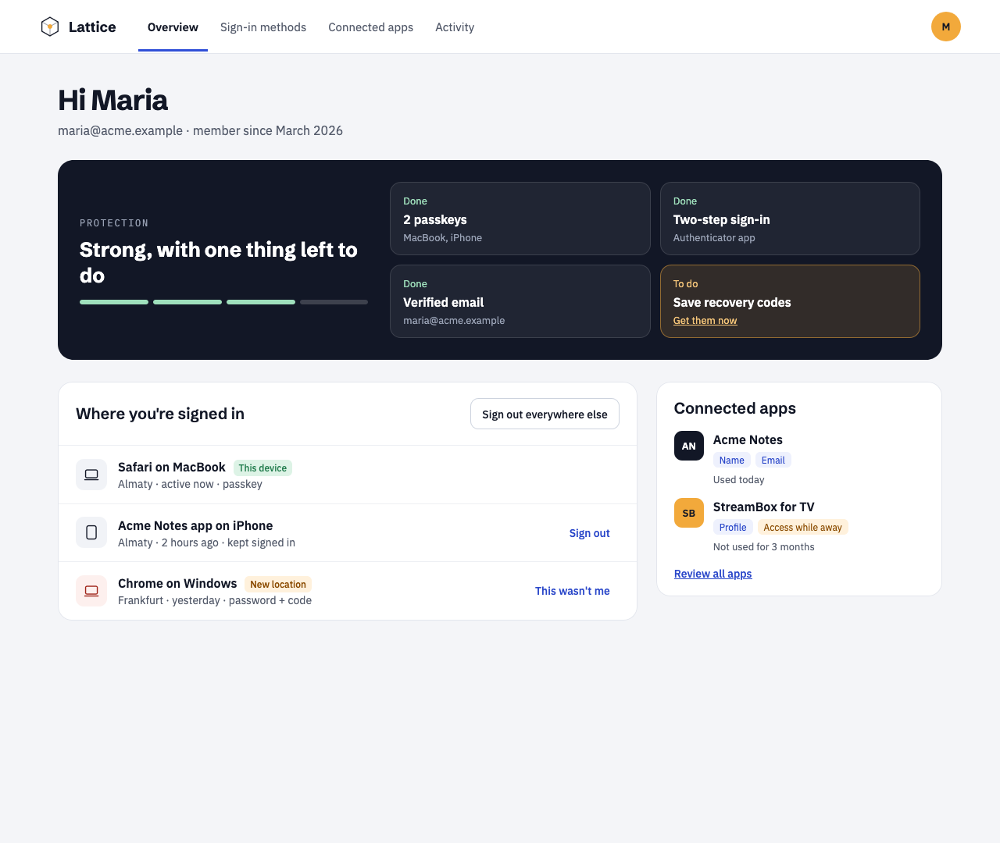
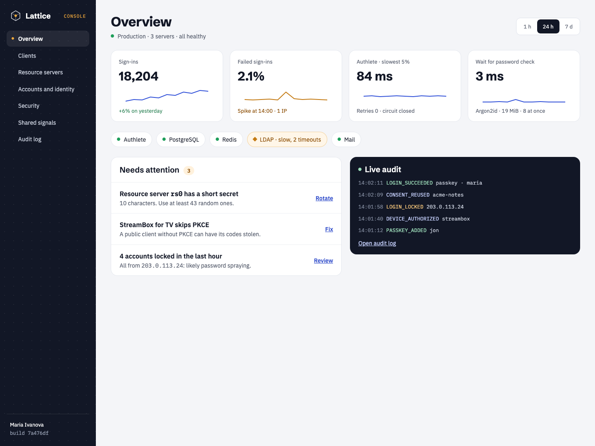
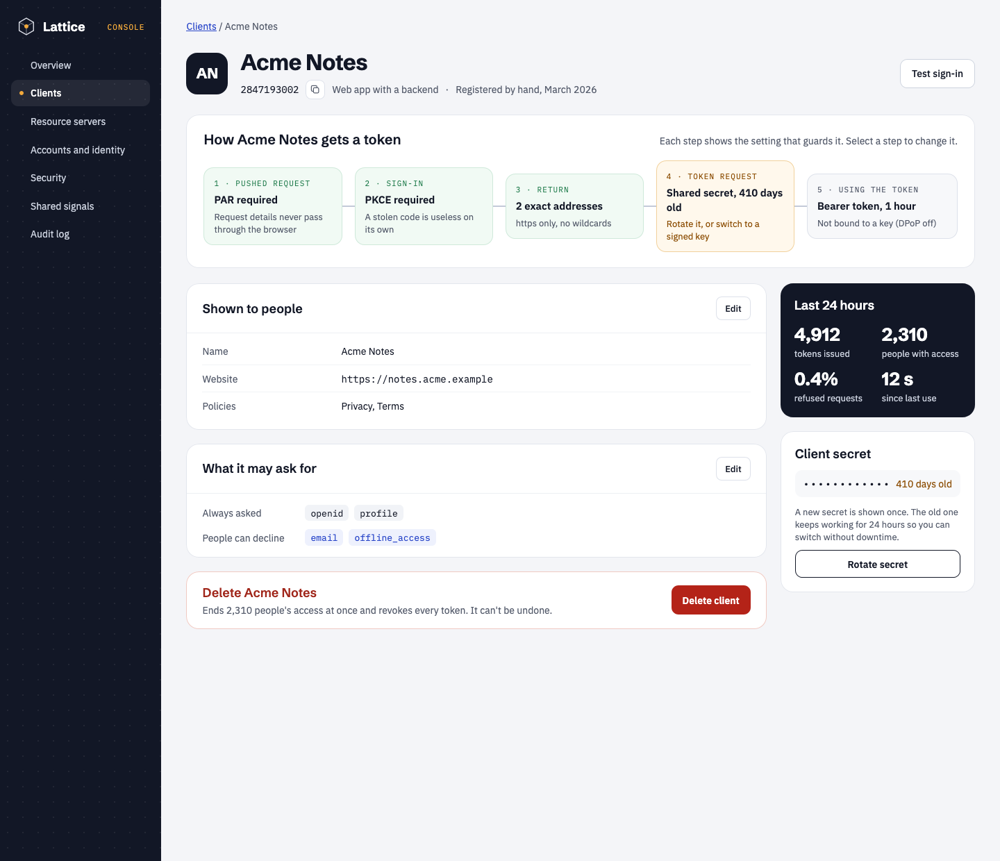
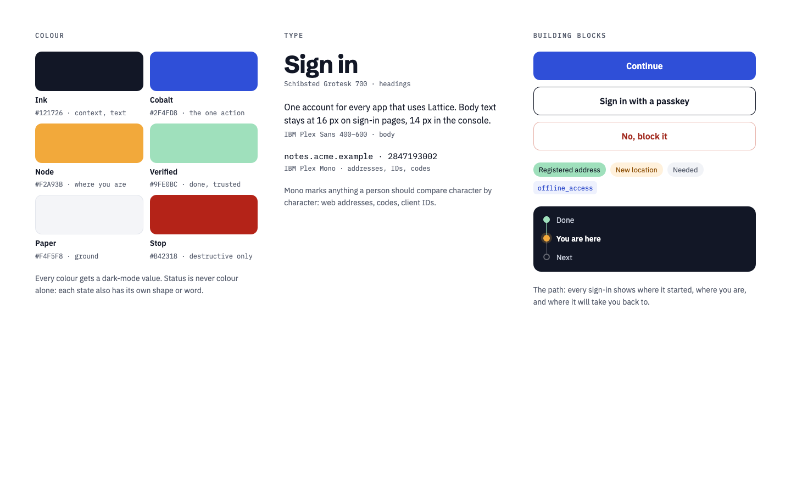

# Lattice Signal, dark panels (design only)

The first version of the redesign, with a dark "ink" context panel on sign-in pages, a dark console sidebar and dark summary panels. These are design renders, not screenshots of the server: Lattice ships the light version in [`../light`](../light). They are kept for comparison and as a reference for a future dark mode.

| Screen | |
| ------ | - |
| 01 Sign in | Identifier first, with the app's return address and the path through sign-in |
| 02 Choose how to verify | Passkey first, then password, then the organisation's sign-in |
| 03 Consent | Each scope required or optional, with a preview of what the app will see |
| 04 Approve on another screen | A device or CIBA sign-in: compare the code, then approve or block |
| 05 Account | Protection summary, where you're signed in, connected apps |
| 06 Console overview | Sign-ins, failures, Authlete latency, password-check wait, dependencies, live audit |
| 07 Console client | The client's token flow step by step, then its settings |
| 08 Foundations | Colour, type and building blocks |

<table>
  <tr>
    <td></td>
    <td></td>
    <td></td>
    <td></td>
  </tr>
  <tr>
    <td></td>
    <td></td>
    <td></td>
    <td></td>
  </tr>
</table>
