# Lattice Signal, light (implemented)

Screenshots of the running server, taken from the real templates (`app/views/oidc`) and `public/stylesheets/oidc.css`. This is the design Lattice ships. The dark-panel variant it was chosen against is in [`../dark`](../dark).

**The design.** End-user pages have two panels: on the left a pale cobalt context panel with the app that is asking (its name and website, so a look-alike stands out), the path through sign-in (done, here, next) and a faint lattice drawing; on the right the task. The bar at the top names the address people should see in their address bar. The operator console has a light sidebar, and each client page opens with how that client gets a token, step by step, from its real settings.

| Screen | Template |
| ------ | -------- |
| 01 Sign in | `signIn.scala.html` with `requestContext` (step 1) |
| 02 Enter password | `signInPassword.scala.html` (step 2) |
| 03 Wrong password | `signInPassword.scala.html`, error state |
| 04 Consent | `authorization.scala.html` (step 3) |
| 05 Connect a device | `deviceVerification.scala.html` |
| 06 Approve sign-in | `cibaApproval.scala.html` (built-in mode) |
| 07 Account | `account.scala.html` |
| 08 Where you're signed in | `sessions.scala.html` |
| 09 Console overview | `admin.scala.html` |
| 10 Console clients | `consoleClients.scala.html` |
| 11 Console client | `consoleClient.scala.html`, with `ConsoleClient.tokenPath()` |
| 12 Console security | `consoleSecurity.scala.html` |

<table>
  <tr>
    <td>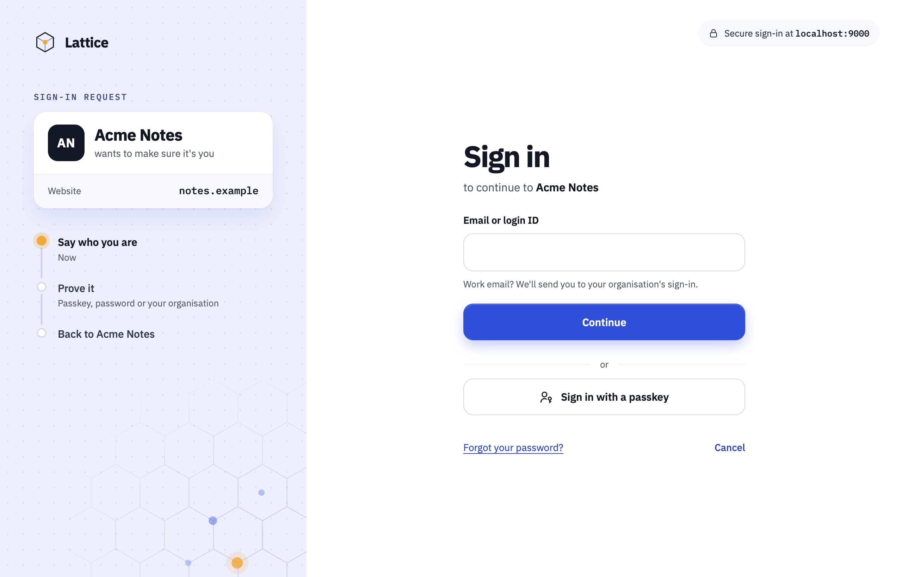</td>
    <td>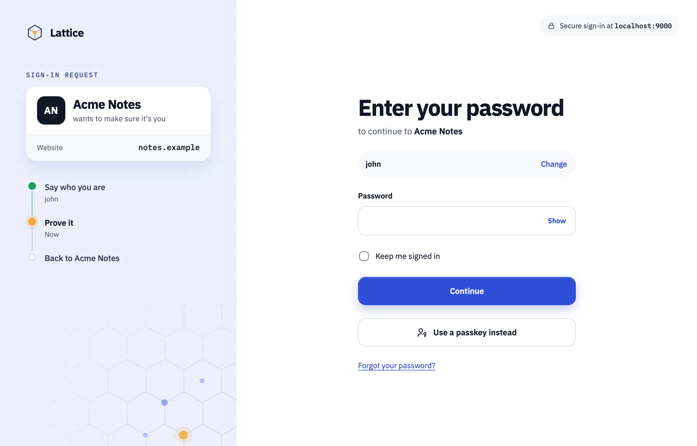</td>
    <td>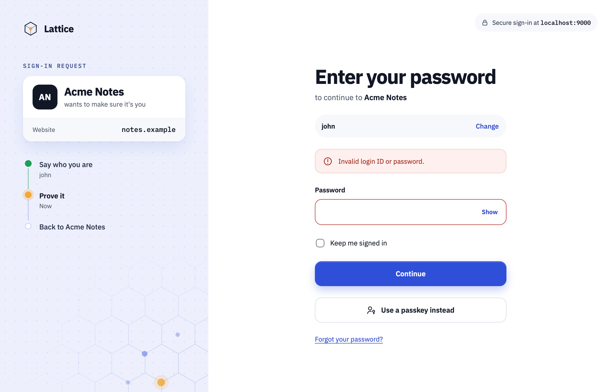</td>
  </tr>
  <tr>
    <td>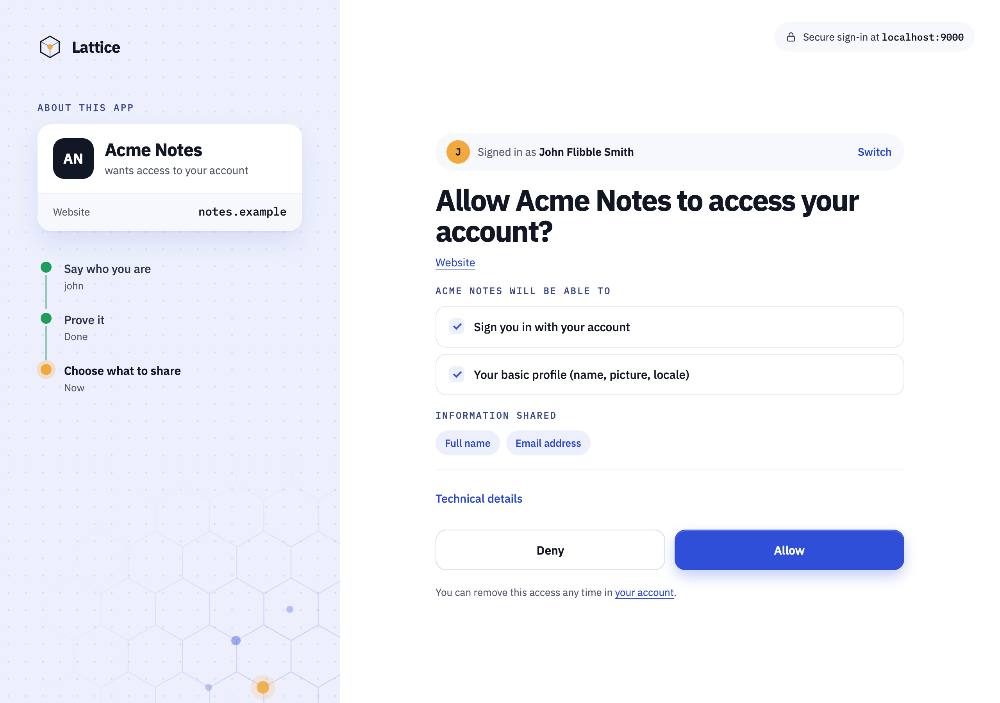</td>
    <td>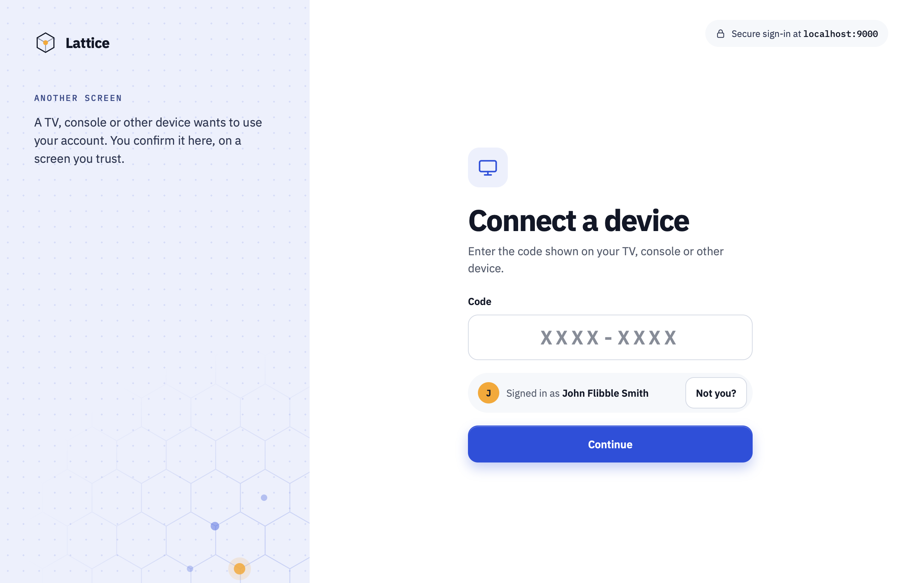</td>
    <td>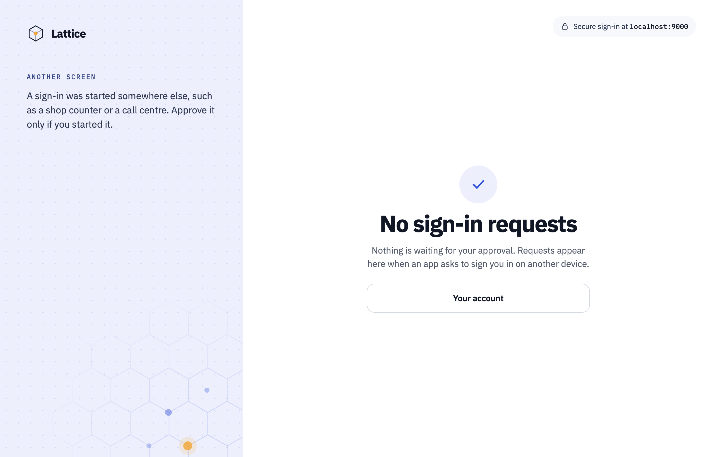</td>
  </tr>
  <tr>
    <td>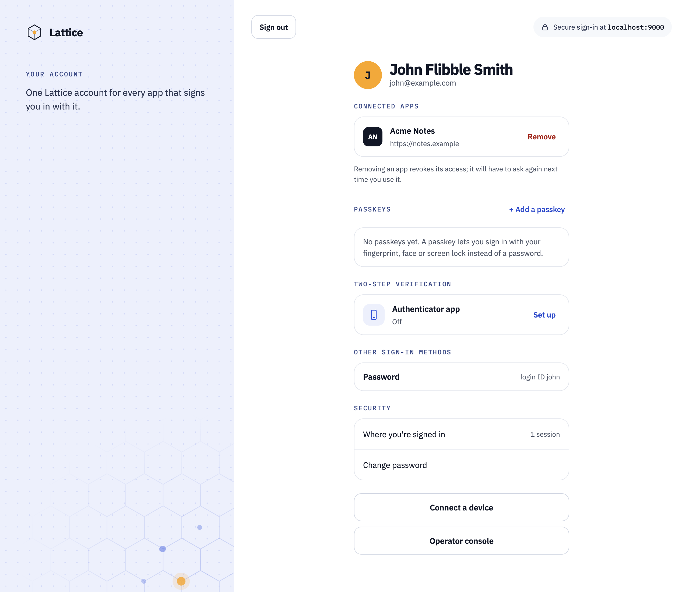</td>
    <td>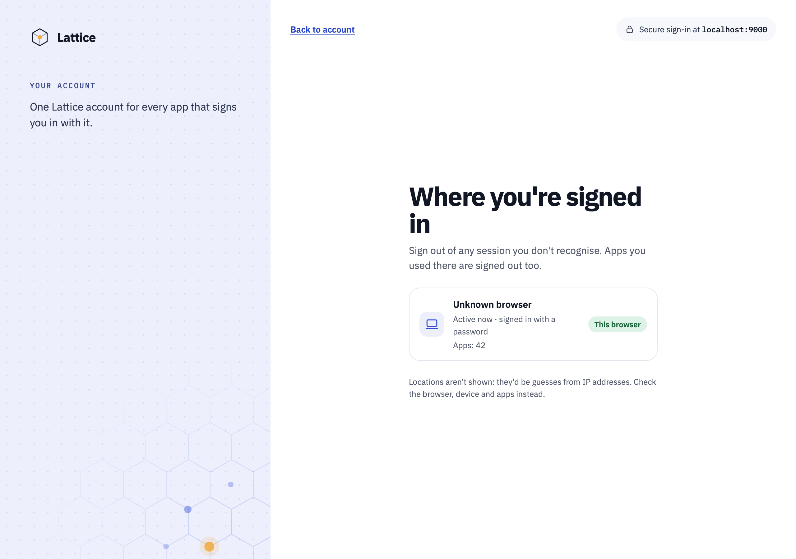</td>
    <td>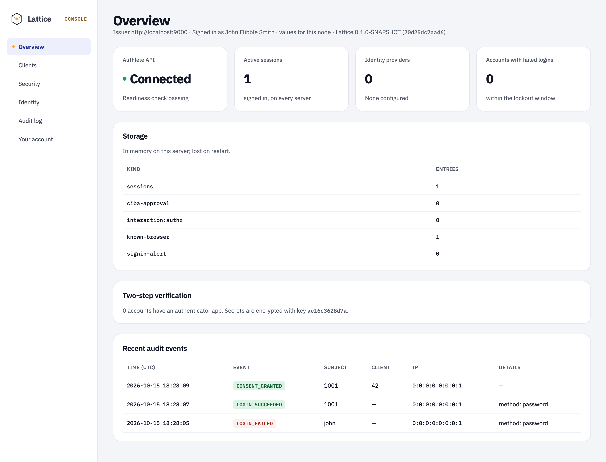</td>
  </tr>
  <tr>
    <td>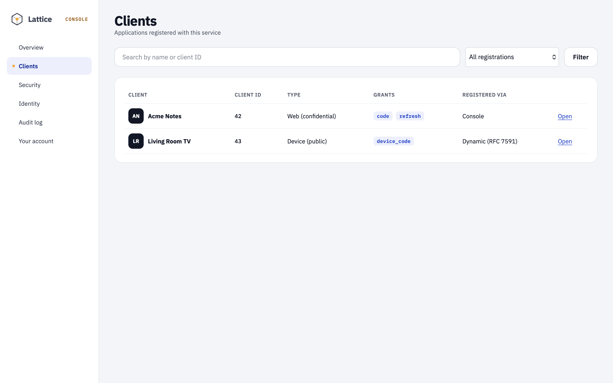</td>
    <td>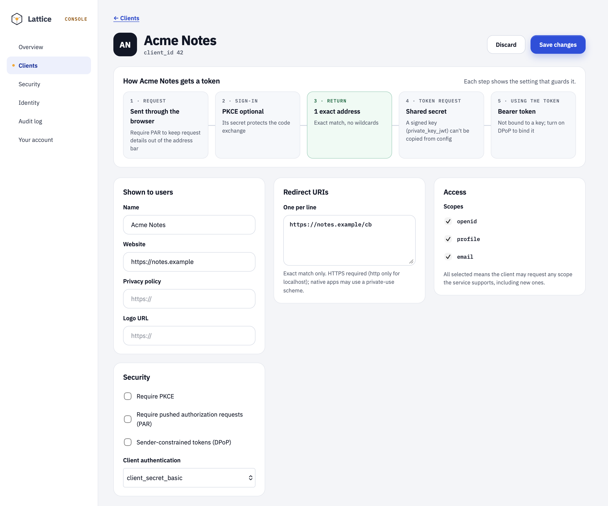</td>
    <td>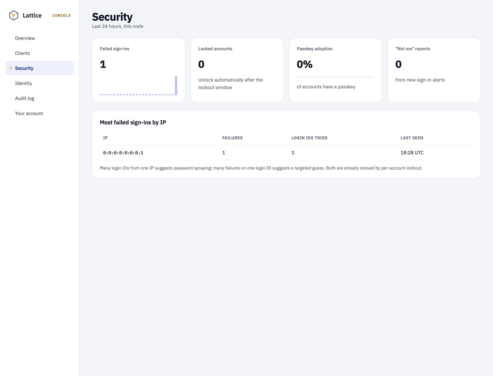</td>
  </tr>
</table>

**Regenerating them.** Start the load-test server with an admin account and the built-in approval page (`ADMIN_LOGIN_IDS=john CIBA_AD_MODE=builtin`, see [`perf/README.md`](../../../perf/README.md)), sign in as `john` / `john`, and capture each page at 1280 px wide (console pages at 1440 px).
